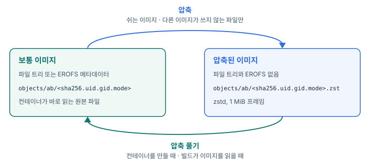
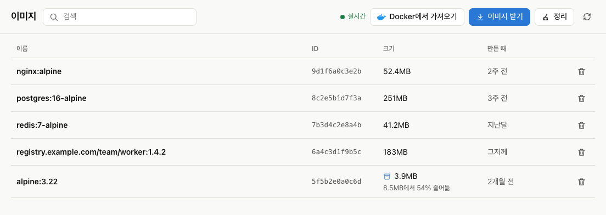

받아 둔 이미지는 디스크에 계속 남습니다. 한 달 전에 한 번 쓴 이미지도 처음과 같은 공간을 차지합니다. 다음 podbag 릴리스에서는 이런 이미지를 압축할 수 있습니다. 이 글에서는 이 기능을 **쉬는 이미지 압축**이라고 부릅니다. 쉬는 이미지는 어떤 컨테이너도 쓰지 않는 이미지입니다. 이 기능은 기본으로 꺼져 있습니다.

## podbag이 이미지를 저장하는 방법

podbag은 각 파일을 한 번만 저장합니다. 위치는 `objects/ab/<sha256.uid.gid.mode>`입니다. 파일 이름에 내용의 해시, 소유자, 권한이 들어 있습니다. 두 이미지에 같은 파일이 있으면 두 이미지가 이 파일 하나를 함께 씁니다.

컨테이너는 이 파일을 두 가지 방법으로 봅니다.

- **root 없이**: 이미지마다 하드 링크 트리를 만듭니다. 하드 링크는 같은 파일을 가리키는 또 하나의 이름입니다.
- **root로**: composefs를 씁니다. 파일 목록을 담은 작은 EROFS 파일과 overlayfs로 이미지를 보여 줍니다.

두 방법 모두 컨테이너는 `objects`의 원본 파일을 직접 읽습니다. 그래서 압축도 이 파일을 대상으로 합니다.

## 압축과 압축 풀기



**압축**은 쉬는 이미지에만 합니다. 쉬는 이미지는 두 조건을 모두 만족합니다.

- 어떤 컨테이너도 이 이미지를 쓰지 않습니다. 멈춘 컨테이너도 셉니다.
- `compress_idle_after` 동안 쓰이지 않았습니다. 기본값은 7일입니다.

podbag은 먼저 이 이미지의 트리나 EROFS 파일을 지웁니다. 그다음 각 파일 옆에 `<파일>.zst`를 쓰고 원본을 지웁니다. 쓰는 중인 다른 이미지에도 있는 파일은 원본 그대로 둡니다. 4096바이트보다 작은 파일도 그대로 둡니다. 압축해도 디스크 블록이 줄지 않기 때문입니다.

**압축 풀기**는 두 경우에 일어납니다. 이미지로 컨테이너를 만들 때, 그리고 빌드가 이미지를 읽을 때입니다. podbag은 `.zst`를 원본 파일로 되돌립니다. 그다음 트리나 EROFS 파일을 다시 만듭니다.

### 안전 규칙

세 가지 규칙이 데이터를 지킵니다.

1. 트리나 EROFS 파일이 있는 이미지는 모든 파일이 원본입니다. 그래서 컨테이너는 늘 원본 파일만 봅니다.
2. 원본과 `.zst`가 함께 있으면 원본을 씁니다.
3. `.zst`에서 푼 파일은 해시가 맞을 때만 다시 저장소의 파일이 됩니다.

### 파일 형식

`.zst` 파일의 맨 앞에는 zstd의 skippable frame이 있습니다. zstd가 데이터로 읽지 않고 건너뛰는 부분입니다. 여기에 작은 머리글을 둡니다. 머리글에는 버전, 크기, 플래그, 수정 시각이 들어 있습니다.

그 뒤에는 1 MiB 단위의 zstd 프레임이 이어집니다. 각 프레임은 "Fastest" 수준으로 압축한 결과와 압축하지 않은 결과 중 작은 쪽입니다. 그래서 이미 압축된 데이터도 커지지 않습니다.

압축에는 [ruzstd](https://github.com/KillingSpark/zstd-rs)를 씁니다. ruzstd는 순수 Rust로 만든 zstd입니다. C 라이브러리가 필요 없어서 podbag의 정적 빌드를 그대로 유지합니다.

## 언제 압축하나요

podbag에는 데몬이 없습니다. 데몬은 뒤에서 계속 도는 프로그램입니다. 그래서 압축만 맡는 프로그램도 없습니다. 대신 이미 저장소를 정리하는 명령이 압축도 합니다.

`image_compression = "idle"`이면 `pull`, `load`, `build`, `rmi`, `prune` 뒤에 압축합니다.

- 명령 하나는 최대 256 MiB 또는 2초만 압축합니다. 남은 일은 다음 명령이 이어서 합니다.
- 저장소 잠금은 한 번에 최대 64 MiB 또는 1초 동안만 잡습니다. 다른 명령이 오래 기다리지 않습니다.
- 32 MiB보다 큰 파일은 자동으로 압축하지 않습니다. `podbag system compress`를 직접 실행하면 압축합니다.
- 명령이 방금 받은 이미지는 그 명령에서 압축하지 않습니다.
- 저장소 크기 제한 때문에 이미지를 지워야 하면 먼저 쉬는 이미지를 압축합니다.

## 측정 결과

podbag-dev VM(노트북의 Linux VM) · arm64 · CPU 4개 · Linux 7.0.0-44 · 저장소는 ext4 · root, composefs · podbag 0.3.2에 이 기능을 더한 개발 빌드

압축을 끈 상태로 이미지 5개를 받았습니다. python 이미지 두 개는 각각 146 MB, Java 이미지 두 개는 각각 310 MB입니다.

- `python:3.12.7-slim-bookworm`, `python:3.12.8-slim-bookworm`
- `eclipse-temurin:21.0.5_11-jre-noble`, `eclipse-temurin:21.0.6_7-jre-noble`
- `alpine:3.22`

그다음 `podbag system compress`로 다섯 개를 모두 압축했습니다.

| 저장소 | 값 |
|---|---:|
| 압축 전 (`system df`의 Objects 행) | {{n:725}} MB |
| 압축 후 | {{n:337}} MB |
| 이미지 5개를 압축한 시간 | {{n:8.4}}초 |

저장소는 절반 아래로 줄었습니다. 압축 전에도 저장소는 다섯 이미지 크기의 합보다 작습니다. 비슷한 버전의 두 이미지는 같은 파일을 함께 쓰기 때문입니다. 파일마다 따로 압축하므로 이 공유는 압축 뒤에도 그대로입니다.

| `podbag run`의 시간 | python 3.12.8 | Java (temurin 21.0.6) |
|---|---:|---:|
| 압축된 이미지의 첫 시작 | {{n:1391}} ms | {{n:1801}} ms |
| 압축하지 않은 이미지의 시작 | {{n:30}} ms | {{n:55}} ms |

각 값은 5번 잰 중앙값입니다. 첫 시작을 잴 때는 매번 이미지를 다시 압축하고 페이지 캐시를 비웠습니다. 비교한 시작도 캐시를 비우고 쟀습니다. 첫 시작에는 파일을 풀고 EROFS 파일을 다시 만드는 시간이 들어갑니다. 그 뒤의 시작은 압축하지 않은 이미지와 같습니다.

압축되지 않은 이미지는 기능을 켜도 느려지지 않습니다. `alpine:3.22`를 끈 상태와 켠 상태로 번갈아 30번씩 시작했습니다. 중앙값은 끈 상태 {{n:12}} ms, 켠 상태 {{n:11}} ms였습니다.

이 숫자는 호스트가 조용할 때 잰 것입니다. 저장소는 호스트 디스크 위의 파일입니다. 호스트가 바쁠 때는 압축이 더 오래 걸렸고, 첫 시작은 몇 초까지 늘었습니다.

## 사용법

```sh
podbag system compression                  # 설정 보기
podbag system compression idle             # 켜기
podbag system compression idle --after 3d  # 3일 동안 쓰지 않은 이미지를 압축
podbag system compression off              # 끄기
podbag system compress                     # 쉬는 이미지를 지금 압축
podbag system compress myapp:1             # 이 이미지를 지금 압축
podbag system decompress myapp:1           # 이 이미지를 지금 풀기
```

- 꺼져 있으면 podbag은 이미지를 압축하지 않습니다. 저장소도 지금과 같습니다.
- `podbag system df`에 `Compressed` 행이 생깁니다. 압축된 파일 수와 압축 전후 크기를 보여 줍니다.
- `system compress`는 컨테이너가 쓰는 이미지를 압축하지 않습니다.
- `save`, `push`, `podbag system verify`는 압축된 이미지에서도 동작합니다. 디스크에 풀지 않고 읽습니다.
- macOS와 Windows에서는 설정이 엔진이 도는 곳에 저장됩니다. 곧 VM이나 podbag의 WSL 배포판입니다. 그래서 `podbag system compression` 명령이나 Podbag Desktop으로 바꿉니다.
- Linux에서는 `config.toml`에 `image_compression = "idle"`을 써도 됩니다.

## Podbag Desktop

- 새로 설치하거나 업데이트한 뒤 한 번 묻습니다. **디스크 공간 아끼기** 알림에서 **켜기** 또는 **나중에**를 고릅니다.
- **설정 > 엔진**에 **쉬는 이미지 압축** 스위치가 있습니다.
- **이미지** 목록에서 압축된 이미지는 아이콘과 디스크의 크기를 보여 줍니다. 그 아래에 "8.5MB에서 54% 줄어듦"처럼 원래 크기와 줄어든 비율이 나옵니다.



Docker API의 `/images/json`도 압축된 이미지에 `PodbagCompression` 필드를 더합니다. Desktop은 이 값을 보여 줍니다.

## 고르지 않은 방법

- **파일 시스템 압축** (btrfs 등): btrfs에서만 됩니다. Linux 사용자 대부분은 ext4를 씁니다. podbag이 사용자 대신 켤 수도 없습니다.
- **이미지 전체를 압축 파일 하나로**: 파일 단위 공유가 깨집니다. 이미지를 다시 쓸 때 전체를 풀어야 합니다.
- **읽을 때 푸는 FUSE 파일 시스템**: FUSE는 프로그램이 파일 시스템 역할을 하는 방식입니다. 그 프로그램이 계속 돌아야 하므로 데몬이 필요합니다.
- **EROFS 자체 압축**: root에서 쓰는 composefs에서만 됩니다. root 없이 쓰는 하드 링크 트리에는 쓸 수 없습니다.

## 언제 쓸 수 있나요

쉬는 이미지 압축은 다음 podbag 릴리스에 들어갑니다. 지금의 저장 방식은 [사용 설명서의 Storage](https://github.com/SteelCrab/podbag/blob/main/docs/usage.md#storage)에 있습니다.

## 재현 자료

[측정 스크립트](compress.sh) · [측정 결과와 환경](results.txt)

[ruzstd](https://github.com/KillingSpark/zstd-rs) · [zstd 형식 (RFC 8878)](https://www.rfc-editor.org/rfc/rfc8878) · [composefs](https://github.com/composefs/composefs)
