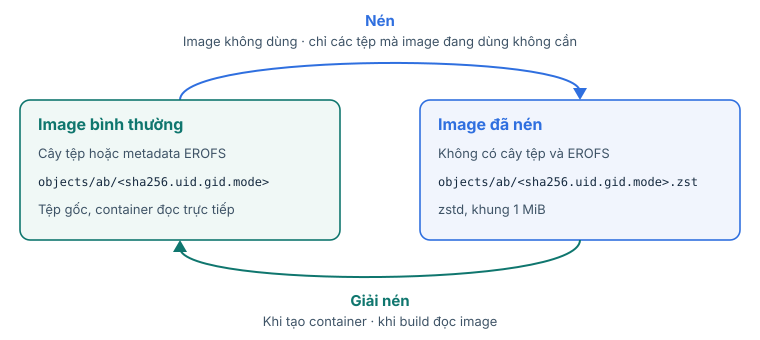
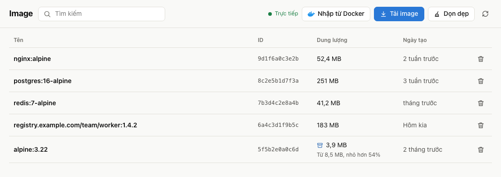

Các image bạn đã tải về vẫn nằm trên đĩa. Một image bạn chỉ dùng một lần vào tháng trước vẫn chiếm chỗ như ngày đầu. Bản phát hành tiếp theo của podbag có thể nén các image này. Trong bài này, chúng tôi gọi tính năng đó là **nén image không dùng**. Image không dùng là image mà không container nào dùng. Tính năng này mặc định tắt.

## podbag lưu image như thế nào

podbag chỉ lưu mỗi tệp một lần, tại `objects/ab/<sha256.uid.gid.mode>`. Tên tệp chứa hash của nội dung, chủ sở hữu và quyền. Khi hai image có cùng một tệp, chúng dùng chung tệp đó.

Container thấy các tệp này theo một trong hai cách:

- **Không có root**: mỗi image có một cây hard link. Hard link là một tên khác cho cùng một tệp.
- **Có root**: podbag dùng composefs. Một tệp EROFS nhỏ liệt kê các tệp của image, và overlayfs hiển thị chúng.

Theo cả hai cách, container đọc trực tiếp các tệp gốc trong `objects`. Vì vậy, việc nén cũng làm trên các tệp này.

## Nén và giải nén



**Nén** chỉ áp dụng cho image không dùng. Một image là không dùng khi cả hai điều sau đều đúng:

- Không container nào dùng nó. Container đã dừng cũng được tính.
- Nó không được dùng trong khoảng `compress_idle_after`. Mặc định là 7 ngày.

Trước tiên, podbag xoá cây hoặc tệp EROFS của image. Sau đó, nó ghi `<tệp>.zst` cạnh mỗi tệp và xoá tệp gốc. Tệp nào cũng có trong một image khác đang dùng thì được giữ nguyên. Tệp nhỏ hơn 4096 byte cũng được giữ nguyên, vì nén chúng không giảm được khối đĩa nào.

**Giải nén** xảy ra trong hai trường hợp: khi tạo container từ image, và khi build đọc image. podbag đưa các tệp `.zst` về lại tệp gốc. Sau đó, nó tạo lại cây hoặc tệp EROFS.

### Quy tắc an toàn

Ba quy tắc giữ an toàn cho dữ liệu:

1. Image có cây hoặc tệp EROFS thì mọi tệp của nó đều là tệp gốc. Vì vậy, container chỉ thấy tệp gốc.
2. Khi có cả tệp gốc và `.zst`, podbag dùng tệp gốc.
3. Tệp giải nén từ `.zst` chỉ trở lại thành tệp trong kho khi hash của nó khớp.

### Định dạng tệp

Tệp `.zst` bắt đầu bằng một skippable frame của zstd. zstd bỏ qua phần này khi đọc dữ liệu. Chúng tôi đặt ở đây một phần đầu nhỏ: phiên bản, kích thước, cờ và thời gian sửa đổi.

Tiếp theo là các khung zstd, mỗi khung 1 MiB. Mỗi khung là kết quả nhỏ hơn trong hai cách: nén ở mức "Fastest", hoặc lưu không nén. Vì vậy, dữ liệu đã nén sẵn sẽ không lớn thêm.

Chúng tôi nén bằng [ruzstd](https://github.com/KillingSpark/zstd-rs), một bản zstd viết hoàn toàn bằng Rust. Nó không cần thư viện C, nên bản build tĩnh của podbag vẫn giữ nguyên.

## Khi nào podbag nén

podbag không có daemon, tức là chương trình luôn chạy ngầm. Vì vậy cũng không có chương trình nào chỉ lo việc nén. Thay vào đó, các lệnh vốn đã dọn dẹp kho lưu trữ sẽ nén luôn.

Khi `image_compression = "idle"`, podbag nén sau `pull`, `load`, `build`, `rmi` và `prune`:

- Một lệnh nén tối đa 256 MiB hoặc 2 giây. Lệnh tiếp theo làm tiếp phần còn lại.
- Mỗi lần, khoá của kho chỉ được giữ tối đa 64 MiB hoặc 1 giây, nên các lệnh khác không phải chờ lâu.
- Tệp lớn hơn 32 MiB không được nén tự động. `podbag system compress` sẽ nén chúng khi bạn chạy lệnh này.
- Image mà một lệnh vừa tải về sẽ không bị nén trong chính lệnh đó.
- Khi giới hạn dung lượng của kho buộc phải xoá image, podbag nén các image không dùng trước.

## Kết quả

VM podbag-dev (một VM Linux trên máy tính xách tay) · arm64 · 4 CPU · Linux 7.0.0-44 · kho trên ext4 · root, composefs · bản build phát triển của podbag 0.3.2 có tính năng này

Chúng tôi tải năm image khi tính năng nén đang tắt. Hai image python mỗi cái 146 MB, hai image Java mỗi cái 310 MB.

- `python:3.12.7-slim-bookworm`, `python:3.12.8-slim-bookworm`
- `eclipse-temurin:21.0.5_11-jre-noble`, `eclipse-temurin:21.0.6_7-jre-noble`
- `alpine:3.22`

Sau đó, `podbag system compress` nén cả năm image.

| Kho lưu trữ | Giá trị |
|---|---:|
| Trước khi nén (hàng Objects của `system df`) | {{n:725}} MB |
| Sau khi nén | {{n:337}} MB |
| Thời gian nén 5 image | {{n:8.4}} giây |

Kho giảm xuống dưới một nửa. Ngay cả trước khi nén, kho đã nhỏ hơn tổng kích thước của năm image, vì hai phiên bản gần nhau của một image dùng chung nhiều tệp. Mỗi tệp được nén riêng, nên việc dùng chung này vẫn giữ nguyên sau khi nén.

| Thời gian của `podbag run` | python 3.12.8 | Java (temurin 21.0.6) |
|---|---:|---:|
| Lần khởi động đầu của image đã nén | {{n:1391}} ms | {{n:1801}} ms |
| Khởi động image chưa nén | {{n:30}} ms | {{n:55}} ms |

Mỗi giá trị là trung vị của 5 lần chạy. Trước mỗi lần khởi động đầu, chúng tôi nén lại image và xoá page cache. Lần khởi động dùng để so sánh cũng được đo sau khi xoá cache. Lần khởi động đầu gồm cả thời gian giải nén các tệp và tạo lại tệp EROFS. Những lần khởi động sau nhanh như image chưa từng bị nén.

Image chưa nén không chậm đi khi bật tính năng này. Chúng tôi khởi động `alpine:3.22` 30 lần khi tắt và 30 lần khi bật, xen kẽ nhau. Trung vị là {{n:12}} ms khi tắt và {{n:11}} ms khi bật.

Các số này được đo khi máy chủ (host) rảnh. Kho là một tệp trên đĩa của host. Khi host bận, việc nén lâu hơn và lần khởi động đầu kéo dài tới vài giây.

## Cách dùng

```sh
podbag system compression                  # xem cài đặt
podbag system compression idle             # bật
podbag system compression idle --after 3d  # nén image không dùng trong 3 ngày
podbag system compression off              # tắt
podbag system compress                     # nén ngay các image không dùng
podbag system compress myapp:1             # nén ngay image này
podbag system decompress myapp:1           # giải nén ngay image này
```

- Khi tính năng tắt, podbag không nén image nào, và kho vẫn như hiện nay.
- `podbag system df` có thêm hàng `Compressed`: số tệp đã nén và kích thước trước và sau khi nén.
- `system compress` không bao giờ nén image mà một container đang dùng.
- `save`, `push` và `podbag system verify` vẫn chạy với image đã nén. Chúng đọc các tệp mà không giải nén ra đĩa.
- Trên macOS và Windows, cài đặt được lưu ở nơi engine chạy: trong VM hoặc trong bản phân phối WSL của podbag. Hãy đổi bằng `podbag system compression` hoặc trong Podbag Desktop.
- Trên Linux, bạn cũng có thể ghi `image_compression = "idle"` vào `config.toml`.

## Podbag Desktop

- Sau khi cài mới hoặc cập nhật, Desktop hỏi một lần. Trong thông báo **Tiết kiệm dung lượng đĩa**, chọn **Bật** hoặc **Để sau**.
- **Cài đặt > Engine** có công tắc **Nén image không dùng**.
- Trong danh sách **Image**, image đã nén hiện một biểu tượng và kích thước trên đĩa. Bên dưới là một dòng như "Từ 8,5 MB, nhỏ hơn 54%", cho biết kích thước trước đó và mức giảm.



`/images/json` của Docker API cũng thêm trường `PodbagCompression` cho image đã nén. Desktop hiển thị giá trị này.

## Những cách chúng tôi không chọn

- **Nén ở hệ thống tệp** (như btrfs): chỉ chạy trên btrfs. Phần lớn người dùng Linux dùng ext4, và podbag không thể bật nó thay họ.
- **Gói cả image vào một tệp nén**: làm mất việc dùng chung từng tệp. Muốn dùng lại image thì phải giải nén toàn bộ.
- **Hệ thống tệp FUSE giải nén khi đọc**: với FUSE, một chương trình đóng vai hệ thống tệp. Chương trình đó phải luôn chạy, nên cần một daemon.
- **Tính năng nén riêng của EROFS**: chỉ chạy với composefs, khi có root. Nó không dùng được cho cây hard link khi không có root.

## Khi nào có thể dùng

Tính năng nén image không dùng sẽ có trong bản phát hành tiếp theo của podbag. Cách podbag lưu image hiện nay có trong [phần Storage của hướng dẫn sử dụng](https://github.com/SteelCrab/podbag/blob/main/docs/usage.md#storage).

## Tái hiện phép đo

[Mã đo](compress.sh) · [Kết quả và môi trường](results.txt)

[ruzstd](https://github.com/KillingSpark/zstd-rs) · [Định dạng zstd (RFC 8878)](https://www.rfc-editor.org/rfc/rfc8878) · [composefs](https://github.com/composefs/composefs)
