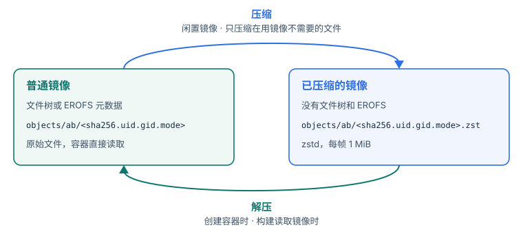
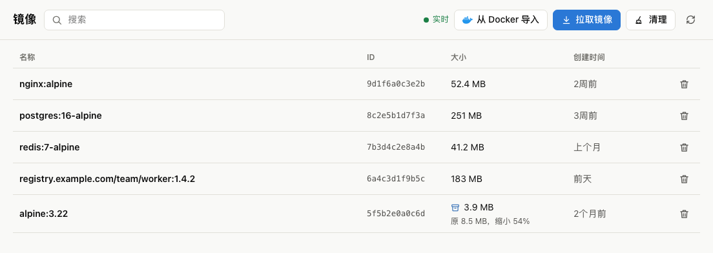

拉取的镜像会一直留在磁盘上。上个月只用过一次的镜像，占用的空间和第一天一样多。下一个 podbag 版本可以压缩这些镜像。本文把这个功能称为**闲置镜像压缩**。闲置镜像就是没有任何容器使用的镜像。这个功能默认关闭。

## podbag 如何存储镜像

podbag 每个文件只存一份，位置是 `objects/ab/<sha256.uid.gid.mode>`。文件名包含内容的哈希、所有者和权限。两个镜像有相同的文件时，它们共用这一个文件。

容器通过两种方式看到这些文件：

- **不用 root**：每个镜像有一棵硬链接树。硬链接是指向同一个文件的另一个名字。
- **使用 root**：podbag 使用 composefs。一个小的 EROFS 文件列出镜像的文件，再由 overlayfs 呈现出来。

两种方式下，容器都直接读取 `objects` 里的原始文件。所以压缩也针对这些文件。

## 压缩与解压



**压缩**只针对闲置镜像。闲置镜像要同时满足两个条件：

- 没有任何容器使用它，已停止的容器也算在内。
- 在 `compress_idle_after` 时间内没有被使用。默认是 7 天。

podbag 先删除这个镜像的文件树或 EROFS 文件。然后在每个文件旁边写入 `<文件>.zst`，再删除原始文件。在用的其他镜像也有的文件保持原样。小于 4096 字节的文件也保持原样，因为压缩它们并不能减少磁盘块。

**解压**在两种情况下发生：用镜像创建容器时，以及构建读取镜像时。podbag 把 `.zst` 还原成原始文件，再重新生成文件树或 EROFS 文件。

### 安全规则

三条规则保护数据：

1. 有文件树或 EROFS 文件的镜像，所有文件都是原始文件。所以容器只会看到原始文件。
2. 原始文件和 `.zst` 同时存在时，使用原始文件。
3. 从 `.zst` 解压出的文件，只有哈希一致时才重新成为存储中的文件。

### 文件格式

`.zst` 文件以一个 zstd skippable frame 开头。zstd 读取数据时会跳过这一部分。我们在这里放一个小的头部，包含版本、大小、标志和修改时间。

后面是每块 1 MiB 的 zstd 帧。每一帧取两种结果中较小的一种：用 "Fastest" 级别压缩的结果，或不压缩直接存储的结果。所以已经压缩过的数据不会变大。

压缩使用 [ruzstd](https://github.com/KillingSpark/zstd-rs)。ruzstd 是用纯 Rust 写的 zstd，不需要 C 库，podbag 的静态构建因此保持不变。

## 什么时候压缩

podbag 没有守护进程。守护进程是一直在后台运行的程序。所以也没有专门负责压缩的程序。实际上是那些本来就会整理存储的命令顺便压缩。

当 `image_compression = "idle"` 时，podbag 会在 `pull`、`load`、`build`、`rmi` 和 `prune` 之后压缩：

- 一条命令最多压缩 256 MiB 或 2 秒，剩下的由下一条命令继续。
- 存储锁每次最多持有 64 MiB 或 1 秒，其他命令不会等很久。
- 大于 32 MiB 的文件不会自动压缩。运行 `podbag system compress` 时才会压缩它们。
- 命令刚拉取的镜像，不会在这条命令中被压缩。
- 存储大小上限要求删除镜像时，podbag 会先压缩闲置镜像。

## 测量结果

podbag-dev 虚拟机（笔记本上的 Linux 虚拟机）· arm64 · 4 个 CPU · Linux 7.0.0-44 · 存储在 ext4 上 · root，composefs · 在 podbag 0.3.2 上加入此功能的开发构建

我们在压缩关闭的状态下拉取了 5 个镜像。两个 python 镜像各 146 MB，两个 Java 镜像各 310 MB。

- `python:3.12.7-slim-bookworm`、`python:3.12.8-slim-bookworm`
- `eclipse-temurin:21.0.5_11-jre-noble`、`eclipse-temurin:21.0.6_7-jre-noble`
- `alpine:3.22`

然后用 `podbag system compress` 压缩了全部 5 个镜像。

| 存储 | 数值 |
|---|---:|
| 压缩前（`system df` 的 Objects 行） | {{n:725}} MB |
| 压缩后 | {{n:337}} MB |
| 压缩 5 个镜像的时间 | {{n:8.4}} 秒 |

存储减少到一半以下。即使在压缩前，存储也小于 5 个镜像大小之和，因为相近版本的两个镜像共用很多文件。由于每个文件单独压缩，这种共用在压缩后依然保留。

| `podbag run` 的时间 | python 3.12.8 | Java (temurin 21.0.6) |
|---|---:|---:|
| 压缩过的镜像第一次启动 | {{n:1391}} ms | {{n:1801}} ms |
| 未压缩的镜像启动 | {{n:30}} ms | {{n:55}} ms |

每个值都是 5 次的中位数。每次测量第一次启动前，我们都重新压缩镜像并清空页缓存。对比的启动也清空了缓存。第一次启动包含解压文件和重新生成 EROFS 文件的时间。之后的启动和未压缩的镜像一样快。

未压缩的镜像在开启此功能后不会变慢。我们让 `alpine:3.22` 在关闭和开启状态下交替各启动 30 次。中位数为关闭 {{n:12}} ms，开启 {{n:11}} ms。

这些数字是在宿主机空闲时测得的。存储是宿主机磁盘上的一个文件。宿主机繁忙时，压缩耗时更长，第一次启动会延长到几秒。

## 使用方法

```sh
podbag system compression                  # 查看设置
podbag system compression idle             # 开启
podbag system compression idle --after 3d  # 压缩 3 天未使用的镜像
podbag system compression off              # 关闭
podbag system compress                     # 立即压缩闲置镜像
podbag system compress myapp:1             # 立即压缩这个镜像
podbag system decompress myapp:1           # 立即解压这个镜像
```

- 关闭时，podbag 不压缩镜像，存储和现在一样。
- `podbag system df` 会多一行 `Compressed`，显示压缩文件的数量以及压缩前后的大小。
- `system compress` 不会压缩容器正在使用的镜像。
- `save`、`push` 和 `podbag system verify` 也能处理压缩过的镜像。它们读取文件时不会在磁盘上解压。
- 在 macOS 和 Windows 上，设置保存在引擎运行的地方，也就是虚拟机或 podbag 的 WSL 发行版中。请用 `podbag system compression` 命令或 Podbag Desktop 修改。
- 在 Linux 上，也可以在 `config.toml` 中写 `image_compression = "idle"`。

## Podbag Desktop

- 全新安装或更新后，Desktop 会询问一次。在**节省磁盘空间**通知中选择**开启**或**以后再说**。
- **设置 > 引擎**中有**压缩闲置镜像**开关。
- 在**镜像**列表中，压缩过的镜像会显示图标和磁盘上的大小。下面一行会写着“原 8.5 MB，缩小 54%”这样的原始大小和缩小比例。



Docker API 的 `/images/json` 也会给压缩过的镜像加上 `PodbagCompression` 字段。Desktop 会显示这个值。

## 没有选择的方法

- **文件系统压缩**（如 btrfs）：只能在 btrfs 上使用。大多数 Linux 用户用的是 ext4，podbag 也无法替用户开启。
- **把整个镜像压成一个归档**：会破坏单个文件的共用。再次使用镜像时必须解压全部内容。
- **读取时解压的 FUSE 文件系统**：FUSE 让一个程序充当文件系统。这个程序必须一直运行，所以需要守护进程。
- **EROFS 自带的压缩**：只能用于以 root 运行的 composefs，无法用于不用 root 的硬链接树。

## 什么时候可以使用

闲置镜像压缩会在下一个 podbag 版本中提供。podbag 目前的存储方式见[使用指南的 Storage 一节](https://github.com/SteelCrab/podbag/blob/main/docs/usage.md#storage)。

## 复现资料

[测量脚本](compress.sh) · [测量结果与环境](results.txt)

[ruzstd](https://github.com/KillingSpark/zstd-rs) · [zstd 格式 (RFC 8878)](https://www.rfc-editor.org/rfc/rfc8878) · [composefs](https://github.com/composefs/composefs)
