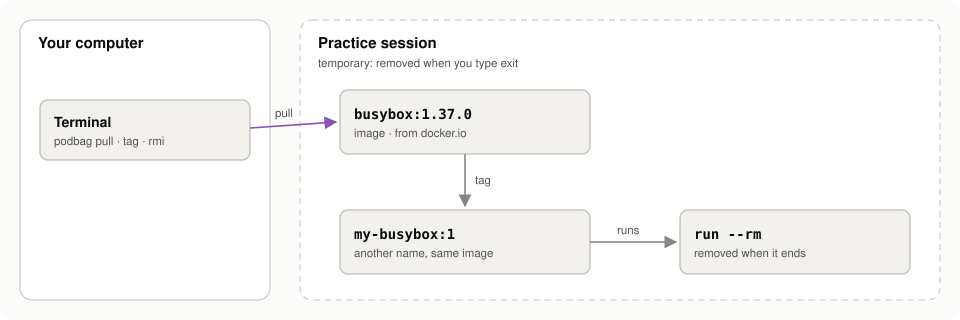

An image is the read-only template that a container starts from. A tag is a name for an image. One image can have many tags. In this module, you pull an image, add a tag, run it, and remove the tags again.

**Time** 10 minutes.



## Start the module

You need a build of Podbag Desktop and the CLI with the Training catalog. It was added after v0.3.2.

Open **Training** in Podbag Desktop and select **Pull, tag and remove an image**. New modules appear after **Refresh**. Or run this command in a terminal:

```sh
podbag lab start image-basics
```

Continue at the `training $` prompt. The practice session has its own empty image store.

To do the steps in the TUI instead of Podbag Desktop, add `--tui`.

```sh
podbag lab start image-basics --tui
```

In the TUI, press `:` to open the training shell for a command step, type `exit` to return to the TUI, and press `q` to end the session.

## Pull an image

`pull` downloads an image from a registry. A registry is a server that stores images. `docker.io` is Docker Hub.

```sh
podbag pull docker.io/library/busybox:1.37.0
```

- **In Podbag Desktop:** Select **Practice containers → Pull docker.io/library/busybox:1.37.0**.
- **In the TUI:** Open **Images**, press `p`, type `docker.io/library/busybox:1.37.0` and press `Enter`.

podbag prints each layer as it downloads it. Podbag checks that the image `docker.io/library/busybox:1.37.0` is now stored.

## List the images

`images` lists every stored image with its name, digest and size.

```sh
podbag images
```

The list shows `docker.io/library/busybox:1.37.0`. Podbag checks the output for this name.

## Give the image a new name

`tag` adds a second name to an image. It copies no files. Both names point to the same image.

```sh
podbag tag docker.io/library/busybox:1.37.0 my-busybox:1
```

A short name like `my-busybox:1` means `docker.io/library/my-busybox:1`. Podbag checks that the tag `my-busybox:1` exists.

## Run a container from the new name

Use the new name like any image name. The `--rm` option removes the container when the command ends.

```sh
podbag run --rm my-busybox:1 echo Hello from my-busybox
```

The terminal prints `Hello from my-busybox`. Podbag checks this output.

## Remove the new name

`rmi` removes an image name. When other names still use the image, only the name goes.

```sh
podbag rmi my-busybox:1
```

- **In Podbag Desktop:** Select **Practice containers → Remove image my-busybox:1** and confirm.
- **In the TUI:** Select `my-busybox:1` in **Images**, press `d`, then `y`.

podbag prints `Untagged: docker.io/library/my-busybox:1`. Podbag checks that the tag is gone.

## Check that the original image stays

List the images again.

```sh
podbag images
```

`docker.io/library/busybox:1.37.0` is still in the list. Podbag checks the output for this name.

## Remove the image

Remove the last name. Now no name points to the image.

```sh
podbag rmi docker.io/library/busybox:1.37.0
```

- **In Podbag Desktop:** Select **Practice containers → Remove image docker.io/library/busybox:1.37.0** and confirm.
- **In the TUI:** Select `docker.io/library/busybox:1.37.0` in **Images**, press `d`, then `y`.

Podbag checks that the image is gone.

## Clean up and finish

Nothing is left to clean up. End the session in the same terminal.

```sh
exit
```

The temporary practice session is removed. Training shows the module as complete.
