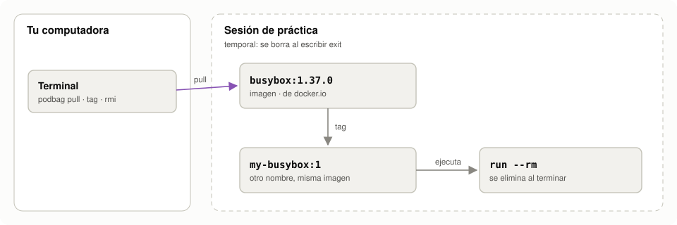

Una imagen es la plantilla de solo lectura desde la que se inicia un contenedor. Una etiqueta (tag) es un nombre para una imagen. Una imagen puede tener muchas etiquetas. En este módulo, descargas una imagen, le añades una etiqueta, la ejecutas y vuelves a eliminar las etiquetas.

**Tiempo** 10 minutos.



## Inicia el módulo

Necesitas una versión de Podbag Desktop y de la CLI con el catálogo de Training. Se añadió después de v0.3.2.

Abre **Training** en Podbag Desktop y selecciona **Descarga, etiqueta y elimina una imagen**. Los módulos nuevos aparecen después de **Actualizar**. O ejecuta este comando en una terminal:

```sh
podbag lab start image-basics
```

Continúa en el prompt `training $`. La sesión de práctica tiene su propio almacén de imágenes vacío.

Para hacer los pasos en la TUI en lugar de Podbag Desktop, añade `--tui`.

```sh
podbag lab start image-basics --tui
```

En la TUI, pulsa `:` para abrir la shell de Training cuando un paso pida un comando, escribe `exit` para volver a la TUI y pulsa `q` para terminar la sesión.

## Descarga una imagen

`pull` descarga una imagen de un registro. Un registro es un servidor que guarda imágenes. `docker.io` es Docker Hub.

```sh
podbag pull docker.io/library/busybox:1.37.0
```

- **En Podbag Desktop:** Selecciona **Contenedores de práctica → Descargar docker.io/library/busybox:1.37.0**.
- **En la TUI:** Abre **Imágenes**, pulsa `p`, escribe `docker.io/library/busybox:1.37.0` y pulsa `Enter`.

podbag muestra cada capa mientras la descarga. Podbag comprueba que la imagen `docker.io/library/busybox:1.37.0` ya está guardada.

## Lista las imágenes

`images` lista todas las imágenes guardadas con su nombre, su digest y su tamaño.

```sh
podbag images
```

La lista muestra `docker.io/library/busybox:1.37.0`. Podbag busca este nombre en la salida.

## Da un nombre nuevo a la imagen

`tag` añade un segundo nombre a una imagen. No copia ningún archivo. Los dos nombres apuntan a la misma imagen.

```sh
podbag tag docker.io/library/busybox:1.37.0 my-busybox:1
```

Un nombre corto como `my-busybox:1` significa `docker.io/library/my-busybox:1`. Podbag comprueba que existe la etiqueta `my-busybox:1`.

## Ejecuta un contenedor con el nombre nuevo

Usa el nombre nuevo como cualquier nombre de imagen. La opción `--rm` elimina el contenedor cuando termina el comando.

```sh
podbag run --rm my-busybox:1 echo Hello from my-busybox
```

La terminal muestra `Hello from my-busybox`. Podbag comprueba esta salida.

## Elimina el nombre nuevo

`rmi` elimina un nombre de imagen. Si otros nombres siguen usando la imagen, solo se elimina el nombre.

```sh
podbag rmi my-busybox:1
```

- **En Podbag Desktop:** Selecciona **Contenedores de práctica → Eliminar la imagen my-busybox:1** y confirma.
- **En la TUI:** Selecciona `my-busybox:1` en **Imágenes**, pulsa `d` y luego `y`.

podbag muestra `Untagged: docker.io/library/my-busybox:1`. Podbag comprueba que la etiqueta ya no existe.

## Comprueba que la imagen original sigue ahí

Vuelve a listar las imágenes.

```sh
podbag images
```

`docker.io/library/busybox:1.37.0` sigue en la lista. Podbag busca este nombre en la salida.

## Elimina la imagen

Elimina el último nombre. Ahora ningún nombre apunta a la imagen.

```sh
podbag rmi docker.io/library/busybox:1.37.0
```

- **En Podbag Desktop:** Selecciona **Contenedores de práctica → Eliminar la imagen docker.io/library/busybox:1.37.0** y confirma.
- **En la TUI:** Selecciona `docker.io/library/busybox:1.37.0` en **Imágenes**, pulsa `d` y luego `y`.

Podbag comprueba que la imagen ya no existe.

## Limpia y termina

No queda nada por limpiar. Termina la sesión en la misma terminal.

```sh
exit
```

Se elimina la sesión de práctica temporal. Training muestra el módulo como completado.
