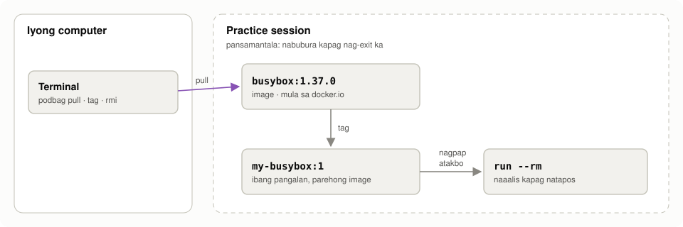

Ang image ay ang read-only na template na pinagmumulan ng container. Ang tag ay pangalan para sa image. Maaaring magkaroon ng maraming tag ang isang image. Sa module na ito, kukuha ka ng image, magdaragdag ng tag, patatakbuhin ito, at aalisin ulit ang mga tag.

**Oras** 10 minuto.



## Simulan ang module

Kailangan mo ng build ng Podbag Desktop at ng CLI na may Training catalog. Idinagdag ito pagkatapos ng v0.3.2.

Buksan ang **Training** sa Podbag Desktop at piliin ang **Kunin, i-tag at alisin ang image**. Lalabas ang mga bagong module pagkatapos ng **I-refresh**. O patakbuhin ang command na ito sa terminal:

```sh
podbag lab start image-basics
```

Magpatuloy sa prompt na `training $`. May sariling walang lamang imbakan ng image ang practice session.

Para gawin ang mga hakbang sa TUI sa halip na sa Podbag Desktop, idagdag ang `--tui`.

```sh
podbag lab start image-basics --tui
```

Sa TUI, pindutin ang `:` para buksan ang training shell sa isang hakbang na command. I-type ang `exit` para bumalik sa TUI. Pindutin ang `q` para tapusin ang practice session.

## Kumuha ng image

Dina-download ng `pull` ang image mula sa registry. Ang registry ay server na nag-iimbak ng mga image. Ang `docker.io` ay Docker Hub.

```sh
podbag pull docker.io/library/busybox:1.37.0
```

- **Sa Podbag Desktop:** Piliin ang **Mga practice container → I-pull ang docker.io/library/busybox:1.37.0**.
- **Sa TUI:** Buksan ang **Mga image**, pindutin ang `p`, i-type ang `docker.io/library/busybox:1.37.0` at pindutin ang `Enter`.

Ipinapakita ng podbag ang bawat layer habang dina-download ito. Sinusuri ng Podbag na naka-imbak na ang image na `docker.io/library/busybox:1.37.0`.

## Ilista ang mga image

Inililista ng `images` ang bawat naka-imbak na image, kasama ang pangalan, digest at laki nito.

```sh
podbag images
```

Ipinapakita ng listahan ang `docker.io/library/busybox:1.37.0`. Hinahanap ng Podbag ang pangalang ito sa output.

## Bigyan ng bagong pangalan ang image

Nagdaragdag ang `tag` ng pangalawang pangalan sa image. Wala itong kinokopyang file. Tumuturo ang dalawang pangalan sa parehong image.

```sh
podbag tag docker.io/library/busybox:1.37.0 my-busybox:1
```

Ang maikling pangalan tulad ng `my-busybox:1` ay nangangahulugang `docker.io/library/my-busybox:1`. Sinusuri ng Podbag na may tag na `my-busybox:1`.

## Magpatakbo ng container mula sa bagong pangalan

Gamitin ang bagong pangalan tulad ng anumang pangalan ng image. Inaalis ng option na `--rm` ang container kapag natapos ang command.

```sh
podbag run --rm my-busybox:1 echo Hello from my-busybox
```

Ipinapakita ng terminal ang `Hello from my-busybox`. Sinusuri ng Podbag ang output na ito.

## Alisin ang bagong pangalan

Inaalis ng `rmi` ang pangalan ng image. Kapag may iba pang pangalan na gumagamit ng image, ang pangalan lang ang naaalis.

```sh
podbag rmi my-busybox:1
```

- **Sa Podbag Desktop:** Piliin ang **Mga practice container → Alisin ang image na my-busybox:1** at kumpirmahin.
- **Sa TUI:** Piliin ang `my-busybox:1` sa **Mga image**, pindutin ang `d`, saka ang `y`.

Ipinapakita ng podbag ang `Untagged: docker.io/library/my-busybox:1`. Sinusuri ng Podbag na wala na ang tag.

## Tiyaking nananatili ang orihinal na image

Ilista ulit ang mga image.

```sh
podbag images
```

Nasa listahan pa rin ang `docker.io/library/busybox:1.37.0`. Hinahanap ng Podbag ang pangalang ito sa output.

## Alisin ang image

Alisin ang huling pangalan. Ngayon, wala nang pangalang tumuturo sa image.

```sh
podbag rmi docker.io/library/busybox:1.37.0
```

- **Sa Podbag Desktop:** Piliin ang **Mga practice container → Alisin ang image na docker.io/library/busybox:1.37.0** at kumpirmahin.
- **Sa TUI:** Piliin ang `docker.io/library/busybox:1.37.0` sa **Mga image**, pindutin ang `d`, saka ang `y`.

Sinusuri ng Podbag na wala na ang image.

## Maglinis at tapusin

Wala nang dapat linisin. Tapusin ang session sa parehong terminal.

```sh
exit
```

Naaalis ang pansamantalang practice session. Ipinapakita ng Training na tapos na ang module.
