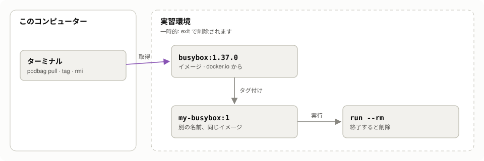

イメージは、コンテナの元になる読み取り専用のテンプレートです。タグはイメージの名前です。1 つのイメージに複数のタグを付けられます。このモジュールでは、イメージを取得し、タグを追加して実行し、タグを削除します。

**所要時間** 10 分。



## モジュールを開始する

Training カタログがある Podbag Desktop と CLI のビルドが必要です。カタログは v0.3.2 より後に追加されました。

Podbag Desktop で **Training** を開き、**イメージを取得し、タグを付けて削除する**を選びます。新しいモジュールは**更新**の後に表示されます。ターミナルで次のコマンドを実行しても開始できます。

```sh
podbag lab start image-basics
```

`training $` プロンプトが表示されたら続けます。実習環境には、専用の空のイメージストアがあります。

Podbag Desktop の代わりに TUI で手順を進めるには、`--tui` を付けます。

```sh
podbag lab start image-basics --tui
```

TUI では、コマンドの手順で `:` を押すと Training シェルが開きます。`exit` と入力すると TUI に戻ります。`q` を押すと実習を終了します。

## イメージを取得する

`pull` はレジストリからイメージをダウンロードします。レジストリは、イメージを保存するサーバーです。`docker.io` は Docker Hub です。

```sh
podbag pull docker.io/library/busybox:1.37.0
```

- **Podbag Desktop で:** **実習コンテナ → docker.io/library/busybox:1.37.0 を取得**を選びます。
- **TUI で:** **イメージ**を開き、`p` を押して `docker.io/library/busybox:1.37.0` と入力し、`Enter` を押します。

podbag は、ダウンロードする各レイヤーを表示します。Podbag は、イメージ `docker.io/library/busybox:1.37.0` が保存されたことを確認します。

## イメージを一覧表示する

`images` は、保存されたすべてのイメージを、名前、ダイジェスト、サイズと一緒に表示します。

```sh
podbag images
```

一覧に `docker.io/library/busybox:1.37.0` が表示されます。Podbag は出力にこの名前があることを確認します。

## イメージに新しい名前を付ける

`tag` はイメージに 2 つ目の名前を追加します。ファイルはコピーしません。両方の名前が同じイメージを指します。

```sh
podbag tag docker.io/library/busybox:1.37.0 my-busybox:1
```

`my-busybox:1` のような短い名前は、`docker.io/library/my-busybox:1` を意味します。Podbag はタグ `my-busybox:1` があることを確認します。

## 新しい名前でコンテナを実行する

新しい名前は、ほかのイメージ名と同じように使えます。`--rm` オプションは、コマンドが終わるとコンテナを削除します。

```sh
podbag run --rm my-busybox:1 echo Hello from my-busybox
```

ターミナルに `Hello from my-busybox` と表示されます。Podbag はこの出力を確認します。

## 新しい名前を削除する

`rmi` はイメージの名前を削除します。ほかの名前がまだそのイメージを使っている場合は、名前だけが消えます。

```sh
podbag rmi my-busybox:1
```

- **Podbag Desktop で:** **実習コンテナ → イメージ my-busybox:1 を削除**を選び、確認します。
- **TUI で:** **イメージ**で `my-busybox:1` を選び、`d` を押してから `y` を押します。

podbag は `Untagged: docker.io/library/my-busybox:1` と表示します。Podbag はタグが消えたことを確認します。

## 元のイメージが残っていることを確認する

もう一度イメージを一覧表示します。

```sh
podbag images
```

`docker.io/library/busybox:1.37.0` はまだ一覧にあります。Podbag は出力にこの名前があることを確認します。

## イメージを削除する

最後の名前を削除します。これで、このイメージを指す名前はなくなります。

```sh
podbag rmi docker.io/library/busybox:1.37.0
```

- **Podbag Desktop で:** **実習コンテナ → イメージ docker.io/library/busybox:1.37.0 を削除**を選び、確認します。
- **TUI で:** **イメージ**で `docker.io/library/busybox:1.37.0` を選び、`d` を押してから `y` を押します。

Podbag はイメージが消えたことを確認します。

## 片付けて終了する

片付けるものは残っていません。同じターミナルで実習を終了します。

```sh
exit
```

一時的な実習環境が削除されます。Training にモジュールの完了が表示されます。
