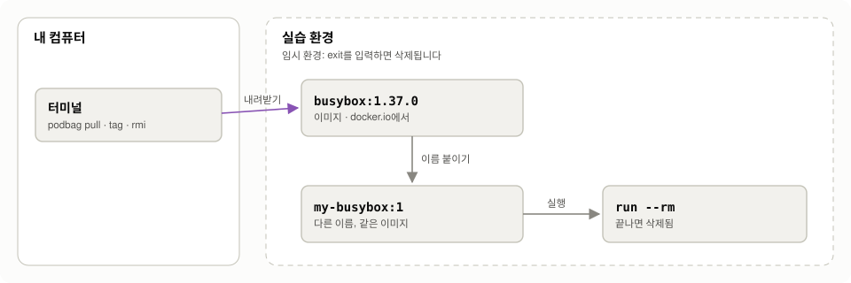

이미지는 컨테이너가 시작할 때 쓰는 읽기 전용 틀입니다. 태그는 이미지의 이름입니다. 이미지 하나에 태그를 여러 개 붙일 수 있습니다. 이번 트레이닝에서는 이미지를 내려받고 태그를 붙여 실행합니다. 마지막에 태그를 다시 삭제합니다.

**예상 시간** 10분.



## 실습 시작

Training 카탈로그가 들어 있는 Podbag Desktop과 CLI가 필요합니다. 이 기능은 v0.3.2 이후에 추가됐습니다.

Podbag Desktop에서 **Training**을 열고 **이미지 내려받고 이름 붙이고 삭제하기**를 선택합니다. 새 모듈은 **새로 고침**을 누르면 나타납니다. 터미널에서 다음 명령을 실행해도 됩니다.

```sh
podbag lab start image-basics
```

`training $` 프롬프트에서 계속 진행합니다. 실습 환경에는 비어 있는 별도의 이미지 저장소가 있습니다.

Podbag Desktop 대신 TUI에서 실습하려면 `--tui`를 붙입니다.

```sh
podbag lab start image-basics --tui
```

TUI에서는 `:` 키로 명령 단계용 Training 셸을 열고, `exit`를 입력해 TUI로 돌아오며, `q` 키로 실습을 끝냅니다.

## 이미지 내려받기

`pull`은 레지스트리에서 이미지를 내려받습니다. 레지스트리는 이미지를 보관하는 서버입니다. `docker.io`는 Docker Hub입니다.

```sh
podbag pull docker.io/library/busybox:1.37.0
```

- **Podbag Desktop에서:** **실습 컨테이너 → docker.io/library/busybox:1.37.0 받기**를 누릅니다.
- **TUI에서:** **이미지** 탭을 열고 `p` 키를 누른 뒤 `docker.io/library/busybox:1.37.0` 입력 후 `Enter` 키를 누릅니다.

podbag은 레이어를 하나씩 내려받으며 진행 상황을 출력합니다. Podbag은 `docker.io/library/busybox:1.37.0` 이미지가 저장됐는지 확인합니다.

## 이미지 목록 보기

`images`는 저장된 이미지의 이름, 다이제스트, 크기를 보여 줍니다.

```sh
podbag images
```

목록에 `docker.io/library/busybox:1.37.0`이 나옵니다. Podbag은 출력에 이 이름이 있는지 확인합니다.

## 이미지에 새 이름 붙이기

`tag`는 이미지에 두 번째 이름을 붙입니다. 파일은 복사하지 않습니다. 두 이름은 같은 이미지를 가리킵니다.

```sh
podbag tag docker.io/library/busybox:1.37.0 my-busybox:1
```

`my-busybox:1` 같은 짧은 이름은 `docker.io/library/my-busybox:1`을 뜻합니다. Podbag은 `my-busybox:1` 태그가 있는지 확인합니다.

## 새 이름으로 컨테이너 실행하기

새 이름은 다른 이미지 이름과 똑같이 쓸 수 있습니다. `--rm` 옵션은 명령이 끝나면 컨테이너를 삭제합니다.

```sh
podbag run --rm my-busybox:1 echo Hello from my-busybox
```

터미널에 `Hello from my-busybox`가 출력됩니다. Podbag은 이 출력을 확인합니다.

## 새 이름 삭제하기

`rmi`는 이미지 이름을 삭제합니다. 다른 이름이 아직 이미지를 쓰고 있으면 이름만 사라집니다.

```sh
podbag rmi my-busybox:1
```

- **Podbag Desktop에서:** **실습 컨테이너 → 이미지 my-busybox:1 삭제**를 누르고 확인합니다.
- **TUI에서:** **이미지**에서 `my-busybox:1` 선택 후 `d` 키, `y` 키를 차례로 누릅니다.

podbag은 `Untagged: docker.io/library/my-busybox:1`을 출력합니다. Podbag은 태그가 사라졌는지 확인합니다.

## 원래 이미지가 남았는지 확인하기

이미지 목록을 다시 봅니다.

```sh
podbag images
```

`docker.io/library/busybox:1.37.0`은 목록에 그대로 있습니다. Podbag은 출력에 이 이름이 있는지 확인합니다.

## 이미지 삭제하기

마지막 이름을 삭제합니다. 이제 이 이미지를 가리키는 이름이 없습니다.

```sh
podbag rmi docker.io/library/busybox:1.37.0
```

- **Podbag Desktop에서:** **실습 컨테이너 → 이미지 docker.io/library/busybox:1.37.0 삭제**를 누르고 확인합니다.
- **TUI에서:** **이미지**에서 `docker.io/library/busybox:1.37.0` 선택 후 `d` 키, `y` 키를 차례로 누릅니다.

Podbag은 이미지가 사라졌는지 확인합니다.

## 정리 및 실습 종료

더 정리할 것은 없습니다. 같은 터미널에서 실습을 종료합니다.

```sh
exit
```

임시 실습 환경이 삭제됩니다. Training에 모듈이 완료됨으로 표시됩니다.
