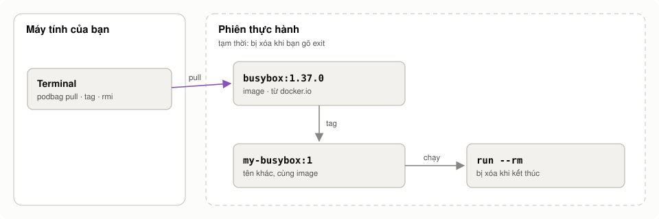

Image là bản mẫu chỉ đọc mà container dùng để bắt đầu. Tag là một tên của image. Một image có thể có nhiều tag. Trong mô-đun này, bạn kéo một image, thêm tag, chạy nó, rồi xóa các tag đi.

**Thời gian** 10 phút.



## Bắt đầu mô-đun

Bạn cần bản Podbag Desktop và CLI có danh mục Training. Danh mục này được thêm sau v0.3.2.

Mở **Training** trong Podbag Desktop và chọn **Kéo, gắn tag và xóa image**. Mô-đun mới xuất hiện sau khi chọn **Làm mới**. Hoặc chạy lệnh này trong terminal:

```sh
podbag lab start image-basics
```

Tiếp tục tại dấu nhắc `training $`. Phiên thực hành có kho image riêng và kho này đang trống.

Để làm các bước trong TUI thay cho Podbag Desktop, hãy thêm `--tui`.

```sh
podbag lab start image-basics --tui
```

Trong TUI, nhấn `:` để mở shell Training cho bước chạy lệnh, gõ `exit` để quay lại TUI và nhấn `q` để kết thúc phiên.

## Kéo image

`pull` tải image từ một registry. Registry là máy chủ lưu image. `docker.io` là Docker Hub.

```sh
podbag pull docker.io/library/busybox:1.37.0
```

- **Trong Podbag Desktop:** Chọn **Container thực hành → Tải docker.io/library/busybox:1.37.0**.
- **Trong TUI:** Mở **Image**, nhấn `p`, gõ `docker.io/library/busybox:1.37.0` rồi nhấn `Enter`.

podbag in từng layer khi tải về. Podbag kiểm tra rằng image `docker.io/library/busybox:1.37.0` đã được lưu.

## Liệt kê các image

`images` liệt kê mọi image đã lưu, kèm tên, digest và dung lượng.

```sh
podbag images
```

Danh sách có `docker.io/library/busybox:1.37.0`. Podbag tìm tên này trong kết quả.

## Đặt tên mới cho image

`tag` thêm một tên thứ hai cho image. Lệnh này không sao chép tệp nào. Cả hai tên đều trỏ tới cùng một image.

```sh
podbag tag docker.io/library/busybox:1.37.0 my-busybox:1
```

Tên ngắn như `my-busybox:1` có nghĩa là `docker.io/library/my-busybox:1`. Podbag kiểm tra rằng tag `my-busybox:1` đã có.

## Chạy container từ tên mới

Dùng tên mới như mọi tên image khác. Tùy chọn `--rm` xóa container khi lệnh kết thúc.

```sh
podbag run --rm my-busybox:1 echo Hello from my-busybox
```

Terminal in `Hello from my-busybox`. Podbag kiểm tra kết quả này.

## Xóa tên mới

`rmi` xóa một tên image. Khi image vẫn còn tên khác, lệnh chỉ xóa tên này.

```sh
podbag rmi my-busybox:1
```

- **Trong Podbag Desktop:** Chọn **Container thực hành → Xóa image my-busybox:1** và xác nhận.
- **Trong TUI:** Chọn `my-busybox:1` trong **Image**, nhấn `d`, rồi nhấn `y`.

podbag in `Untagged: docker.io/library/my-busybox:1`. Podbag kiểm tra rằng tag không còn.

## Kiểm tra rằng image gốc vẫn còn

Liệt kê lại các image.

```sh
podbag images
```

`docker.io/library/busybox:1.37.0` vẫn có trong danh sách. Podbag tìm tên này trong kết quả.

## Xóa image

Xóa tên cuối cùng. Bây giờ không còn tên nào trỏ tới image.

```sh
podbag rmi docker.io/library/busybox:1.37.0
```

- **Trong Podbag Desktop:** Chọn **Container thực hành → Xóa image docker.io/library/busybox:1.37.0** và xác nhận.
- **Trong TUI:** Chọn `docker.io/library/busybox:1.37.0` trong **Image**, nhấn `d`, rồi nhấn `y`.

Podbag kiểm tra rằng image không còn.

## Dọn dẹp và kết thúc

Không còn gì cần dọn. Kết thúc phiên trong cùng terminal.

```sh
exit
```

Phiên thực hành tạm thời đã được xóa. Training hiển thị mô-đun đã hoàn thành.
