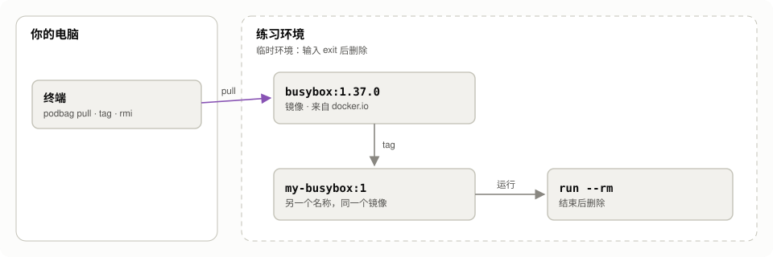

镜像是容器启动时使用的只读模板。标签是镜像的名称。一个镜像可以有多个标签。在本模块中，你将拉取镜像、添加标签、运行它，然后再删除这些标签。

**预计用时** 10 分钟。



## 开始模块

需要带有 Training 目录的 Podbag Desktop 和 CLI 版本。该目录在 v0.3.2 之后加入。

在 Podbag Desktop 中打开 **Training**，选择**拉取、标记和删除镜像**。点击**刷新**后会出现新模块。也可以在终端中运行以下命令：

```sh
podbag lab start image-basics
```

出现 `training $` 提示符后继续。练习环境有自己的空镜像存储。

要在 TUI 而不是 Podbag Desktop 中完成这些步骤，请加上 `--tui`。

```sh
podbag lab start image-basics --tui
```

在 TUI 中，按 `:` 打开 Training 终端来执行命令步骤，输入 `exit` 返回 TUI，按 `q` 结束实验。

## 拉取镜像

`pull` 从镜像仓库下载镜像。镜像仓库是存储镜像的服务器。`docker.io` 就是 Docker Hub。

```sh
podbag pull docker.io/library/busybox:1.37.0
```

- **在 Podbag Desktop 中：** 选择**实验容器 → 拉取 docker.io/library/busybox:1.37.0**。
- **在 TUI 中：** 打开**镜像**，按 `p`，输入 `docker.io/library/busybox:1.37.0` 并按 `Enter`。

podbag 在下载每个层时都会打印出来。Podbag 会检查镜像 `docker.io/library/busybox:1.37.0` 是否已存储。

## 列出镜像

`images` 列出所有已存储的镜像，包括名称、摘要和大小。

```sh
podbag images
```

列表中显示 `docker.io/library/busybox:1.37.0`。Podbag 会检查输出中是否有这个名称。

## 为镜像起一个新名称

`tag` 为镜像添加第二个名称。它不复制任何文件。两个名称指向同一个镜像。

```sh
podbag tag docker.io/library/busybox:1.37.0 my-busybox:1
```

像 `my-busybox:1` 这样的短名称表示 `docker.io/library/my-busybox:1`。Podbag 会检查标签 `my-busybox:1` 是否存在。

## 用新名称运行容器

新名称的用法和其他镜像名称一样。`--rm` 选项会在命令结束时删除容器。

```sh
podbag run --rm my-busybox:1 echo Hello from my-busybox
```

终端打印 `Hello from my-busybox`。Podbag 会检查这个输出。

## 删除新名称

`rmi` 删除镜像名称。如果镜像还有其他名称，只删除这个名称。

```sh
podbag rmi my-busybox:1
```

- **在 Podbag Desktop 中：** 选择**实验容器 → 删除镜像 my-busybox:1**并确认。
- **在 TUI 中：** 在**镜像**中选择 `my-busybox:1`，按 `d`，再按 `y`。

podbag 打印 `Untagged: docker.io/library/my-busybox:1`。Podbag 会检查标签是否已删除。

## 确认原镜像仍然保留

再次列出镜像。

```sh
podbag images
```

`docker.io/library/busybox:1.37.0` 仍在列表中。Podbag 会检查输出中是否有这个名称。

## 删除镜像

删除最后一个名称。现在没有任何名称指向该镜像。

```sh
podbag rmi docker.io/library/busybox:1.37.0
```

- **在 Podbag Desktop 中：** 选择**实验容器 → 删除镜像 docker.io/library/busybox:1.37.0**并确认。
- **在 TUI 中：** 在**镜像**中选择 `docker.io/library/busybox:1.37.0`，按 `d`，再按 `y`。

Podbag 会检查镜像是否已删除。

## 清理并结束

没有需要清理的内容。在同一个终端中结束实验。

```sh
exit
```

临时练习环境会被删除。Training 会显示该模块已完成。
