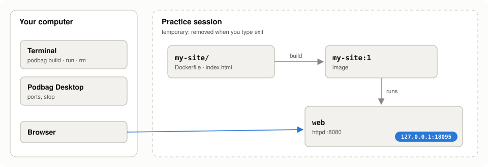

A Dockerfile is a text file with the steps that make an image. `podbag build` reads it and makes the image itself, without a daemon or BuildKit. In this module, you build a small web server image, run it and open its page.

**Time** 10–15 minutes.



## Start the module

You need a build of Podbag Desktop and the CLI with the Training catalog. It was added after v0.3.2.

Open **Training** in Podbag Desktop and select **Build an image from a Dockerfile**. New modules appear after **Refresh**. Or run this command in a terminal:

```sh
podbag lab start image-build
```

Continue at the `training $` prompt.

To do the steps in the TUI instead of Podbag Desktop, add `--tui`.

```sh
podbag lab start image-build --tui
```

In the TUI, press `:` to open the training shell for a command step, type `exit` to return to the TUI, and press `q` to end the session.

The session puts a folder named `my-site` in the practice directory. It has two files. `index.html` is the page:

```text
Hello from my-site
```

`Dockerfile` has four steps:

```dockerfile
FROM docker.io/library/busybox:1.37.0
COPY index.html /www/index.html
EXPOSE 8080
CMD ["httpd", "-f", "-p", "8080", "-h", "/www"]
```

`FROM` picks the base image. `COPY` puts the page into the image. `EXPOSE` notes the port. `CMD` is the command the container runs.

## Build the image

```sh
podbag build -t my-site:1 my-site
```

The last word, `my-site`, is the build context: the folder that `COPY` reads from. `-t` gives the image its name. podbag pulls the base image and prints each step. Podbag checks that the image `my-site:1` exists.

## Build again with the cache

Run the same command again.

```sh
podbag build -t my-site:1 my-site
```

podbag keeps the result of each step. Nothing changed, so the `COPY` step prints `Using cache`. Podbag checks the output for these words. When you change `index.html`, that step runs again.

## Run the new image

Run a container named `web` from the image. Use the port shown in Training if the default `18095` is already in use.

```sh
podbag run -d --name web -p 127.0.0.1:18095:8080 my-site:1
```

You give no command. The container runs the `CMD` from the Dockerfile. Podbag checks that `web` runs, publishes the port and shows **Hello from my-site**.

## Open the page in Desktop

Go to **Practice containers → web → View ports**. Select **Open in browser**. The page displays **Hello from my-site**. Podbag checks for an HTTP 200 response and this text.

- **In Podbag Desktop:** Select **Practice containers → web → View ports**.
- **In the TUI:** Select `web` in **Containers** and press `Enter`.
- **In Podbag Desktop:** Select **Open in browser**.
- **In the TUI:** Open `http://127.0.0.1:18095/` in a browser. When the page shows, press `o`.

## Clean up and finish

In Desktop, select **Practice containers → web → Stop**. Then remove the container and the image in the same terminal.

- **In Podbag Desktop:** Select **Practice containers → web → Stop**.
- **In the TUI:** Select `web` in **Containers** and press `x`.
- **In Podbag Desktop:** Select **Practice containers → web → Remove** and confirm.
- **In the TUI:** Select `web` in **Containers**, press `d`, then `y`.
- **In Podbag Desktop:** Select **Practice containers → Remove image my-site:1** and confirm.
- **In the TUI:** Select `my-site:1` in **Images**, press `d`, then `y`.

```sh
podbag rm web
podbag rmi my-site:1
exit
```

The temporary practice session is removed. Training shows the module as complete.
