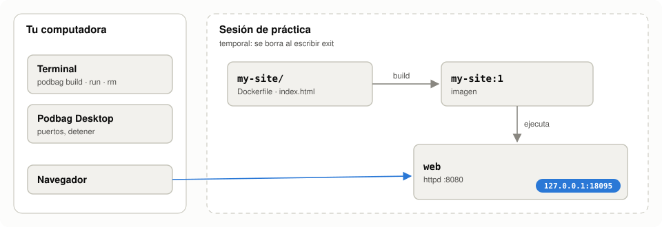

Un Dockerfile es un archivo de texto con los pasos que crean una imagen. `podbag build` lo lee y crea la imagen por sí mismo, sin daemon ni BuildKit. En este módulo, creas la imagen de un pequeño servidor web, la ejecutas y abres su página.

**Tiempo** 10–15 minutos.



## Inicia el módulo

Necesitas una versión de Podbag Desktop y de la CLI con el catálogo de Training. Se añadió después de v0.3.2.

Abre **Training** en Podbag Desktop y selecciona **Crea una imagen a partir de un Dockerfile**. Los módulos nuevos aparecen después de **Actualizar**. O ejecuta este comando en una terminal:

```sh
podbag lab start image-build
```

Continúa en el prompt `training $`.

Para hacer los pasos en la TUI en lugar de Podbag Desktop, añade `--tui`.

```sh
podbag lab start image-build --tui
```

En la TUI, pulsa `:` para abrir la shell de Training cuando un paso pida un comando, escribe `exit` para volver a la TUI y pulsa `q` para terminar la sesión.

La sesión pone una carpeta llamada `my-site` en el directorio de práctica. Tiene dos archivos. `index.html` es la página:

```text
Hello from my-site
```

`Dockerfile` tiene cuatro pasos:

```dockerfile
FROM docker.io/library/busybox:1.37.0
COPY index.html /www/index.html
EXPOSE 8080
CMD ["httpd", "-f", "-p", "8080", "-h", "/www"]
```

`FROM` elige la imagen base. `COPY` pone la página en la imagen. `EXPOSE` indica el puerto. `CMD` es el comando que ejecuta el contenedor.

## Crea la imagen

```sh
podbag build -t my-site:1 my-site
```

La última palabra, `my-site`, es el contexto de build: la carpeta de la que lee `COPY`. `-t` da el nombre a la imagen. podbag descarga la imagen base y muestra cada paso. Podbag comprueba que existe la imagen `my-site:1`.

## Vuelve a crearla con la caché

Ejecuta el mismo comando otra vez.

```sh
podbag build -t my-site:1 my-site
```

podbag guarda el resultado de cada paso. No cambió nada, así que el paso `COPY` muestra `Using cache`. Podbag busca estas palabras en la salida. Si cambias `index.html`, ese paso se ejecuta de nuevo.

## Ejecuta la imagen nueva

Ejecuta un contenedor llamado `web` a partir de la imagen. Si el puerto predeterminado `18095` ya está en uso, usa el puerto que indica Training.

```sh
podbag run -d --name web -p 127.0.0.1:18095:8080 my-site:1
```

No das ningún comando. El contenedor ejecuta el `CMD` del Dockerfile. Podbag comprueba que `web` está en ejecución, publica el puerto y muestra **Hello from my-site**.

## Abre la página en Desktop

Ve a **Contenedores de práctica → web → Ver puertos**. Selecciona **Abrir en el navegador**. La página muestra **Hello from my-site**. Podbag comprueba que hay una respuesta HTTP 200 y este texto.

- **En Podbag Desktop:** Selecciona **Contenedores de práctica → web → Ver puertos**.
- **En la TUI:** Selecciona `web` en **Contenedores** y pulsa `Enter`.
- **En Podbag Desktop:** Selecciona **Abrir en el navegador**.
- **En la TUI:** Abre `http://127.0.0.1:18095/` en un navegador. Cuando se vea la página, pulsa `o`.

## Limpia y termina

En Desktop, selecciona **Contenedores de práctica → web → Detener**. Luego elimina el contenedor y la imagen en la misma terminal.

- **En Podbag Desktop:** Selecciona **Contenedores de práctica → web → Detener**.
- **En la TUI:** Selecciona `web` en **Contenedores** y pulsa `x`.
- **En Podbag Desktop:** Selecciona **Contenedores de práctica → web → Eliminar** y confirma.
- **En la TUI:** Selecciona `web` en **Contenedores**, pulsa `d` y luego `y`.
- **En Podbag Desktop:** Selecciona **Contenedores de práctica → Eliminar la imagen my-site:1** y confirma.
- **En la TUI:** Selecciona `my-site:1` en **Imágenes**, pulsa `d` y luego `y`.

```sh
podbag rm web
podbag rmi my-site:1
exit
```

Se elimina la sesión de práctica temporal. Training muestra el módulo como completado.
