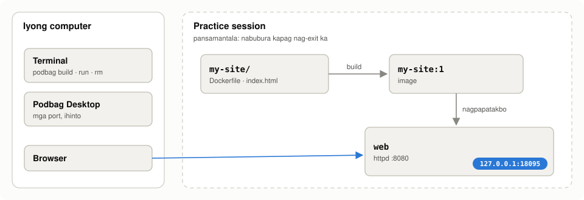

Ang Dockerfile ay text file na may mga hakbang sa paggawa ng image. Binabasa ito ng `podbag build` at ito mismo ang gumagawa ng image, nang walang daemon o BuildKit. Sa module na ito, magbu-build ka ng maliit na image ng web server, patatakbuhin ito at bubuksan ang page nito.

**Oras** 10–15 minuto.



## Simulan ang module

Kailangan mo ng build ng Podbag Desktop at ng CLI na may Training catalog. Idinagdag ito pagkatapos ng v0.3.2.

Buksan ang **Training** sa Podbag Desktop at piliin ang **Mag-build ng image mula sa Dockerfile**. Lalabas ang mga bagong module pagkatapos ng **I-refresh**. O patakbuhin ang command na ito sa terminal:

```sh
podbag lab start image-build
```

Magpatuloy sa prompt na `training $`.

Para gawin ang mga hakbang sa TUI sa halip na sa Podbag Desktop, idagdag ang `--tui`.

```sh
podbag lab start image-build --tui
```

Sa TUI, pindutin ang `:` para buksan ang training shell sa isang hakbang na command. I-type ang `exit` para bumalik sa TUI. Pindutin ang `q` para tapusin ang practice session.

Naglalagay ang session ng folder na `my-site` sa practice directory. May dalawang file ito. Ang `index.html` ang page:

```text
Hello from my-site
```

May apat na hakbang ang `Dockerfile`:

```dockerfile
FROM docker.io/library/busybox:1.37.0
COPY index.html /www/index.html
EXPOSE 8080
CMD ["httpd", "-f", "-p", "8080", "-h", "/www"]
```

Pinipili ng `FROM` ang base image. Inilalagay ng `COPY` ang page sa image. Itinatala ng `EXPOSE` ang port. Ang `CMD` ang command na pinapatakbo ng container.

## I-build ang image

```sh
podbag build -t my-site:1 my-site
```

Ang huling salita, `my-site`, ang build context. Ito ang folder na binabasa ng `COPY`. Binibigyan ng `-t` ng pangalan ang image. Kinukuha ng podbag ang base image at ipinapakita ang bawat hakbang. Sinusuri ng Podbag na may image na `my-site:1`.

## Mag-build ulit gamit ang cache

Patakbuhin ulit ang parehong command.

```sh
podbag build -t my-site:1 my-site
```

Itinatago ng podbag ang resulta ng bawat hakbang. Walang nagbago, kaya ipinapakita ng hakbang na `COPY` ang `Using cache`. Hinahanap ng Podbag ang mga salitang ito sa output. Kapag binago mo ang `index.html`, tatakbo ulit ang hakbang na iyon.

## Patakbuhin ang bagong image

Magpatakbo ng container na `web` mula sa image. Gamitin ang port na nasa Training kung gamit na ang default na `18095`.

```sh
podbag run -d --name web -p 127.0.0.1:18095:8080 my-site:1
```

Wala kang ibinibigay na command. Pinapatakbo ng container ang `CMD` mula sa Dockerfile. Sinusuri ng Podbag na tumatakbo ang `web`, nagpa-publish ito ng port at ipinapakita nito ang **Hello from my-site**.

## Buksan ang page sa Desktop

Pumunta sa **Mga practice container → web → Tingnan ang mga port**. Piliin ang **Buksan sa browser**. Ipinapakita ng page ang **Hello from my-site**. Sinusuri ng Podbag kung may tugon na HTTP 200 at ang text na ito.

- **Sa Podbag Desktop:** Piliin ang **Mga practice container → web → Tingnan ang mga port**.
- **Sa TUI:** Piliin ang `web` sa **Mga container** at pindutin ang `Enter`.
- **Sa Podbag Desktop:** Piliin ang **Buksan sa browser**.
- **Sa TUI:** Buksan ang `http://127.0.0.1:18095/` sa browser. Kapag lumabas ang page, pindutin ang `o`.

## Maglinis at tapusin

Sa Desktop, piliin ang **Mga practice container → web → Ihinto**. Pagkatapos, alisin ang container at ang image sa parehong terminal.

- **Sa Podbag Desktop:** Piliin ang **Mga practice container → web → Ihinto**.
- **Sa TUI:** Piliin ang `web` sa **Mga container** at pindutin ang `x`.
- **Sa Podbag Desktop:** Piliin ang **Mga practice container → web → Alisin** at kumpirmahin.
- **Sa TUI:** Piliin ang `web` sa **Mga container**, pindutin ang `d`, saka ang `y`.
- **Sa Podbag Desktop:** Piliin ang **Mga practice container → Alisin ang image na my-site:1** at kumpirmahin.
- **Sa TUI:** Piliin ang `my-site:1` sa **Mga image**, pindutin ang `d`, saka ang `y`.

```sh
podbag rm web
podbag rmi my-site:1
exit
```

Naaalis ang pansamantalang practice session. Ipinapakita ng Training na tapos na ang module.
