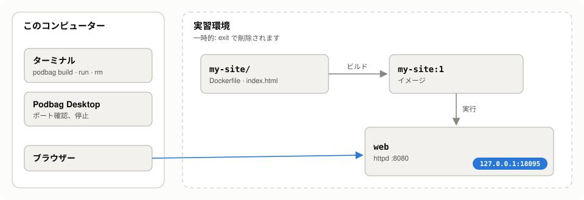

Dockerfile は、イメージを作る手順を書いたテキストファイルです。`podbag build` はこのファイルを読み、デーモンや BuildKit を使わずに自分でイメージを作ります。このモジュールでは、小さな Web サーバーのイメージをビルドして実行し、そのページを開きます。

**所要時間** 10〜15 分。



## モジュールを開始する

Training カタログがある Podbag Desktop と CLI のビルドが必要です。カタログは v0.3.2 より後に追加されました。

Podbag Desktop で **Training** を開き、**Dockerfile からイメージをビルドする**を選びます。新しいモジュールは**更新**の後に表示されます。ターミナルで次のコマンドを実行しても開始できます。

```sh
podbag lab start image-build
```

`training $` プロンプトが表示されたら続けます。

Podbag Desktop の代わりに TUI で手順を進めるには、`--tui` を付けます。

```sh
podbag lab start image-build --tui
```

TUI では、コマンドの手順で `:` を押すと Training シェルが開きます。`exit` と入力すると TUI に戻ります。`q` を押すと実習を終了します。

実習環境は、実習用のディレクトリに `my-site` というフォルダーを置きます。このフォルダーには 2 つのファイルがあります。`index.html` はページです。

```text
Hello from my-site
```

`Dockerfile` には 4 つの手順があります。

```dockerfile
FROM docker.io/library/busybox:1.37.0
COPY index.html /www/index.html
EXPOSE 8080
CMD ["httpd", "-f", "-p", "8080", "-h", "/www"]
```

`FROM` はベースイメージを選びます。`COPY` はページをイメージに入れます。`EXPOSE` はポートを記録します。`CMD` はコンテナが実行するコマンドです。

## イメージをビルドする

```sh
podbag build -t my-site:1 my-site
```

最後の語 `my-site` はビルドコンテキストです。`COPY` がファイルを読むフォルダーです。`-t` はイメージに名前を付けます。podbag はベースイメージを取得し、各手順を表示します。Podbag はイメージ `my-site:1` があることを確認します。

## キャッシュを使ってもう一度ビルドする

同じコマンドをもう一度実行します。

```sh
podbag build -t my-site:1 my-site
```

podbag は各手順の結果を保存しています。何も変わっていないので、`COPY` の手順に `Using cache` と表示されます。Podbag は出力にこの語があることを確認します。`index.html` を変更すると、その手順はもう一度実行されます。

## 新しいイメージを実行する

このイメージから `web` という名前のコンテナを実行します。既定の `18095` がすでに使われている場合は、Training に表示されるポートを使います。

```sh
podbag run -d --name web -p 127.0.0.1:18095:8080 my-site:1
```

コマンドは指定しません。コンテナは Dockerfile の `CMD` を実行します。Podbag は、`web` が実行中で、ポートを公開し、**Hello from my-site** と表示することを確認します。

## Desktop でページを開く

**実習コンテナ → web → ポートを表示**に移動します。**ブラウザーで開く**を選びます。ページに **Hello from my-site** と表示されます。Podbag は、HTTP 200 の応答とこのテキストを確認します。

- **Podbag Desktop で:** **実習コンテナ → web → ポートを表示**を選びます。
- **TUI で:** **コンテナ**で `web` を選び、`Enter` を押します。
- **Podbag Desktop で:** **ブラウザーで開く**を選びます。
- **TUI で:** ブラウザーで `http://127.0.0.1:18095/` を開きます。ページが表示されたら `o` を押します。

## 片付けて終了する

Desktop で**実習コンテナ → web → 停止**を選びます。次に、同じターミナルでコンテナとイメージを削除します。

- **Podbag Desktop で:** **実習コンテナ → web → 停止**を選びます。
- **TUI で:** **コンテナ**で `web` を選び、`x` を押します。
- **Podbag Desktop で:** **実習コンテナ → web → 削除**を選び、確認します。
- **TUI で:** **コンテナ**で `web` を選び、`d` を押してから `y` を押します。
- **Podbag Desktop で:** **実習コンテナ → イメージ my-site:1 を削除**を選び、確認します。
- **TUI で:** **イメージ**で `my-site:1` を選び、`d` を押してから `y` を押します。

```sh
podbag rm web
podbag rmi my-site:1
exit
```

一時的な実習環境が削除されます。Training にモジュールの完了が表示されます。
