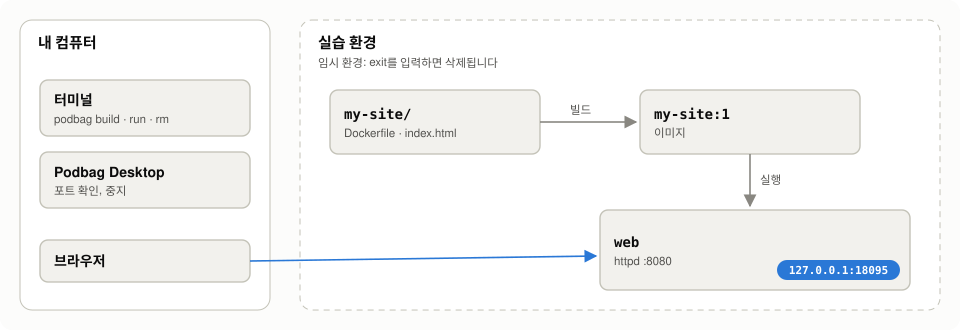

Dockerfile은 이미지를 만드는 단계를 적은 텍스트 파일입니다. `podbag build`는 이 파일을 읽고 데몬이나 BuildKit 없이 직접 이미지를 만듭니다. 이번 트레이닝에서는 작은 웹 서버 이미지를 빌드하고 실행한 뒤 페이지를 엽니다.

**예상 시간** 10~15분.



## 실습 시작

Training 카탈로그가 들어 있는 Podbag Desktop과 CLI가 필요합니다. 이 기능은 v0.3.2 이후에 추가됐습니다.

Podbag Desktop에서 **Training**을 열고 **Dockerfile로 이미지 빌드하기**를 선택합니다. 새 모듈은 **새로 고침**을 누르면 나타납니다. 터미널에서 다음 명령을 실행해도 됩니다.

```sh
podbag lab start image-build
```

`training $` 프롬프트에서 계속 진행합니다.

Podbag Desktop 대신 TUI에서 실습하려면 `--tui`를 붙입니다.

```sh
podbag lab start image-build --tui
```

TUI에서는 `:` 키로 명령 단계용 Training 셸을 열고, `exit`를 입력해 TUI로 돌아오며, `q` 키로 실습을 끝냅니다.

실습 디렉터리에는 `my-site` 폴더가 있습니다. 이 폴더에는 파일이 두 개 있습니다. `index.html`은 페이지입니다.

```text
Hello from my-site
```

`Dockerfile`에는 단계가 네 개 있습니다.

```dockerfile
FROM docker.io/library/busybox:1.37.0
COPY index.html /www/index.html
EXPOSE 8080
CMD ["httpd", "-f", "-p", "8080", "-h", "/www"]
```

`FROM`은 기반 이미지를 고릅니다. `COPY`는 페이지를 이미지에 넣습니다. `EXPOSE`는 포트를 적어 둡니다. `CMD`는 컨테이너가 실행할 명령입니다.

## 이미지 빌드하기

```sh
podbag build -t my-site:1 my-site
```

마지막 단어 `my-site`는 빌드 컨텍스트입니다. `COPY`가 파일을 읽는 폴더입니다. `-t`는 이미지에 이름을 붙입니다. podbag은 기반 이미지를 내려받고 각 단계를 출력합니다. Podbag은 `my-site:1` 이미지가 있는지 확인합니다.

## 캐시로 다시 빌드하기

같은 명령을 다시 실행합니다.

```sh
podbag build -t my-site:1 my-site
```

podbag은 단계마다 결과를 보관합니다. 바뀐 것이 없으므로 `COPY` 단계에 `Using cache`가 출력됩니다. Podbag은 출력에 이 문구가 있는지 확인합니다. `index.html`을 바꾸면 이 단계를 다시 실행합니다.

## 새 이미지 실행하기

이 이미지로 `web` 컨테이너를 실행합니다. 기본 포트 `18095`를 이미 사용 중이면 Training에 표시된 포트를 사용합니다.

```sh
podbag run -d --name web -p 127.0.0.1:18095:8080 my-site:1
```

명령을 따로 주지 않습니다. 컨테이너는 Dockerfile의 `CMD`를 실행합니다. Podbag은 `web`이 실행 중인지, 포트를 공개했는지, **Hello from my-site**를 보여 주는지 확인합니다.

## Desktop에서 페이지 열기

**실습 컨테이너 → web → 포트 보기**로 이동합니다. **브라우저에서 열기**를 선택합니다. 페이지에 **Hello from my-site**가 표시됩니다. Podbag은 HTTP 200 응답과 이 문구를 확인합니다.

- **Podbag Desktop에서:** **실습 컨테이너 → web → 포트 보기**를 누릅니다.
- **TUI에서:** **컨테이너**에서 `web` 선택 후 `Enter` 키를 누릅니다.
- **Podbag Desktop에서:** **브라우저에서 열기**를 누릅니다.
- **TUI에서:** 브라우저에서 `http://127.0.0.1:18095/` 주소를 엽니다. 페이지가 보이면 `o` 키를 누릅니다.

## 정리 및 실습 종료

Desktop에서 **실습 컨테이너 → web → 중지**를 선택합니다. 그다음 같은 터미널에서 컨테이너와 이미지를 삭제합니다.

- **Podbag Desktop에서:** **실습 컨테이너 → web → 중지**를 누릅니다.
- **TUI에서:** **컨테이너**에서 `web` 선택 후 `x` 키를 누릅니다.
- **Podbag Desktop에서:** **실습 컨테이너 → web → 삭제**를 누르고 확인합니다.
- **TUI에서:** **컨테이너**에서 `web` 선택 후 `d` 키, `y` 키를 차례로 누릅니다.
- **Podbag Desktop에서:** **실습 컨테이너 → 이미지 my-site:1 삭제**를 누르고 확인합니다.
- **TUI에서:** **이미지**에서 `my-site:1` 선택 후 `d` 키, `y` 키를 차례로 누릅니다.

```sh
podbag rm web
podbag rmi my-site:1
exit
```

임시 실습 환경이 삭제됩니다. Training에 모듈이 완료됨으로 표시됩니다.
