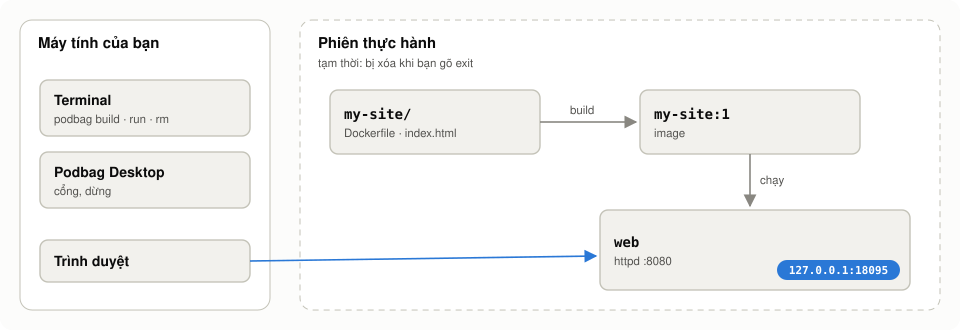

Dockerfile là tệp văn bản chứa các bước để tạo image. `podbag build` đọc tệp này và tự tạo image, không cần daemon hay BuildKit. Trong mô-đun này, bạn build image của một máy chủ web nhỏ, chạy nó và mở trang của nó.

**Thời gian** 10–15 phút.



## Bắt đầu mô-đun

Bạn cần bản Podbag Desktop và CLI có danh mục Training. Danh mục này được thêm sau v0.3.2.

Mở **Training** trong Podbag Desktop và chọn **Build image từ Dockerfile**. Mô-đun mới xuất hiện sau khi chọn **Làm mới**. Hoặc chạy lệnh này trong terminal:

```sh
podbag lab start image-build
```

Tiếp tục tại dấu nhắc `training $`. Phiên thực hành đặt một thư mục tên `my-site` vào thư mục thực hành. Thư mục này có hai tệp. `index.html` là trang web:

```text
Hello from my-site
```

`Dockerfile` có bốn bước:

```dockerfile
FROM docker.io/library/busybox:1.37.0
COPY index.html /www/index.html
EXPOSE 8080
CMD ["httpd", "-f", "-p", "8080", "-h", "/www"]
```

`FROM` chọn image nền. `COPY` đưa trang web vào image. `EXPOSE` ghi chú cổng. `CMD` là lệnh mà container chạy.

## Build image

```sh
podbag build -t my-site:1 my-site
```

Từ cuối cùng, `my-site`, là build context: thư mục mà `COPY` đọc tệp từ đó. `-t` đặt tên cho image. podbag kéo image nền và in từng bước. Podbag kiểm tra rằng image `my-site:1` đã có.

## Build lại bằng cache

Chạy lại cùng lệnh đó.

```sh
podbag build -t my-site:1 my-site
```

podbag giữ kết quả của từng bước. Không có gì thay đổi, nên bước `COPY` in `Using cache`. Podbag tìm các từ này trong kết quả. Khi bạn sửa `index.html`, bước đó sẽ chạy lại.

## Chạy image mới

Chạy một container tên `web` từ image này. Nếu cổng mặc định `18095` đang được dùng, hãy dùng cổng hiển thị trong Training.

```sh
podbag run -d --name web -p 127.0.0.1:18095:8080 my-site:1
```

Bạn không đưa lệnh nào. Container chạy `CMD` trong Dockerfile. Podbag kiểm tra rằng `web` đang chạy, công bố cổng và hiển thị **Hello from my-site**.

## Mở trang trong Desktop

Đi tới **Container thực hành → web → Xem cổng**. Chọn **Mở trong trình duyệt**. Trang hiển thị **Hello from my-site**. Podbag kiểm tra phản hồi HTTP 200 và dòng chữ này.

## Dọn dẹp và kết thúc

Trong Desktop, chọn **Container thực hành → web → Dừng**. Sau đó xóa container và image trong cùng terminal.

```sh
podbag rm web
podbag rmi my-site:1
exit
```

Phiên thực hành tạm thời đã được xóa. Training hiển thị mô-đun đã hoàn thành.
