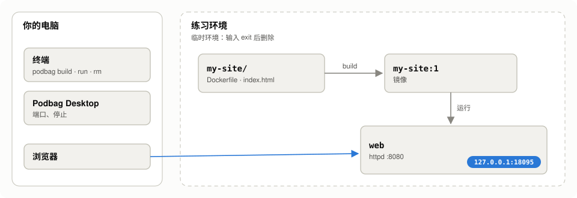

Dockerfile 是一个文本文件，写着制作镜像的步骤。`podbag build` 读取它并自己制作镜像，不需要守护进程，也不需要 BuildKit。在本模块中，你将构建一个小型 Web 服务器镜像，运行它并打开它的页面。

**预计用时** 10–15 分钟。



## 开始模块

需要带有 Training 目录的 Podbag Desktop 和 CLI 版本。该目录在 v0.3.2 之后加入。

在 Podbag Desktop 中打开 **Training**，选择**用 Dockerfile 构建镜像**。点击**刷新**后会出现新模块。也可以在终端中运行以下命令：

```sh
podbag lab start image-build
```

出现 `training $` 提示符后继续。实验会在练习目录中放入一个名为 `my-site` 的文件夹。其中有两个文件。`index.html` 是页面：

```text
Hello from my-site
```

`Dockerfile` 有四个步骤：

```dockerfile
FROM docker.io/library/busybox:1.37.0
COPY index.html /www/index.html
EXPOSE 8080
CMD ["httpd", "-f", "-p", "8080", "-h", "/www"]
```

`FROM` 选择基础镜像。`COPY` 把页面放入镜像。`EXPOSE` 标明端口。`CMD` 是容器要运行的命令。

## 构建镜像

```sh
podbag build -t my-site:1 my-site
```

最后一个词 `my-site` 是构建上下文，也就是 `COPY` 读取文件的文件夹。`-t` 为镜像命名。podbag 会拉取基础镜像，并打印每个步骤。Podbag 会检查镜像 `my-site:1` 是否存在。

## 利用缓存再次构建

再次运行同一条命令。

```sh
podbag build -t my-site:1 my-site
```

podbag 会保存每个步骤的结果。由于没有任何变化，`COPY` 步骤会打印 `Using cache`。Podbag 会检查输出中是否有这些词。如果修改了 `index.html`，这个步骤会重新运行。

## 运行新镜像

用这个镜像运行一个名为 `web` 的容器。如果默认端口 `18095` 已被占用，请使用 Training 中显示的端口。

```sh
podbag run -d --name web -p 127.0.0.1:18095:8080 my-site:1
```

这里没有指定命令。容器会运行 Dockerfile 中的 `CMD`。Podbag 会检查 `web` 是否正在运行、是否发布了端口，以及是否显示 **Hello from my-site**。

## 在 Desktop 中打开页面

前往**实验容器 → web → 查看端口**。点击**在浏览器中打开**。页面显示 **Hello from my-site**。Podbag 会检查 HTTP 200 响应和这段文字。

## 清理并结束

在 Desktop 中选择**实验容器 → web → 停止**。然后在同一个终端中删除容器和镜像。

```sh
podbag rm web
podbag rmi my-site:1
exit
```

临时练习环境会被删除。Training 会显示该模块已完成。
