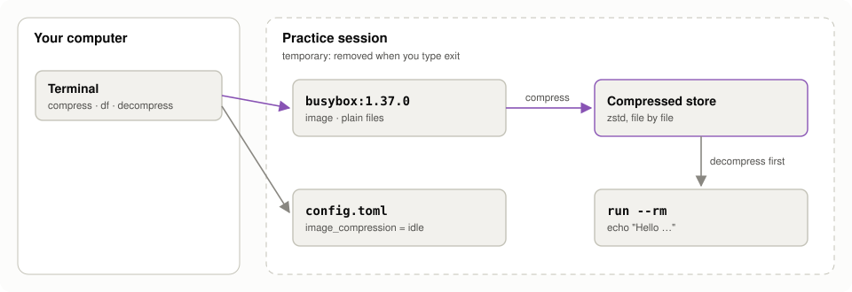

Images that you do not use still take disk space. Podbag can compress them. It compresses each stored file with zstd, a fast compression method. A container that needs the image decompresses it first. In this module, you compress an image, use it, and turn on automatic compression.

**Time** 10 minutes.



## Start the module

Open **Training** in Podbag Desktop and select **Compress unused images**. New modules appear after **Refresh**. Or run this command in a terminal:

```sh
podbag lab start image-compression
```

You need a Podbag build with image compression (after v0.3.2). Continue at the `training $` prompt.

## Pull the busybox image

The practice session starts with no images. Pull a small one.

```sh
podbag pull docker.io/library/busybox:1.37.0
```

Podbag checks that the image is there.

## Compress the image

`podbag system compress` compresses the images that you name. No container uses busybox now, so it can be compressed.

```sh
podbag system compress docker.io/library/busybox:1.37.0
```

The output shows the size before and after, for example `Compressed 1 images: 4.1MB → 2.6MB`. The sizes depend on your CPU type. Podbag checks for `Compressed 1 images`.

An image that a container uses is not compressed. The command says so and continues with the other images.

## Read the Compressed row

```sh
podbag system df
```

The **Compressed** row counts the compressed files. It shows their size on disk, and in brackets the size before. Files that two images share stay shared, so they are compressed once. Podbag checks for the `Compressed` row.

## Run a container from the compressed image

```sh
podbag run --rm docker.io/library/busybox:1.37.0 echo "Hello from a compressed image"
```

Podbag decompresses the image first, and then starts the container. Only this first start is slower. Podbag checks that the output is `Hello from a compressed image`.

## See that the image is decompressed

```sh
podbag system df
```

The **Compressed** row now shows `0B (0B before)`. The run decompressed the image, and it stays that way. Podbag checks for `0B (0B before)`.

## Compress the image again

```sh
podbag system compress docker.io/library/busybox:1.37.0
```

Podbag checks for `Compressed 1 images` again.

## Decompress the image now

You can also decompress an image before you need it. Then its next container starts at once.

```sh
podbag system decompress docker.io/library/busybox:1.37.0
```

Podbag checks for `Decompressed 1 images`.

## Show the compression setting

```sh
podbag system compression
```

Image compression is off by default. The output is `Image compression: off`. Podbag checks for `Image compression:`.

## Turn on idle compression

With the mode `idle`, Podbag compresses images that no container used for a while. It does this a little after `pull`, `load`, `build`, `rmi` and `prune`. `--after` sets how long an image stays unused first. The default is 7 days.

```sh
podbag system compression idle --after 3d
```

The output is `Image compression: idle (images unused for 3d)`. Podbag checks for this line. The setting goes into the practice session's `config.toml`, so your own setting does not change. `podbag system compression off` turns it off again.

## Finish

```sh
exit
```

The temporary practice session is removed. Training shows the module as complete.
