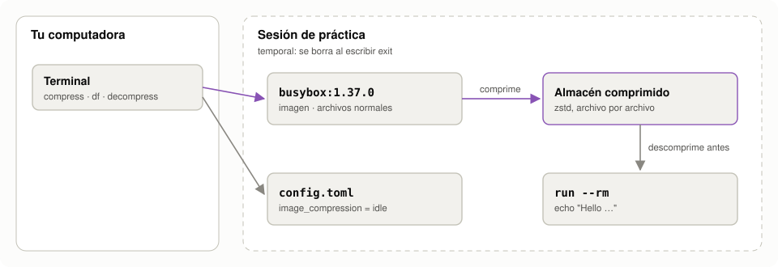

Las imágenes que no usas siguen ocupando espacio en disco. Podbag puede comprimirlas. Comprime cada archivo guardado con zstd, un método de compresión rápido. Un contenedor que necesita la imagen la descomprime primero. En este módulo, comprimes una imagen, la usas y activas la compresión automática.

**Tiempo** 10 minutos.



## Inicia el módulo

Abre **Training** en Podbag Desktop y selecciona **Comprime las imágenes que no usas**. Los módulos nuevos aparecen después de **Actualizar**. O ejecuta este comando en una terminal:

```sh
podbag lab start image-compression
```

Necesitas una versión de Podbag con compresión de imágenes (después de v0.3.2). Continúa en el prompt `training $`.

Para hacer los pasos en la TUI en lugar de Podbag Desktop, añade `--tui`.

```sh
podbag lab start image-compression --tui
```

En la TUI, pulsa `:` para abrir la shell de Training cuando un paso pida un comando, escribe `exit` para volver a la TUI y pulsa `q` para terminar la sesión.

## Descarga la imagen busybox

La sesión de práctica empieza sin imágenes. Descarga una pequeña.

```sh
podbag pull docker.io/library/busybox:1.37.0
```

- **En Podbag Desktop:** Selecciona **Contenedores de práctica → Descargar docker.io/library/busybox:1.37.0**.
- **En la TUI:** Abre **Imágenes**, pulsa `p`, escribe `docker.io/library/busybox:1.37.0` y pulsa `Enter`.

Podbag comprueba que la imagen está ahí.

## Comprime la imagen

`podbag system compress` comprime las imágenes que nombras. Ningún contenedor usa busybox ahora, así que se puede comprimir.

```sh
podbag system compress docker.io/library/busybox:1.37.0
```

La salida muestra el tamaño antes y después, por ejemplo `Compressed 1 images: 4.1MB → 2.6MB`. Los tamaños dependen del tipo de tu CPU. Podbag busca `Compressed 1 images`.

Una imagen que usa un contenedor no se comprime. El comando lo indica y continúa con las otras imágenes.

## Lee la fila Compressed

```sh
podbag system df
```

La fila **Compressed** cuenta los archivos comprimidos. Muestra su tamaño en disco y, entre paréntesis, el tamaño de antes. Los archivos que comparten dos imágenes siguen compartidos, así que se comprimen una sola vez. Podbag busca la fila `Compressed`.

## Ejecuta un contenedor con la imagen comprimida

```sh
podbag run --rm docker.io/library/busybox:1.37.0 echo "Hello from a compressed image"
```

Podbag descomprime primero la imagen y después inicia el contenedor. Solo este primer inicio es más lento. Podbag comprueba que la salida es `Hello from a compressed image`.

## Comprueba que la imagen ya no está comprimida

```sh
podbag system df
```

La fila **Compressed** ahora muestra `0B (0B before)`. La ejecución descomprimió la imagen, y se queda así. Podbag busca `0B (0B before)`.

## Vuelve a comprimir la imagen

```sh
podbag system compress docker.io/library/busybox:1.37.0
```

Podbag busca `Compressed 1 images` otra vez.

## Descomprime la imagen ahora

También puedes descomprimir una imagen antes de necesitarla. Así, su siguiente contenedor se inicia enseguida.

```sh
podbag system decompress docker.io/library/busybox:1.37.0
```

Podbag busca `Decompressed 1 images`.

## Muestra el ajuste de compresión

```sh
podbag system compression
```

La compresión de imágenes está desactivada por defecto. La salida es `Image compression: off`. Podbag busca `Image compression:`.

## Activa la compresión idle

Con el modo `idle` (en reposo), Podbag comprime las imágenes que ningún contenedor usó durante un tiempo. Lo hace un poco después de `pull`, `load`, `build`, `rmi` y `prune`. `--after` indica cuánto tiempo debe estar sin uso una imagen antes. El valor por defecto es 7 días.

```sh
podbag system compression idle --after 3d
```

La salida es `Image compression: idle (images unused for 3d)`. Podbag busca esta línea. El ajuste se guarda en el `config.toml` de la sesión de práctica, así que tu propio ajuste no cambia. `podbag system compression off` lo desactiva otra vez.

## Termina

```sh
exit
```

Se elimina la sesión de práctica temporal. Training muestra el módulo como completado.
