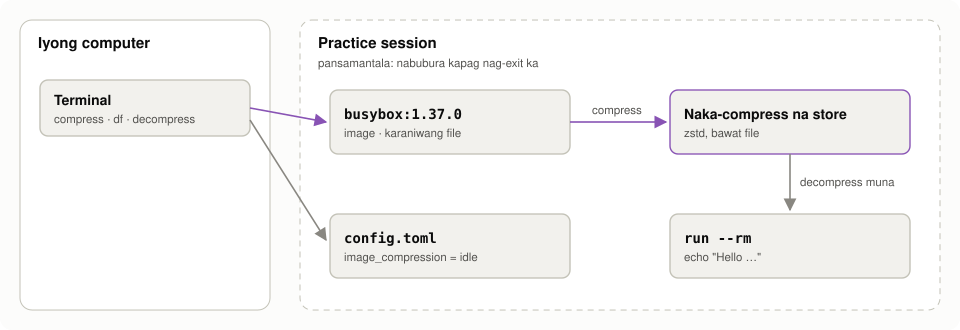

Kumukuha pa rin ng espasyo sa disk ang mga image na hindi mo ginagamit. Kayang i-compress ng Podbag ang mga ito. Kino-compress nito ang bawat nakaimbak na file gamit ang zstd, isang mabilis na paraan ng compression. Kapag may container na nangangailangan ng image, dine-decompress muna ito. Sa module na ito, magko-compress ka ng image, gagamitin mo ito, at io-on mo ang awtomatikong compression.

**Oras** 10 minuto.



## Simulan ang module

Buksan ang **Training** sa Podbag Desktop at piliin ang **I-compress ang mga image na hindi ginagamit**. Lalabas ang mga bagong module pagkatapos ng **I-refresh**. O patakbuhin ang command na ito sa terminal:

```sh
podbag lab start image-compression
```

Kailangan mo ng build ng Podbag na may image compression (pagkatapos ng v0.3.2). Magpatuloy sa prompt na `training $`.

Para gawin ang mga hakbang sa TUI sa halip na sa Podbag Desktop, idagdag ang `--tui`.

```sh
podbag lab start image-compression --tui
```

Sa TUI, pindutin ang `:` para buksan ang training shell sa isang hakbang na command. I-type ang `exit` para bumalik sa TUI. Pindutin ang `q` para tapusin ang practice session.

## I-pull ang image na busybox

Walang image ang practice session sa simula. Mag-pull ng maliit na image.

```sh
podbag pull docker.io/library/busybox:1.37.0
```

- **Sa Podbag Desktop:** Piliin ang **Mga practice container → I-pull ang docker.io/library/busybox:1.37.0**.
- **Sa TUI:** Buksan ang **Mga image**, pindutin ang `p`, i-type ang `docker.io/library/busybox:1.37.0` at pindutin ang `Enter`.

Sinusuri ng Podbag na nandoon ang image.

## I-compress ang image

Kino-compress ng `podbag system compress` ang mga image na pinangalanan mo. Walang container na gumagamit ng busybox ngayon, kaya maaari itong i-compress.

```sh
podbag system compress docker.io/library/busybox:1.37.0
```

Ipinapakita ng output ang laki bago at pagkatapos, halimbawa `Compressed 1 images: 4.1MB → 2.6MB`. Depende sa uri ng CPU mo ang mga laki. Hinahanap ng Podbag ang `Compressed 1 images`.

Hindi kino-compress ang image na ginagamit ng container. Sasabihin ito ng command at magpapatuloy ito sa iba pang image.

## Basahin ang Compressed na row

```sh
podbag system df
```

Binibilang ng row na **Compressed** ang mga naka-compress na file. Ipinapakita nito ang laki ng mga ito sa disk, at sa loob ng panaklong ang laki bago i-compress. Nananatiling pinagsasaluhan ang mga file na ginagamit ng dalawang image, kaya minsan lang ang mga ito kino-compress. Hinahanap ng Podbag ang row na `Compressed`.

## Magpatakbo ng container mula sa naka-compress na image

```sh
podbag run --rm docker.io/library/busybox:1.37.0 echo "Hello from a compressed image"
```

Dine-decompress muna ng Podbag ang image, at saka sinisimulan ang container. Ang unang simulang ito lang ang mas mabagal. Sinusuri ng Podbag na `Hello from a compressed image` ang output.

## Tingnan na na-decompress na ang image

```sh
podbag system df
```

Ipinapakita na ngayon ng row na **Compressed** ang `0B (0B before)`. Na-decompress ng pagpapatakbo ang image, at ganoon na ito mananatili. Hinahanap ng Podbag ang `0B (0B before)`.

## I-compress ulit ang image

```sh
podbag system compress docker.io/library/busybox:1.37.0
```

Hinahanap ulit ng Podbag ang `Compressed 1 images`.

## I-decompress ngayon ang image

Maaari mo ring i-decompress ang image bago mo ito kailanganin. Pagkatapos, agad na magsisimula ang susunod na container nito.

```sh
podbag system decompress docker.io/library/busybox:1.37.0
```

Hinahanap ng Podbag ang `Decompressed 1 images`.

## Ipakita ang setting ng compression

```sh
podbag system compression
```

Naka-off ang image compression bilang default. Ang output ay `Image compression: off`. Hinahanap ng Podbag ang `Image compression:`.

## I-on ang idle compression

Sa mode na `idle`, kino-compress ng Podbag ang mga image na hindi ginamit ng anumang container sa loob ng ilang panahon. Ginagawa nito ito sandali pagkatapos ng `pull`, `load`, `build`, `rmi` at `prune`. Itinatakda ng `--after` kung gaano katagal munang hindi ginagamit ang image. Ang default ay 7 araw.

```sh
podbag system compression idle --after 3d
```

Ang output ay `Image compression: idle (images unused for 3d)`. Hinahanap ng Podbag ang linyang ito. Napupunta ang setting sa `config.toml` ng practice session, kaya hindi nagbabago ang sarili mong setting. Ino-off ito ulit ng `podbag system compression off`.

## Tapusin

```sh
exit
```

Naaalis ang pansamantalang practice session. Ipinapakita ng Training na tapos na ang module.
