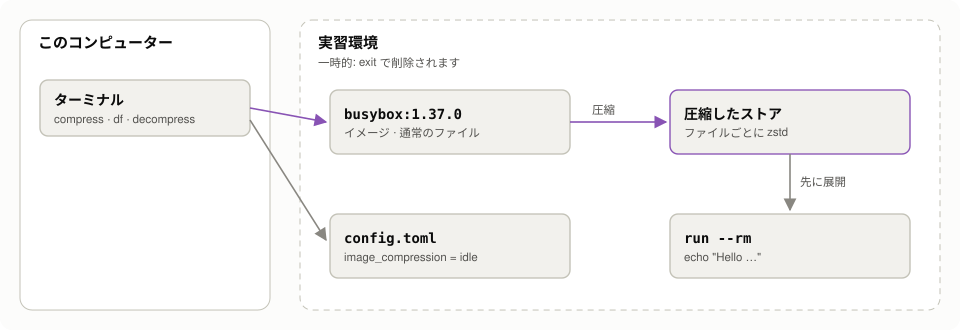

使っていないイメージも、ディスクの容量を使います。Podbag はそのようなイメージを圧縮できます。保存されたファイルを 1 つずつ zstd で圧縮します。zstd は高速な圧縮方式です。イメージが必要なコンテナーは、先に圧縮を解きます。このモジュールでは、イメージを圧縮して使い、自動圧縮をオンにします。

**所要時間** 10 分。



## モジュールを開始する

Podbag Desktop で **Training** を開き、**使っていないイメージを圧縮する**を選びます。新しいモジュールは**更新**の後に表示されます。ターミナルで次のコマンドを実行しても開始できます。

```sh
podbag lab start image-compression
```

イメージ圧縮に対応した Podbag のビルドが必要です(v0.3.2 より後)。`training $` プロンプトが表示されたら続けます。

## busybox イメージを取得する

実習環境には、最初はイメージがありません。小さなイメージを取得します。

```sh
podbag pull docker.io/library/busybox:1.37.0
```

Podbag はイメージがあることを確認します。

## イメージを圧縮する

`podbag system compress` は、指定したイメージを圧縮します。今は busybox を使うコンテナーがないので、圧縮できます。

```sh
podbag system compress docker.io/library/busybox:1.37.0
```

出力に圧縮の前後のサイズが表示されます。例: `Compressed 1 images: 4.1MB → 2.6MB`。サイズは CPU の種類によって変わります。Podbag は `Compressed 1 images` があることを確認します。

コンテナーが使っているイメージは圧縮されません。コマンドはそのことを表示し、ほかのイメージを続けて処理します。

## system df の Compressed 行を読む

```sh
podbag system df
```

**Compressed** 行は、圧縮されたファイルの数を表します。ディスク上のサイズと、かっこの中に圧縮前のサイズが表示されます。2 つのイメージが共有するファイルは共有されたままなので、1 回だけ圧縮されます。Podbag は `Compressed` 行があることを確認します。

## 圧縮したイメージでコンテナーを実行する

```sh
podbag run --rm docker.io/library/busybox:1.37.0 echo "Hello from a compressed image"
```

Podbag は先にイメージの圧縮を解き、それからコンテナーを起動します。遅くなるのは、この最初の起動だけです。Podbag は出力が `Hello from a compressed image` であることを確認します。

## イメージが展開されたことを確認する

```sh
podbag system df
```

**Compressed** 行は `0B (0B before)` になります。コンテナーの実行でイメージの圧縮が解かれ、そのままになります。Podbag は `0B (0B before)` があることを確認します。

## イメージをもう一度圧縮する

```sh
podbag system compress docker.io/library/busybox:1.37.0
```

Podbag は、もう一度 `Compressed 1 images` があることを確認します。

## イメージを今すぐ展開する

イメージが必要になる前に、圧縮を解くこともできます。そうすると、次のコンテナーはすぐに起動します。

```sh
podbag system decompress docker.io/library/busybox:1.37.0
```

Podbag は `Decompressed 1 images` があることを確認します。

## 圧縮の設定を表示する

```sh
podbag system compression
```

イメージ圧縮は、初期状態ではオフです。出力は `Image compression: off` です。Podbag は `Image compression:` があることを確認します。

## idle 圧縮をオンにする

モード `idle` では、しばらくどのコンテナーも使わなかったイメージを Podbag が圧縮します。圧縮は、`pull`、`load`、`build`、`rmi`、`prune` の少し後に行われます。`--after` は、イメージを何日使わないと圧縮するかを決めます。初期値は 7 日です。

```sh
podbag system compression idle --after 3d
```

出力は `Image compression: idle (images unused for 3d)` です。Podbag はこの行があることを確認します。設定は実習環境の `config.toml` に入るので、お使いの設定は変わりません。`podbag system compression off` で、もう一度オフにできます。

## 実習を終了する

```sh
exit
```

一時的な実習環境が削除されます。Training にモジュールの完了が表示されます。
