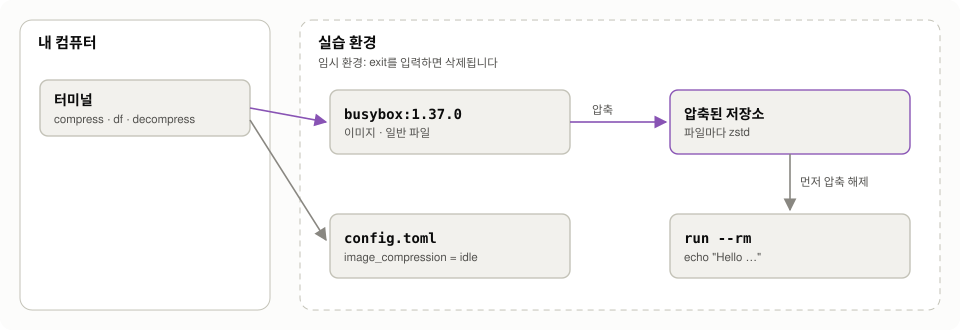

쓰지 않는 이미지도 디스크 공간을 차지합니다. Podbag은 이런 이미지를 압축할 수 있습니다. 저장된 파일을 하나씩 zstd로 압축합니다. zstd는 빠른 압축 방식입니다. 이미지가 필요한 컨테이너는 먼저 압축을 풉니다. 이번 트레이닝에서는 이미지를 압축하고, 사용하고, 자동 압축을 켭니다.

**예상 시간** 10분.



## 실습 시작

Podbag Desktop에서 **Training**을 열고 **쓰지 않는 이미지 압축하기**를 선택합니다. 새 모듈은 **새로 고침** 후에 나타납니다. 터미널에서 다음 명령을 실행해도 됩니다.

```sh
podbag lab start image-compression
```

이미지 압축을 지원하는 Podbag 빌드가 필요합니다(v0.3.2 이후). `training $` 프롬프트가 나오면 다음 단계로 진행합니다.

Podbag Desktop 대신 TUI에서 실습하려면 `--tui`를 붙입니다.

```sh
podbag lab start image-compression --tui
```

TUI에서는 `:` 키로 명령 단계용 Training 셸을 열고, `exit`를 입력해 TUI로 돌아오며, `q` 키로 실습을 끝냅니다.

## busybox 이미지 받기

실습 환경에는 처음에 이미지가 없습니다. 작은 이미지를 받습니다.

```sh
podbag pull docker.io/library/busybox:1.37.0
```

- **Podbag Desktop에서:** **실습 컨테이너 → docker.io/library/busybox:1.37.0 받기**를 누릅니다.
- **TUI에서:** **이미지** 탭을 열고 `p` 키를 누른 뒤 `docker.io/library/busybox:1.37.0` 입력 후 `Enter` 키를 누릅니다.

Podbag은 이미지가 있는지 확인합니다.

## 이미지 압축하기

`podbag system compress`는 지정한 이미지를 압축합니다. 지금은 busybox를 쓰는 컨테이너가 없으므로 압축할 수 있습니다.

```sh
podbag system compress docker.io/library/busybox:1.37.0
```

출력에 압축 전과 후의 크기가 나옵니다. 예를 들면 `Compressed 1 images: 4.1MB → 2.6MB`입니다. 크기는 CPU 종류에 따라 다릅니다. Podbag은 `Compressed 1 images`가 있는지 확인합니다.

컨테이너가 쓰고 있는 이미지는 압축하지 않습니다. 명령은 이를 알려 주고 다른 이미지를 계속 압축합니다.

## Compressed 행 읽기

```sh
podbag system df
```

**Compressed** 행은 압축된 파일 수를 보여 줍니다. 디스크에서 차지하는 크기와, 괄호 안에 압축 전 크기도 보여 줍니다. 두 이미지가 함께 쓰는 파일은 계속 하나로 공유되므로 한 번만 압축됩니다. Podbag은 `Compressed` 행이 있는지 확인합니다.

## 압축된 이미지로 컨테이너 실행하기

```sh
podbag run --rm docker.io/library/busybox:1.37.0 echo "Hello from a compressed image"
```

Podbag은 먼저 이미지의 압축을 풀고 컨테이너를 시작합니다. 이 첫 시작만 조금 느립니다. Podbag은 출력이 `Hello from a compressed image`인지 확인합니다.

## 압축이 풀렸는지 보기

```sh
podbag system df
```

이제 **Compressed** 행에 `0B (0B before)`가 나옵니다. 실행할 때 이미지의 압축이 풀렸고, 그 상태로 남습니다. Podbag은 `0B (0B before)`가 있는지 확인합니다.

## 이미지 다시 압축하기

```sh
podbag system compress docker.io/library/busybox:1.37.0
```

Podbag은 다시 `Compressed 1 images`가 있는지 확인합니다.

## 지금 압축 풀기

필요하기 전에 미리 압축을 풀 수도 있습니다. 그러면 다음 컨테이너가 바로 시작합니다.

```sh
podbag system decompress docker.io/library/busybox:1.37.0
```

Podbag은 `Decompressed 1 images`가 있는지 확인합니다.

## 압축 설정 보기

```sh
podbag system compression
```

이미지 압축은 기본으로 꺼져 있습니다. 출력은 `Image compression: off`입니다. Podbag은 `Image compression:`이 있는지 확인합니다.

## idle 압축 켜기

`idle` 모드에서는 한동안 어떤 컨테이너도 쓰지 않은 이미지를 Podbag이 압축합니다. 압축은 `pull`, `load`, `build`, `rmi`, `prune` 후 잠시 뒤에 합니다. `--after`는 이미지가 얼마 동안 쓰이지 않아야 하는지 정합니다. 기본값은 7일입니다.

```sh
podbag system compression idle --after 3d
```

출력은 `Image compression: idle (images unused for 3d)`입니다. Podbag은 이 줄을 확인합니다. 이 설정은 실습 환경의 `config.toml`에 저장되므로 내 설정은 바뀌지 않습니다. `podbag system compression off`로 다시 끌 수 있습니다.

## 실습 종료

```sh
exit
```

임시 실습 환경이 삭제됩니다. Training에 모듈이 완료됨으로 표시됩니다.
