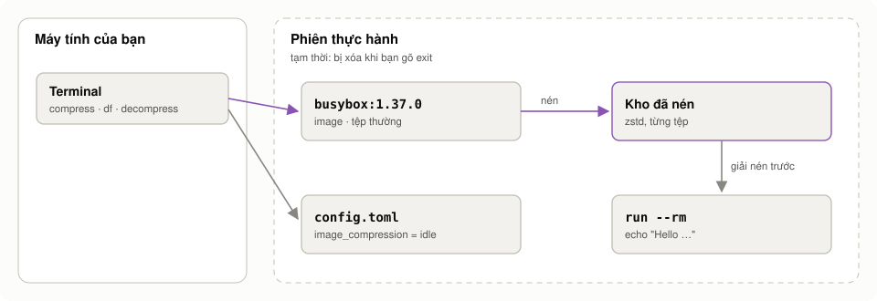

Image mà bạn không dùng vẫn chiếm dung lượng đĩa. Podbag có thể nén chúng. Podbag nén từng tệp đã lưu bằng zstd, một cách nén nhanh. Container cần image sẽ giải nén nó trước. Trong mô-đun này, bạn nén một image, dùng nó, rồi bật nén tự động.

**Thời gian** 10 phút.



## Bắt đầu mô-đun

Mở **Training** trong Podbag Desktop và chọn **Nén các image không dùng**. Mô-đun mới xuất hiện sau khi chọn **Làm mới**. Hoặc chạy lệnh này trong terminal:

```sh
podbag lab start image-compression
```

Bạn cần bản Podbag có tính năng nén image (sau v0.3.2). Tiếp tục tại dấu nhắc `training $`.

## Kéo image busybox

Phiên thực hành bắt đầu mà không có image nào. Hãy kéo một image nhỏ.

```sh
podbag pull docker.io/library/busybox:1.37.0
```

Podbag kiểm tra rằng image đã có.

## Nén image

`podbag system compress` nén các image mà bạn nêu tên. Hiện không container nào dùng busybox, nên có thể nén nó.

```sh
podbag system compress docker.io/library/busybox:1.37.0
```

Kết quả hiển thị kích thước trước và sau khi nén, ví dụ `Compressed 1 images: 4.1MB → 2.6MB`. Kích thước phụ thuộc vào loại CPU của bạn. Podbag tìm `Compressed 1 images`.

Image đang được container dùng sẽ không bị nén. Lệnh báo điều này và tiếp tục với các image khác.

## Đọc dòng Compressed

```sh
podbag system df
```

Dòng **Compressed** đếm các tệp đã nén. Nó hiển thị kích thước trên đĩa, và trong ngoặc là kích thước trước khi nén. Các tệp mà hai image dùng chung vẫn được dùng chung, nên chỉ nén một lần. Podbag tìm dòng `Compressed`.

## Chạy container từ image đã nén

```sh
podbag run --rm docker.io/library/busybox:1.37.0 echo "Hello from a compressed image"
```

Podbag giải nén image trước, rồi mới khởi động container. Chỉ lần khởi động đầu này chậm hơn. Podbag kiểm tra rằng kết quả là `Hello from a compressed image`.

## Xem image đã được giải nén

```sh
podbag system df
```

Dòng **Compressed** giờ hiển thị `0B (0B before)`. Lần chạy đã giải nén image, và image giữ nguyên như vậy. Podbag tìm `0B (0B before)`.

## Nén image lần nữa

```sh
podbag system compress docker.io/library/busybox:1.37.0
```

Podbag lại tìm `Compressed 1 images`.

## Giải nén image ngay

Bạn cũng có thể giải nén image trước khi cần. Khi đó container tiếp theo của image khởi động ngay.

```sh
podbag system decompress docker.io/library/busybox:1.37.0
```

Podbag tìm `Decompressed 1 images`.

## Xem cài đặt nén

```sh
podbag system compression
```

Theo mặc định, nén image đang tắt. Kết quả là `Image compression: off`. Podbag tìm `Image compression:`.

## Bật nén idle

Với chế độ `idle`, Podbag nén các image mà không container nào dùng trong một thời gian. Podbag làm việc này ngay sau `pull`, `load`, `build`, `rmi` và `prune`. `--after` đặt thời gian image phải không được dùng trước đó. Mặc định là 7 ngày.

```sh
podbag system compression idle --after 3d
```

Kết quả là `Image compression: idle (images unused for 3d)`. Podbag tìm dòng này. Cài đặt được ghi vào `config.toml` của phiên thực hành, nên cài đặt của bạn không đổi. `podbag system compression off` tắt lại chế độ này.

## Kết thúc

```sh
exit
```

Phiên thực hành tạm thời đã được xóa. Training hiển thị mô-đun đã hoàn thành.
