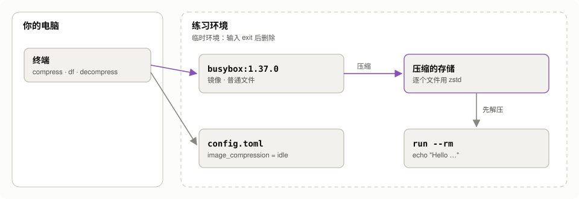

不用的镜像也会占用磁盘空间。Podbag 可以压缩它们。它用 zstd 逐个压缩已保存的文件，zstd 是一种很快的压缩方法。需要这个镜像的容器会先把它解压。在本模块中，你将压缩一个镜像、使用它，并开启自动压缩。

**预计用时** 10 分钟。



## 开始模块

在 Podbag Desktop 中打开 **Training**，选择**压缩未使用的镜像**。点击**刷新**后会出现新模块。也可以在终端中运行以下命令：

```sh
podbag lab start image-compression
```

需要支持镜像压缩的 Podbag 版本（v0.3.2 之后）。出现 `training $` 提示符后继续。

要在 TUI 而不是 Podbag Desktop 中完成这些步骤，请加上 `--tui`。

```sh
podbag lab start image-compression --tui
```

在 TUI 中，按 `:` 打开 Training 终端来执行命令步骤，输入 `exit` 返回 TUI，按 `q` 结束实验。

## 拉取 busybox 镜像

练习环境一开始没有镜像。先拉取一个小镜像。

```sh
podbag pull docker.io/library/busybox:1.37.0
```

- **在 Podbag Desktop 中：** 选择**实验容器 → 拉取 docker.io/library/busybox:1.37.0**。
- **在 TUI 中：** 打开**镜像**，按 `p`，输入 `docker.io/library/busybox:1.37.0` 并按 `Enter`。

Podbag 会检查镜像是否存在。

## 压缩镜像

`podbag system compress` 会压缩你指定的镜像。现在没有容器使用 busybox，所以可以压缩它。

```sh
podbag system compress docker.io/library/busybox:1.37.0
```

输出会显示压缩前后的大小，例如 `Compressed 1 images: 4.1MB → 2.6MB`。大小取决于你的 CPU 类型。Podbag 会检查输出中是否有 `Compressed 1 images`。

正在被容器使用的镜像不会被压缩。命令会说明这一点，并继续处理其他镜像。

## 查看 Compressed 行

```sh
podbag system df
```

**Compressed** 行统计已压缩的文件。它显示这些文件在磁盘上的大小，括号中是压缩前的大小。两个镜像共用的文件仍然只有一份，所以只压缩一次。Podbag 会检查是否有 `Compressed` 行。

## 用压缩的镜像运行容器

```sh
podbag run --rm docker.io/library/busybox:1.37.0 echo "Hello from a compressed image"
```

Podbag 先解压镜像，再启动容器。只有第一次启动会慢一些。Podbag 会检查输出是否为 `Hello from a compressed image`。

## 确认镜像已解压

```sh
podbag system df
```

现在 **Compressed** 行显示 `0B (0B before)`。运行容器时镜像已被解压，并保持解压状态。Podbag 会检查是否有 `0B (0B before)`。

## 再次压缩镜像

```sh
podbag system compress docker.io/library/busybox:1.37.0
```

Podbag 会再次检查是否有 `Compressed 1 images`。

## 立即解压镜像

你也可以在需要之前先解压镜像。这样它的下一个容器会立即启动。

```sh
podbag system decompress docker.io/library/busybox:1.37.0
```

Podbag 会检查是否有 `Decompressed 1 images`。

## 查看压缩设置

```sh
podbag system compression
```

镜像压缩默认是关闭的。输出为 `Image compression: off`。Podbag 会检查是否有 `Image compression:`。

## 开启 idle 压缩

在 `idle` 模式下，Podbag 会压缩一段时间内没有被任何容器使用的镜像。它会在 `pull`、`load`、`build`、`rmi` 和 `prune` 之后稍等片刻再压缩。`--after` 设置镜像要先闲置多久，默认是 7 天。

```sh
podbag system compression idle --after 3d
```

输出为 `Image compression: idle (images unused for 3d)`。Podbag 会检查这一行。该设置保存在练习环境的 `config.toml` 中，所以你自己的设置不会改变。用 `podbag system compression off` 可以再次关闭。

## 结束

```sh
exit
```

临时练习环境会被删除。Training 会显示该模块已完成。
