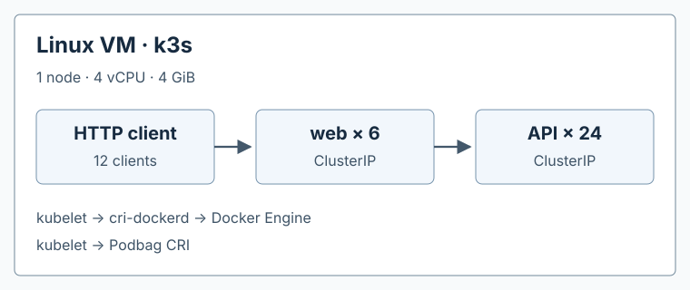

¿Cuánto tarda la aplicación en estar lista? ¿Qué cambia cuando ya atiende solicitudes? Ejecutamos la misma aplicación en un nodo k3s con dos motores de contenedores.

## Qué medimos

Seis pods web envían solicitudes a 24 pods de API mediante un Service de Kubernetes. Cada API responde con el nombre de su pod. Un cliente en el nodo llama a la ClusterIP del servicio web. Contamos como éxito un estado 200 con el nombre de un pod de API en el cuerpo.

Ambas capas usan la misma imagen de NGINX y sondas HTTP de disponibilidad. Cada contenedor solicita 20m de CPU y 16 MiB de memoria, con límites de 200m y 48 MiB. K3s usa su adaptador cri-dockerd para Docker Engine y el socket CRI de Podbag para este último.

Ubuntu 26.04.1 LTS · Linux 7.0.0-43-generic · ARM64 · 4 vCPU · 4 GiB · k3s v1.37.2+k3s1 · Docker Engine 29.1.3 · [Podbag c0ff5eb](https://github.com/SteelCrab/podbag/commit/c0ff5ebdbd8762760652fbe0a869655a105557a9)

## Resultados

<!-- compare-columns: docker podbag -->
| Métrica | Docker Engine | Podbag |
|---|---:|---:|
| Los 30 pods listos | {{n:3.39}} s | {{n:2.48}} s |
| HTTP p95 con carga fija | {{n:1.41}} ms | {{n:1.26}} ms |
| HTTP p95 en ráfaga | {{n:3.46}} ms | {{n:3.69}} ms |
| Respuestas correctas/s en ráfaga | {{n:7019}} | {{n:6330}} |
| Respuestas validadas | {{n:33600}} / {{n:33600}} | {{n:33600}} / {{n:33600}} |

En este nodo, la mediana del despliegue fue {{n:0.91}} s menor con Podbag. A 240 solicitudes/s, el p95 por ronda fue {{n:1.20}}–{{n:1.60}} ms con Docker y {{n:0.93}}–{{n:1.88}} ms con Podbag. Los 24 pods de API respondieron en todas las rondas. En la ráfaga, Docker tuvo la mayor mediana de solicitudes por segundo. Los rangos por ronda se solaparon.

El cronómetro empieza justo antes de la primera solicitud de escalado. Consultamos los dos Deployments cada 100 ms hasta que informan de 30 réplicas listas. Verificamos los 30 endpoints y esperamos dos segundos. Doce clientes envían 100 solicitudes cada uno con conexiones TCP nuevas. El p95 es el tiempo en el que termina el 95 % de las solicitudes correctas.

Tras la ráfaga esperamos dos segundos. Los mismos doce clientes enviaron 20 solicitudes por segundo cada uno durante unos 30 segundos, con un objetivo total de 240 por segundo. Calculamos el p95 de cada fase por separado.

El orden fue Docker → Podbag → Podbag → Docker. Cada bloque incluyó un calentamiento y dos rondas medidas. La tabla muestra la mediana de cuatro rondas por motor y la suma de respuestas correctas. Las imágenes estaban en caché. El cliente compartía las CPU de la máquina virtual. La API devolvía texto breve. La prueba no incluye consultas a bases de datos ni latencia de redes externas.

Los resultados describen un despliegue y un servicio HTTP en un nodo. El cliente y la red influyen en la tasa de la ráfaga. Su corta duración impide estimar el rendimiento máximo sostenido.

## Por qué importa la referencia de la imagen

En la prueba preliminar usamos el índice multiarquitectura de NGINX con `IfNotPresent`. Podbag tenía la imagen ARM64, pero la consulta CRI por el digest del índice no la encontró. El kubelet reintentó la descarga y alcanzó el límite de solicitudes. Para medir, verificamos el digest del manifiesto ARM64 en ambos motores y usamos `imagePullPolicy: Never`. Reiniciamos la máquina virtual y creamos un clúster nuevo para cada bloque.

## Ejemplo de despliegue en AWS

Un Application Load Balancer público utiliza subredes públicas de dos zonas de disponibilidad. Envía el tráfico HTTPS al NodePort del servicio web en nodos EC2 de subredes privadas. Para colocar tres réplicas web y doce de API por zona, configure restricciones de distribución por zona para cada Deployment. La API conserva un Service interno de tipo ClusterIP. La figura muestra la ruta del tráfico de la aplicación.

[AWS Application Load Balancer](https://docs.aws.amazon.com/elasticloadbalancing/latest/application/application-load-balancers.html) · [AWS Architecture Icons](https://aws.amazon.com/architecture/icons/)

## Cómo repetir la prueba

[Carga de trabajo](workload.json) · [Programa de medición](measure.py) · [Datos de cada ronda](results.jsonl) · [Configuración del nodo y orden de ejecución](reproduce.txt) · [start-node.sh](start-node.sh)

[k3s · Docker](https://docs.k3s.io/advanced#using-docker-as-the-container-runtime) · [Podbag CRI](https://github.com/SteelCrab/podbag/blob/c0ff5ebdbd8762760652fbe0a869655a105557a9/docs/usage.md)
