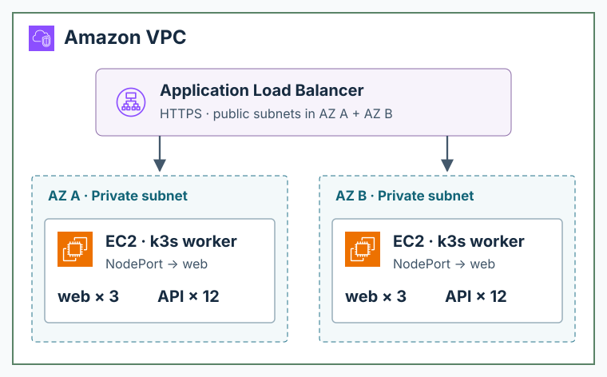

Gaano katagal bago makatanggap ng request ang application? May pagkakaiba pa ba kapag tumatakbo na ito? Ginamit namin ang parehong workload sa iisang k3s node at pinalitan ang container runtime.

## Ang sinukat namin

Nagpapasa ang anim na web pod ng mga request sa 24 na API pod sa pamamagitan ng Kubernetes Service. Ibinabalik ng bawat API ang pangalan ng sarili nitong pod. Tumatawag ang client sa node gamit ang ClusterIP ng web Service. Matagumpay ang request kung 200 ang status at pangalan ng API pod ang nasa tugon.

Iisa ang NGINX image at HTTP readiness probe ng dalawang tier. Humihiling ang bawat container ng 20m CPU at 16 MiB na memory. Ang mga limitasyon ay 200m at 48 MiB. Ang k3s ay gumagamit ng kasamang cri-dockerd para sa Docker Engine at ng sariling CRI socket ng Podbag.

Ubuntu 26.04.1 LTS · Linux 7.0.0-43-generic · ARM64 · 4 vCPU · 4 GiB · k3s v1.37.2+k3s1 · Docker Engine 29.1.3 · [Podbag c0ff5eb](https://github.com/SteelCrab/podbag/commit/c0ff5ebdbd8762760652fbe0a869655a105557a9)

## Mga resulta

<!-- compare-columns: docker podbag -->
| Sukatan | Docker Engine | Podbag |
|---|---:|---:|
| Handa ang lahat ng 30 pod | {{n:3.39}} s | {{n:2.48}} s |
| HTTP p95 sa takdang load | {{n:1.41}} ms | {{n:1.26}} ms |
| HTTP p95 sa burst | {{n:3.46}} ms | {{n:3.69}} ms |
| Matagumpay na request/s sa burst | {{n:7019}} | {{n:6330}} |
| Mga tugong napatunayan | {{n:33600}} / {{n:33600}} | {{n:33600}} / {{n:33600}} |

Sa node na ito, mas maikli nang {{n:0.91}} s ang median ng deployment sa Podbag. Sa 240 request/s, ang p95 sa mga run ay {{n:1.20}}–{{n:1.60}} ms sa Docker at {{n:0.93}}–{{n:1.88}} ms sa Podbag. Sumagot ang lahat ng 24 na API pod sa bawat run. Sa maikling burst, mas mataas ang median na throughput ng Docker. Nagpatong ang saklaw ng throughput ng dalawang runtime sa mga run.

Nagsimula ang oras bago ang unang scale request. Sinuri namin ang dalawang Deployment bawat 100 ms hanggang mag-ulat ang mga ito ng 30 handang replica. Pagkatapos matiyak na handa ang 30 endpoint, naghintay kami ng dalawang segundo. Nagpadala ang 12 client ng tig-100 request gamit ang bagong TCP connection sa bawat isa. Ang p95 ay ang oras kung kailan natapos na ang 95% ng matagumpay na request.

Naghintay kami ng dalawang segundo pagkatapos ng burst. Nagpadala ang 12 client ng tig-20 request bawat segundo nang mga 30 segundo, na may kabuuang target na 240 bawat segundo. Hiwalay ang pagkuha ng p95 sa dalawang yugto.

Ang pagkakasunod ay Docker → Podbag → Podbag → Docker. Bawat bloke ay may isang warm-up at dalawang sinusukat na run. Ipinapakita ang median ng apat na run para sa bawat runtime at ang kabuuang matagumpay na tugon. Nasa cache na ang mga image. Ginamit din ng client ang CPU ng VM. Maikling teksto ang sagot ng API. Hindi sakop ang database at panlabas na network.

Saklaw ng mga resulta ang deployment at HTTP sa isang node. Nakaaapekto ang client at network sa rate ng burst. Masyadong maikli ang burst para tantiyahin ang pangmatagalang pinakamataas na throughput.

## Bakit mahalaga ang reference ng image

Sa unang pagsubok ginamit namin ang multi-architecture index ng NGINX at `IfNotPresent`. Nakaimbak na ang ARM64 image sa Podbag, ngunit hindi ito nakita ng CRI gamit ang digest ng index. Inulit ng kubelet ang pull at umabot sa limitasyon nito. Sa pagsukat, sinuri namin ang ARM64 manifest digest sa parehong engine at ginamit ang `imagePullPolicy: Never`. Ni-reboot namin ang VM at gumawa ng bagong cluster para sa bawat bloke.

## Halimbawa ng deployment sa AWS

Ginagamit ng pampublikong Application Load Balancer ang mga public subnet sa dalawang Availability Zone. Ipinapasa nito ang HTTPS traffic sa NodePort ng web Service sa mga EC2 worker sa private subnet. Gumamit ng topology spread constraint sa bawat Deployment para maglagay ng tatlong web at labindalawang API replica sa bawat zone. Panatilihing internal ang API gamit ang ClusterIP. Ipinapakita ng diagram ang dinaraanan ng application traffic.

[AWS Application Load Balancer](https://docs.aws.amazon.com/elasticloadbalancing/latest/application/application-load-balancers.html) · [AWS Architecture Icons](https://aws.amazon.com/architecture/icons/)

## Ulitin ang pagsukat

[Workload](workload.json) · [Script ng pagsukat](measure.py) · [Datos bawat run](results.jsonl) · [Pagsasaayos ng node at pagkakasunod ng mga run](reproduce.txt) · [start-node.sh](start-node.sh)

[k3s · Docker](https://docs.k3s.io/advanced#using-docker-as-the-container-runtime) · [Podbag CRI](https://github.com/SteelCrab/podbag/blob/c0ff5ebdbd8762760652fbe0a869655a105557a9/docs/usage.md)
