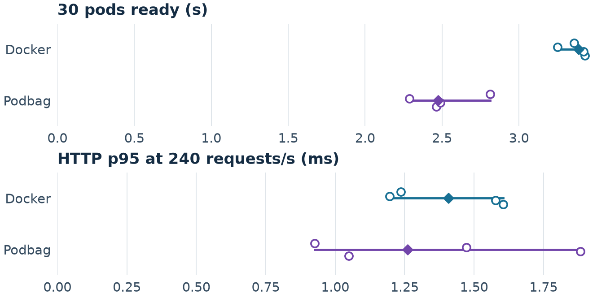

배포를 시작한 뒤 요청을 받을 수 있기까지 얼마나 걸릴까요? 요청을 받기 시작한 뒤에도 두 엔진의 차이가 남을까요? 같은 k3s 노드에서 런타임만 바꾸어 두 질문을 따로 측정했습니다.

## 측정한 구성

웹 파드 6개가 Kubernetes 서비스를 통해 API 파드 24개로 요청을 전달합니다. 각 API는 자신의 파드 이름을 응답합니다. 노드에 둔 클라이언트가 웹 서비스의 ClusterIP로 요청을 보냅니다. 응답 코드가 200이고 본문에 API 파드 이름이 있어야 성공으로 셉니다.

두 계층 모두 같은 NGINX 이미지와 HTTP 준비 상태 검사를 사용합니다. 컨테이너마다 CPU 20m와 메모리 16 MiB를 요청합니다. 상한은 CPU 200m와 메모리 48 MiB입니다. Docker는 k3s에 포함된 cri-dockerd로 연결합니다. Podbag은 자체 CRI 소켓으로 연결합니다.

Ubuntu 26.04.1 LTS · Linux 7.0.0-43-generic · ARM64 · 4 vCPU · 4 GiB · k3s v1.37.2+k3s1 · Docker Engine 29.1.3 · [Podbag c0ff5eb](https://github.com/SteelCrab/podbag/commit/c0ff5ebdbd8762760652fbe0a869655a105557a9)

## 측정 결과

<!-- compare-columns: docker podbag -->
| 지표 | Docker Engine | Podbag |
|---|---:|---:|
| 30개 모두 준비 | {{n:3.39}} s | {{n:2.48}} s |
| 같은 부하에서의 HTTP p95 | {{n:1.41}} ms | {{n:1.26}} ms |
| 짧은 부하에서의 HTTP p95 | {{n:3.46}} ms | {{n:3.69}} ms |
| 짧은 부하의 성공 응답/초 | {{n:7019}} | {{n:6330}} |
| 검증된 응답 | {{n:33600}} / {{n:33600}} | {{n:33600}} / {{n:33600}} |

이 노드에서 Podbag은 30개 파드를 준비하는 데 중앙값 기준 {{n:0.91}}초 덜 걸렸습니다. 초당 240건을 보냈을 때 회차별 p95 범위는 Docker {{n:1.20}}–{{n:1.60}} ms, Podbag {{n:0.93}}–{{n:1.88}} ms였습니다. 모든 회차에서 API 파드 24개가 각각 한 번 이상 응답했습니다. 짧게 요청을 몰아 보냈을 때는 Docker의 초당 처리량 중앙값이 더 높았습니다. 두 런타임의 회차별 처리량 범위는 겹쳤습니다.

준비 시간은 첫 확장 요청 직전부터 두 Deployment에서 총 30개가 준비됐다고 보고할 때까지입니다. 0.1초 간격으로 확인했습니다. 그다음 30개 엔드포인트를 확인하고 2초를 기다렸습니다. 클라이언트 12개가 각각 100번 요청했습니다. 요청마다 새 TCP 연결을 사용했습니다. p95는 성공한 요청의 95%가 이 시간 안에 응답했다는 뜻입니다.

짧은 부하가 끝나면 2초를 쉬었습니다. 이어서 같은 클라이언트 12개가 각각 초당 20회씩 약 30초간 요청했습니다. 목표 부하는 총 240요청/초입니다. 두 구간의 p95를 따로 계산했습니다.

두 런타임의 실행 순서는 Docker → Podbag → Podbag → Docker입니다. 각 구간에서 한 번 예열한 뒤 두 번 측정했습니다. 표는 런타임별 네 번의 중앙값입니다. 성공 응답은 네 번의 합계입니다. 이미지 다운로드 시간은 제외했습니다. 클라이언트도 같은 VM의 CPU를 사용합니다. API는 고정된 작업만 수행합니다. 데이터베이스 조회와 외부 네트워크 지연은 별도 측정 대상입니다.

이 수치는 단일 노드에서의 배포와 HTTP 응답을 설명합니다. 짧은 부하에서 초당 처리량은 클라이언트와 네트워크의 영향도 받습니다. 장시간 최대 처리량으로 해석하기에는 측정 구간이 짧습니다.

## 이미지 주소가 바꾼 결과

예비 실험에서는 여러 아키텍처를 가리키는 NGINX 이미지 인덱스와 `IfNotPresent`를 사용했습니다. Podbag에 ARM64 이미지가 저장된 후에도 인덱스 주소로 조회하면 이미지를 찾지 못했습니다. kubelet은 pull을 재시도했고 요청 속도 제한에 걸렸습니다. 본 측정에서는 ARM64 이미지의 다이제스트를 두 엔진에서 확인하고 `imagePullPolicy: Never`를 적용했습니다. 각 구간은 VM을 다시 시작하고 새 클러스터를 만든 뒤 측정했습니다.

## AWS에 배치한다면

인터넷용 Application Load Balancer를 두 가용 영역의 퍼블릭 서브넷에 연결합니다. HTTPS 요청을 프라이빗 서브넷의 EC2 워커에 있는 웹 서비스의 NodePort로 전달합니다. 각 노드에 `topology.kubernetes.io/zone` 레이블을 지정합니다. 각 Deployment가 이 레이블을 기준으로 파드를 고르게 나누면 영역마다 웹 3개와 API 12개가 배치됩니다. API 서비스는 내부 ClusterIP를 사용합니다. 그림은 애플리케이션 트래픽 경로를 보여 줍니다.

[AWS Application Load Balancer](https://docs.aws.amazon.com/elasticloadbalancing/latest/application/application-load-balancers.html) · [AWS Architecture Icons](https://aws.amazon.com/architecture/icons/)

## 재현 자료

[워크로드](workload.json) · [측정 스크립트](measure.py) · [회차별 원자료](results.jsonl) · [노드 설정과 실행 순서](reproduce.txt) · [start-node.sh](start-node.sh)

[k3s · Docker](https://docs.k3s.io/advanced#using-docker-as-the-container-runtime) · [Podbag CRI](https://github.com/SteelCrab/podbag/blob/c0ff5ebdbd8762760652fbe0a869655a105557a9/docs/usage.md)
