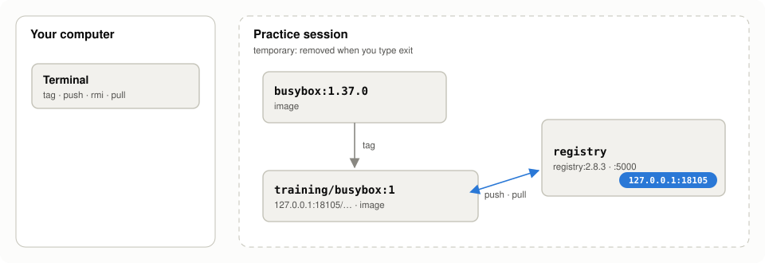

A registry is a server that keeps images. Docker Hub is one. You can also run a small registry yourself, in a container. In this module, you run one, push an image to it and pull the image back.

**Time** 10–15 minutes.



## Start the module

You need a build of Podbag Desktop and the CLI with the Training catalog. It was added after v0.3.2.

Open **Training** in Podbag Desktop and select **Push and pull with a local registry**. New modules appear after **Refresh**. Or run this command in a terminal:

```sh
podbag lab start local-registry
```

Continue at the `training $` prompt.

To do the steps in the TUI instead of Podbag Desktop, add `--tui`.

```sh
podbag lab start local-registry --tui
```

In the TUI, press `:` to open the training shell for a command step, type `exit` to return to the TUI, and press `q` to end the session.

## Pull the busybox image

First, get the image that you will push later.

```sh
podbag pull docker.io/library/busybox:1.37.0
```

- **In Podbag Desktop:** Select **Practice containers → Pull docker.io/library/busybox:1.37.0**.
- **In the TUI:** Open **Images**, press `p`, type `docker.io/library/busybox:1.37.0` and press `Enter`.

Podbag checks that the image `busybox:1.37.0` exists.

## Run a registry

The image `registry:2.8.3` is a registry server. It listens on port `5000` in the container. The command publishes it on your computer at `127.0.0.1:18105`.

```sh
podbag run -d --name registry -p 127.0.0.1:18105:5000 docker.io/library/registry:2.8.3
```

The image names below contain this port. If `18105` is in use, Training shows the commands with another port; copy them from Training. Podbag checks that the container `registry` runs.

## Tag the image with the registry address

An image name starts with its registry. `docker.io/library/busybox` lives on Docker Hub. To send an image to your registry, give it a second name that starts with `127.0.0.1:18105/`.

```sh
podbag tag docker.io/library/busybox:1.37.0 127.0.0.1:18105/training/busybox:1
```

A tag is only a name. Both names point to the same image. Podbag checks that the new name exists.

## Push the image

```sh
podbag push 127.0.0.1:18105/training/busybox:1
```

podbag sends each layer to the registry, and then the manifest. The manifest is the list of the image's layers. Registries on `127.0.0.1` and `localhost` use plain HTTP, so you need no certificate. The last line shows the digest of the manifest. Podbag checks the output for `digest: sha256:`.

## Remove the local tag

```sh
podbag rmi 127.0.0.1:18105/training/busybox:1
```

- **In Podbag Desktop:** Select **Practice containers → Remove image 127.0.0.1:18105/training/busybox:1** and confirm.
- **In the TUI:** Select `127.0.0.1:18105/training/busybox:1` in **Images**, press `d`, then `y`.

This removes the name only. The name `busybox:1.37.0` still points to the image, so its files stay. Podbag checks that the name `127.0.0.1:18105/training/busybox:1` is gone.

## Pull the image back

```sh
podbag pull 127.0.0.1:18105/training/busybox:1
```

- **In Podbag Desktop:** Select **Practice containers → Pull 127.0.0.1:18105/training/busybox:1**.
- **In the TUI:** Open **Images**, press `p`, type `127.0.0.1:18105/training/busybox:1` and press `Enter`.

podbag asks your registry for the image and stores it under that name again. Podbag checks that the name exists.

## Run the pulled image

```sh
podbag run --rm 127.0.0.1:18105/training/busybox:1 echo "Hello from the registry"
```

The container prints the text and stops. `--rm` removes it at once. Podbag checks that the output is `Hello from the registry`.

## Clean up and finish

Remove the registry. It is still running, so `-f` stops it first.

- **In Podbag Desktop:** Select **Practice containers → registry → Remove** and confirm.
- **In the TUI:** Select `registry` in **Containers**, press `d`, then `y`.

```sh
podbag rm -f registry
exit
```

The temporary practice session is removed. Training shows the module as complete.
