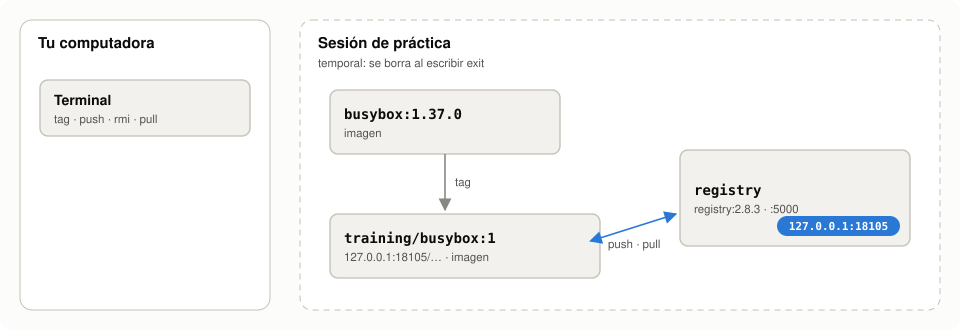

Un registro es un servidor que guarda imágenes. Docker Hub es uno. También puedes ejecutar tú mismo un pequeño registro en un contenedor. En este módulo, ejecutas uno, subes una imagen a él y vuelves a descargarla.

**Tiempo** 10–15 minutos.



## Inicia el módulo

Necesitas una versión de Podbag Desktop y de la CLI con el catálogo de Training. Se añadió después de v0.3.2.

Abre **Training** en Podbag Desktop y selecciona **Sube y descarga una imagen con un registro local**. Los módulos nuevos aparecen después de **Actualizar**. O ejecuta este comando en una terminal:

```sh
podbag lab start local-registry
```

Continúa en el prompt `training $`.

## Descarga la imagen busybox

Primero, obtén la imagen que vas a subir después.

```sh
podbag pull docker.io/library/busybox:1.37.0
```

Podbag comprueba que existe la imagen `busybox:1.37.0`.

## Ejecuta un registro

La imagen `registry:2.8.3` es un servidor de registro. Escucha en el puerto `5000` del contenedor. El comando lo publica en tu computadora en `127.0.0.1:18105`.

```sh
podbag run -d --name registry -p 127.0.0.1:18105:5000 docker.io/library/registry:2.8.3
```

Los nombres de imagen de los pasos siguientes contienen este puerto. Si `18105` está en uso, Training muestra los comandos con otro puerto. Cópialos desde Training. Podbag comprueba que el contenedor `registry` está en ejecución.

## Etiqueta la imagen con la dirección del registro

El nombre de una imagen empieza por su registro. `docker.io/library/busybox` está en Docker Hub. Para enviar una imagen a tu registro, dale un segundo nombre que empiece por `127.0.0.1:18105/`.

```sh
podbag tag docker.io/library/busybox:1.37.0 127.0.0.1:18105/training/busybox:1
```

Una etiqueta es solo un nombre. Los dos nombres apuntan a la misma imagen. Podbag comprueba que existe el nombre nuevo.

## Sube la imagen

```sh
podbag push 127.0.0.1:18105/training/busybox:1
```

podbag envía cada capa al registro y después el manifiesto. El manifiesto es la lista de las capas de la imagen. Los registros en `127.0.0.1` y `localhost` usan HTTP simple, así que no necesitas ningún certificado. La última línea muestra el digest del manifiesto. Podbag busca `digest: sha256:` en la salida.

## Elimina la etiqueta local

```sh
podbag rmi 127.0.0.1:18105/training/busybox:1
```

Esto elimina solo el nombre. El nombre `busybox:1.37.0` sigue apuntando a la imagen, así que sus archivos se quedan. Podbag comprueba que el nombre `127.0.0.1:18105/training/busybox:1` ya no existe.

## Vuelve a descargar la imagen

```sh
podbag pull 127.0.0.1:18105/training/busybox:1
```

podbag pide la imagen a tu registro y la vuelve a guardar con ese nombre. Podbag comprueba que existe el nombre.

## Ejecuta la imagen descargada

```sh
podbag run --rm 127.0.0.1:18105/training/busybox:1 echo "Hello from the registry"
```

El contenedor muestra el texto y se detiene. `--rm` lo elimina enseguida. Podbag comprueba que la salida es `Hello from the registry`.

## Limpia y termina

Elimina el registro. Sigue en ejecución, así que `-f` lo detiene primero.

```sh
podbag rm -f registry
exit
```

Se elimina la sesión de práctica temporal. Training muestra el módulo como completado.
