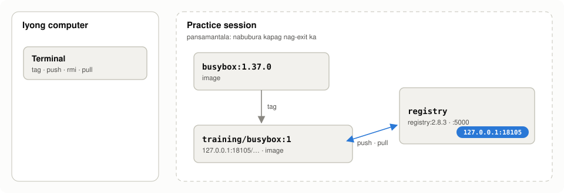

Ang registry ay server na nag-iingat ng mga image. Isa rito ang Docker Hub. Maaari ka ring magpatakbo ng sarili mong maliit na registry sa isang container. Sa module na ito, magpapatakbo ka ng registry, magpu-push ng image dito at ipu-pull ulit ang image.

**Oras** 10–15 minuto.



## Simulan ang module

Kailangan mo ng build ng Podbag Desktop at ng CLI na may Training catalog. Idinagdag ito pagkatapos ng v0.3.2.

Buksan ang **Training** sa Podbag Desktop at piliin ang **Mag-push at mag-pull gamit ang lokal na registry**. Lalabas ang mga bagong module pagkatapos ng **I-refresh**. O patakbuhin ang command na ito sa terminal:

```sh
podbag lab start local-registry
```

Magpatuloy sa prompt na `training $`.

## I-pull ang image na busybox

Una, kunin ang image na ipu-push mo mamaya.

```sh
podbag pull docker.io/library/busybox:1.37.0
```

Sinusuri ng Podbag na may image na `busybox:1.37.0`.

## Magpatakbo ng registry

Registry server ang image na `registry:2.8.3`. Nakikinig ito sa port na `5000` sa container. Ipina-publish ito ng command sa computer mo sa `127.0.0.1:18105`.

```sh
podbag run -d --name registry -p 127.0.0.1:18105:5000 docker.io/library/registry:2.8.3
```

May port na ito sa mga pangalan ng image sa ibaba. Kung gamit na ang `18105`, ipapakita ng Training ang mga command na may ibang port. Kopyahin ang mga ito mula sa Training. Sinusuri ng Podbag na tumatakbo ang container na `registry`.

## I-tag ang image gamit ang address ng registry

Nagsisimula ang pangalan ng image sa registry nito. Nasa Docker Hub ang `docker.io/library/busybox`. Para ipadala ang image sa registry mo, bigyan ito ng pangalawang pangalan na nagsisimula sa `127.0.0.1:18105/`.

```sh
podbag tag docker.io/library/busybox:1.37.0 127.0.0.1:18105/training/busybox:1
```

Pangalan lang ang tag. Tumuturo ang dalawang pangalan sa parehong image. Sinusuri ng Podbag na may bagong pangalan.

## I-push ang image

```sh
podbag push 127.0.0.1:18105/training/busybox:1
```

Ipinapadala ng podbag ang bawat layer sa registry, at saka ang manifest. Ang manifest ay listahan ng mga layer ng image. Simpleng HTTP ang gamit ng mga registry sa `127.0.0.1` at `localhost`, kaya hindi mo kailangan ng certificate. Ipinapakita ng huling linya ang digest ng manifest. Hinahanap ng Podbag ang `digest: sha256:` sa output.

## Alisin ang lokal na tag

```sh
podbag rmi 127.0.0.1:18105/training/busybox:1
```

Pangalan lang ang inaalis nito. Tumuturo pa rin sa image ang pangalang `busybox:1.37.0`, kaya nananatili ang mga file nito. Sinusuri ng Podbag na wala na ang pangalang `127.0.0.1:18105/training/busybox:1`.

## I-pull ulit ang image

```sh
podbag pull 127.0.0.1:18105/training/busybox:1
```

Hinihingi ng podbag sa registry mo ang image at iniimbak ito ulit sa pangalang iyon. Sinusuri ng Podbag na may ganoong pangalan.

## Patakbuhin ang na-pull na image

```sh
podbag run --rm 127.0.0.1:18105/training/busybox:1 echo "Hello from the registry"
```

Ipinapakita ng container ang text at humihinto ito. Agad itong inaalis ng `--rm`. Sinusuri ng Podbag na `Hello from the registry` ang output.

## Maglinis at tapusin

Alisin ang registry. Tumatakbo pa ito, kaya inihihinto muna ito ng `-f`.

```sh
podbag rm -f registry
exit
```

Naaalis ang pansamantalang practice session. Ipinapakita ng Training na tapos na ang module.
