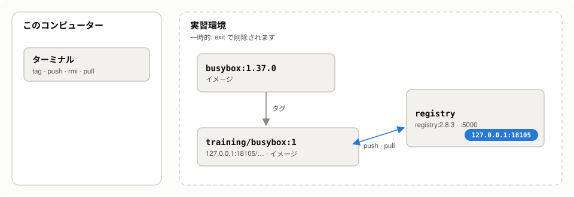

レジストリは、イメージを保管するサーバーです。Docker Hub もレジストリの 1 つです。小さなレジストリを自分でコンテナとして実行することもできます。このモジュールでは、レジストリを実行し、イメージを push して、pull で取り戻します。

**所要時間** 10〜15 分。



## モジュールを開始する

Training カタログがある Podbag Desktop と CLI のビルドが必要です。カタログは v0.3.2 より後に追加されました。

Podbag Desktop で **Training** を開き、**ローカルレジストリで push と pull を行う**を選びます。新しいモジュールは**更新**の後に表示されます。ターミナルで次のコマンドを実行しても開始できます。

```sh
podbag lab start local-registry
```

`training $` プロンプトが表示されたら続けます。

## busybox イメージを取得する

まず、後で push するイメージを取得します。

```sh
podbag pull docker.io/library/busybox:1.37.0
```

Podbag はイメージ `busybox:1.37.0` があることを確認します。

## レジストリを実行する

イメージ `registry:2.8.3` はレジストリのサーバーです。コンテナ内のポート `5000` で待ち受けます。このコマンドは、このコンピューターの `127.0.0.1:18105` でレジストリを公開します。

```sh
podbag run -d --name registry -p 127.0.0.1:18105:5000 docker.io/library/registry:2.8.3
```

この後のイメージ名には、このポートが含まれます。`18105` が使われている場合、Training は別のポートでコマンドを表示します。そのときは Training からコマンドをコピーします。Podbag はコンテナ `registry` が実行中であることを確認します。

## レジストリのアドレスでイメージにタグを付ける

イメージ名は、レジストリの名前で始まります。`docker.io/library/busybox` は Docker Hub にあります。自分のレジストリにイメージを送るには、`127.0.0.1:18105/` で始まる 2 つ目の名前を付けます。

```sh
podbag tag docker.io/library/busybox:1.37.0 127.0.0.1:18105/training/busybox:1
```

タグはただの名前です。両方の名前が同じイメージを指します。Podbag は新しい名前があることを確認します。

## イメージを push する

```sh
podbag push 127.0.0.1:18105/training/busybox:1
```

podbag は各レイヤーをレジストリに送り、最後にマニフェストを送ります。マニフェストは、イメージのレイヤーの一覧です。`127.0.0.1` と `localhost` のレジストリは通常の HTTP を使うので、証明書は必要ありません。最後の行にマニフェストのダイジェストが表示されます。Podbag は出力に `digest: sha256:` があることを確認します。

## ローカルのタグを削除する

```sh
podbag rmi 127.0.0.1:18105/training/busybox:1
```

このコマンドは名前だけを削除します。`busybox:1.37.0` という名前がまだイメージを指しているので、ファイルは残ります。Podbag は名前 `127.0.0.1:18105/training/busybox:1` が消えたことを確認します。

## イメージを pull で取り戻す

```sh
podbag pull 127.0.0.1:18105/training/busybox:1
```

podbag は自分のレジストリにイメージを要求し、もう一度その名前で保存します。Podbag はその名前があることを確認します。

## 取り戻したイメージを実行する

```sh
podbag run --rm 127.0.0.1:18105/training/busybox:1 echo "Hello from the registry"
```

コンテナはテキストを表示して停止します。`--rm` がすぐにコンテナを削除します。Podbag は出力が `Hello from the registry` であることを確認します。

## 片付けて終了する

レジストリを削除します。まだ実行中なので、`-f` で先に停止します。

```sh
podbag rm -f registry
exit
```

一時的な実習環境が削除されます。Training にモジュールの完了が表示されます。
