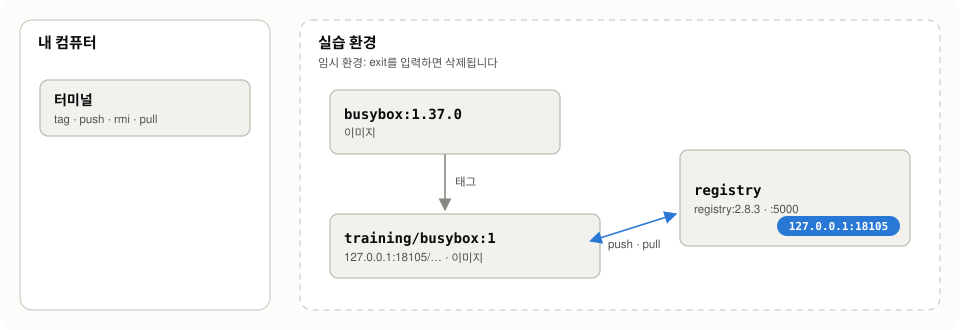

레지스트리는 이미지를 보관하는 서버입니다. Docker Hub도 레지스트리입니다. 작은 레지스트리를 컨테이너로 직접 실행할 수도 있습니다. 이번 트레이닝에서는 레지스트리를 실행하고 이미지를 push한 뒤 다시 pull합니다.

**예상 시간** 10~15분.



## 실습 시작

Training 카탈로그가 들어 있는 Podbag Desktop과 CLI가 필요합니다. 이 기능은 v0.3.2 이후에 추가됐습니다.

Podbag Desktop에서 **Training**을 열고 **로컬 레지스트리에 push하고 pull하기**를 선택합니다. 새 모듈은 **새로 고침**을 누르면 나타납니다. 터미널에서 다음 명령을 실행해도 됩니다.

```sh
podbag lab start local-registry
```

`training $` 프롬프트에서 계속 진행합니다.

## busybox 이미지 받기

먼저 나중에 push할 이미지를 받습니다.

```sh
podbag pull docker.io/library/busybox:1.37.0
```

Podbag은 `busybox:1.37.0` 이미지가 있는지 확인합니다.

## 레지스트리 실행하기

`registry:2.8.3` 이미지는 레지스트리 서버입니다. 컨테이너 안에서 `5000` 포트로 요청을 받습니다. 이 명령은 이 포트를 내 컴퓨터의 `127.0.0.1:18105`로 공개합니다.

```sh
podbag run -d --name registry -p 127.0.0.1:18105:5000 docker.io/library/registry:2.8.3
```

아래 이미지 이름에도 이 포트가 들어갑니다. `18105`가 이미 사용 중이면 Training이 다른 포트로 바꾼 명령을 보여 줍니다. 명령은 Training에서 복사합니다. Podbag은 `registry` 컨테이너가 실행 중인지 확인합니다.

## 레지스트리 주소로 태그 붙이기

이미지 이름은 레지스트리 주소로 시작합니다. `docker.io/library/busybox`는 Docker Hub에 있습니다. 내 레지스트리로 보내려면 `127.0.0.1:18105/`로 시작하는 이름을 하나 더 붙입니다.

```sh
podbag tag docker.io/library/busybox:1.37.0 127.0.0.1:18105/training/busybox:1
```

태그는 이름일 뿐입니다. 두 이름은 같은 이미지를 가리킵니다. Podbag은 새 이름이 있는지 확인합니다.

## 이미지 push하기

```sh
podbag push 127.0.0.1:18105/training/busybox:1
```

podbag은 레이어를 하나씩 레지스트리로 보내고, 마지막에 매니페스트를 보냅니다. 매니페스트는 이미지의 레이어 목록입니다. `127.0.0.1`과 `localhost`의 레지스트리는 일반 HTTP를 사용하므로 인증서가 필요 없습니다. 마지막 줄에 매니페스트의 다이제스트가 출력됩니다. Podbag은 출력에 `digest: sha256:`이 있는지 확인합니다.

## 로컬 태그 삭제하기

```sh
podbag rmi 127.0.0.1:18105/training/busybox:1
```

이 명령은 이름만 지웁니다. `busybox:1.37.0` 이름이 아직 이미지를 가리키므로 파일은 남습니다. Podbag은 `127.0.0.1:18105/training/busybox:1` 이름이 없어졌는지 확인합니다.

## 이미지 다시 받기

```sh
podbag pull 127.0.0.1:18105/training/busybox:1
```

podbag은 내 레지스트리에 이미지를 요청하고 그 이름으로 다시 저장합니다. Podbag은 이 이름이 있는지 확인합니다.

## 받은 이미지 실행하기

```sh
podbag run --rm 127.0.0.1:18105/training/busybox:1 echo "Hello from the registry"
```

컨테이너는 문구를 출력하고 멈춥니다. `--rm`이 컨테이너를 바로 삭제합니다. Podbag은 출력이 `Hello from the registry`인지 확인합니다.

## 정리 및 실습 종료

레지스트리를 삭제합니다. 아직 실행 중이므로 `-f`가 먼저 멈춥니다.

```sh
podbag rm -f registry
exit
```

임시 실습 환경이 삭제됩니다. Training에 모듈이 완료됨으로 표시됩니다.
