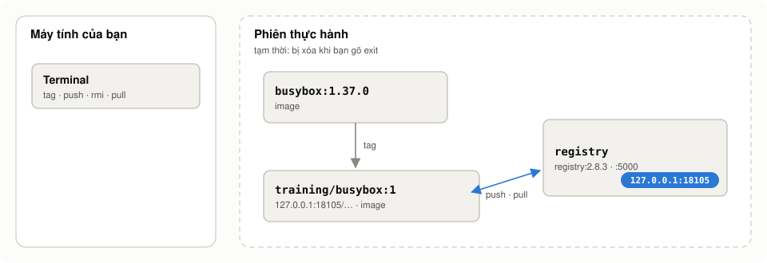

Registry là máy chủ lưu giữ image. Docker Hub là một registry. Bạn cũng có thể tự chạy một registry nhỏ trong container. Trong mô-đun này, bạn chạy một registry, đẩy image lên đó và kéo image về lại.

**Thời gian** 10–15 phút.



## Bắt đầu mô-đun

Bạn cần bản Podbag Desktop và CLI có danh mục Training. Danh mục này được thêm sau v0.3.2.

Mở **Training** trong Podbag Desktop và chọn **Đẩy và kéo image với registry cục bộ**. Mô-đun mới xuất hiện sau khi chọn **Làm mới**. Hoặc chạy lệnh này trong terminal:

```sh
podbag lab start local-registry
```

Tiếp tục tại dấu nhắc `training $`.

## Kéo image busybox

Trước tiên, lấy image mà bạn sẽ đẩy lên ở bước sau.

```sh
podbag pull docker.io/library/busybox:1.37.0
```

Podbag kiểm tra rằng image `busybox:1.37.0` đã có.

## Chạy registry

Image `registry:2.8.3` là một máy chủ registry. Nó nhận yêu cầu ở cổng `5000` trong container. Lệnh này công bố registry trên máy tính của bạn tại `127.0.0.1:18105`.

```sh
podbag run -d --name registry -p 127.0.0.1:18105:5000 docker.io/library/registry:2.8.3
```

Các tên image bên dưới có chứa cổng này. Nếu `18105` đang được dùng, Training hiển thị các lệnh với cổng khác. Hãy sao chép lệnh từ Training. Podbag kiểm tra rằng container `registry` đang chạy.

## Gắn tag địa chỉ registry cho image

Tên image bắt đầu bằng registry của nó. `docker.io/library/busybox` nằm trên Docker Hub. Để gửi image tới registry của bạn, hãy đặt cho nó tên thứ hai bắt đầu bằng `127.0.0.1:18105/`.

```sh
podbag tag docker.io/library/busybox:1.37.0 127.0.0.1:18105/training/busybox:1
```

Tag chỉ là một tên. Cả hai tên đều trỏ tới cùng một image. Podbag kiểm tra rằng tên mới đã có.

## Đẩy image

```sh
podbag push 127.0.0.1:18105/training/busybox:1
```

podbag gửi từng layer tới registry, rồi gửi manifest. Manifest là danh sách các layer của image. Registry trên `127.0.0.1` và `localhost` dùng HTTP thường, nên bạn không cần chứng chỉ. Dòng cuối hiển thị digest của manifest. Podbag tìm `digest: sha256:` trong kết quả.

## Xóa tag cục bộ

```sh
podbag rmi 127.0.0.1:18105/training/busybox:1
```

Lệnh này chỉ xóa tên. Tên `busybox:1.37.0` vẫn trỏ tới image, nên các tệp của image vẫn còn. Podbag kiểm tra rằng tên `127.0.0.1:18105/training/busybox:1` không còn.

## Kéo image về lại

```sh
podbag pull 127.0.0.1:18105/training/busybox:1
```

podbag yêu cầu image từ registry của bạn và lưu lại image dưới tên đó. Podbag kiểm tra rằng tên này đã có.

## Chạy image vừa kéo

```sh
podbag run --rm 127.0.0.1:18105/training/busybox:1 echo "Hello from the registry"
```

Container in dòng chữ rồi dừng. `--rm` xóa nó ngay. Podbag kiểm tra rằng kết quả là `Hello from the registry`.

## Dọn dẹp và kết thúc

Xóa registry. Nó vẫn đang chạy, nên `-f` dừng nó trước.

```sh
podbag rm -f registry
exit
```

Phiên thực hành tạm thời đã được xóa. Training hiển thị mô-đun đã hoàn thành.
