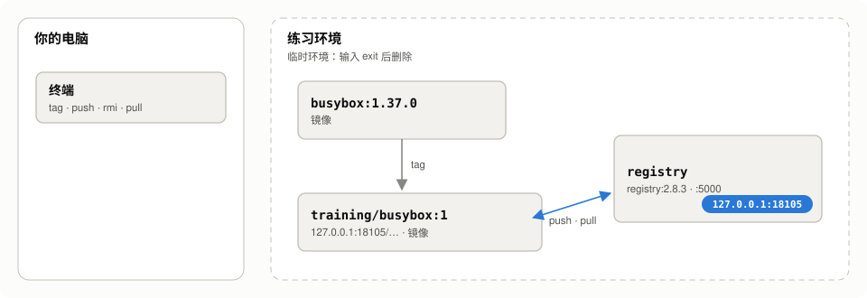

镜像仓库是保存镜像的服务器。Docker Hub 就是一个镜像仓库。你也可以在容器中自己运行一个小型镜像仓库。在本模块中，你将运行一个镜像仓库，把镜像推送到其中，再把镜像拉取回来。

**预计用时** 10–15 分钟。



## 开始模块

需要带有 Training 目录的 Podbag Desktop 和 CLI 版本。该目录在 v0.3.2 之后加入。

在 Podbag Desktop 中打开 **Training**，选择**用本地镜像仓库推送和拉取**。点击**刷新**后会出现新模块。也可以在终端中运行以下命令：

```sh
podbag lab start local-registry
```

出现 `training $` 提示符后继续。

要在 TUI 而不是 Podbag Desktop 中完成这些步骤，请加上 `--tui`。

```sh
podbag lab start local-registry --tui
```

在 TUI 中，按 `:` 打开 Training 终端来执行命令步骤，输入 `exit` 返回 TUI，按 `q` 结束实验。

## 拉取 busybox 镜像

首先，获取稍后要推送的镜像。

```sh
podbag pull docker.io/library/busybox:1.37.0
```

- **在 Podbag Desktop 中：** 选择**实验容器 → 拉取 docker.io/library/busybox:1.37.0**。
- **在 TUI 中：** 打开**镜像**，按 `p`，输入 `docker.io/library/busybox:1.37.0` 并按 `Enter`。

Podbag 会检查镜像 `busybox:1.37.0` 是否存在。

## 运行镜像仓库

镜像 `registry:2.8.3` 是一个镜像仓库服务器。它在容器内的 `5000` 端口上监听。这条命令把它发布到你电脑上的 `127.0.0.1:18105`。

```sh
podbag run -d --name registry -p 127.0.0.1:18105:5000 docker.io/library/registry:2.8.3
```

下面的镜像名称中包含这个端口。如果 `18105` 已被占用，Training 会显示使用其他端口的命令，请从 Training 复制。Podbag 会检查容器 `registry` 是否正在运行。

## 用仓库地址标记镜像

镜像名称以它所在的仓库开头。`docker.io/library/busybox` 位于 Docker Hub。要把镜像发送到你的仓库，就为它起第二个名称，以 `127.0.0.1:18105/` 开头。

```sh
podbag tag docker.io/library/busybox:1.37.0 127.0.0.1:18105/training/busybox:1
```

标签只是一个名称。两个名称指向同一个镜像。Podbag 会检查新名称是否存在。

## 推送镜像

```sh
podbag push 127.0.0.1:18105/training/busybox:1
```

podbag 把每个层发送到镜像仓库，然后发送清单。清单是镜像各层的列表。`127.0.0.1` 和 `localhost` 上的镜像仓库使用普通 HTTP，所以不需要证书。最后一行显示清单的摘要。Podbag 会检查输出中是否有 `digest: sha256:`。

## 删除本地标签

```sh
podbag rmi 127.0.0.1:18105/training/busybox:1
```

- **在 Podbag Desktop 中：** 选择**实验容器 → 删除镜像 127.0.0.1:18105/training/busybox:1**并确认。
- **在 TUI 中：** 在**镜像**中选择 `127.0.0.1:18105/training/busybox:1`，按 `d`，再按 `y`。

这只会删除名称。名称 `busybox:1.37.0` 仍然指向该镜像，所以镜像文件会保留。Podbag 会检查名称 `127.0.0.1:18105/training/busybox:1` 是否已删除。

## 拉取回镜像

```sh
podbag pull 127.0.0.1:18105/training/busybox:1
```

- **在 Podbag Desktop 中：** 选择**实验容器 → 拉取 127.0.0.1:18105/training/busybox:1**。
- **在 TUI 中：** 打开**镜像**，按 `p`，输入 `127.0.0.1:18105/training/busybox:1` 并按 `Enter`。

podbag 向你的镜像仓库请求该镜像，并再次以这个名称存储。Podbag 会检查该名称是否存在。

## 运行拉取的镜像

```sh
podbag run --rm 127.0.0.1:18105/training/busybox:1 echo "Hello from the registry"
```

容器打印这段文字后停止。`--rm` 会立即删除它。Podbag 会检查输出是否为 `Hello from the registry`。

## 清理并结束

删除镜像仓库。它仍在运行，所以 `-f` 会先停止它。

- **在 Podbag Desktop 中：** 选择**实验容器 → registry → 删除**并确认。
- **在 TUI 中：** 在**容器**中选择 `registry`，按 `d`，再按 `y`。

```sh
podbag rm -f registry
exit
```

临时练习环境会被删除。Training 会显示该模块已完成。
