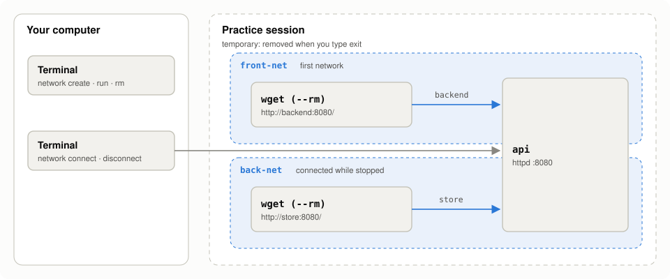

A container can be on more than one network. Containers on each network reach it by its name or by an alias. An alias is one more name for the same container. In this module, you put a server on a second network and call it from both networks.

**Time** 15 minutes. This module follows [Connect two containers by name](../container-network/).



## Start the module

Open **Training** in Podbag Desktop and select **Connect a container to a second network**. New modules appear after **Refresh**. Or run this command in a terminal:

```sh
podbag lab start network-connect
```

You need a Podbag build with the Training catalog (after v0.3.2). Continue at the `training $` prompt.

## Create two networks

Create the networks `front-net` and `back-net`. Each one is a separate bridge with its own addresses.

```sh
podbag network create front-net
podbag network create back-net
```

Podbag checks each network after its step.

## Run api with a network alias

Run a small server named `api` on `front-net`. It serves the text `Hello from api` on port `8080`. `--network-alias backend` gives it one more name on `front-net`.

```sh
podbag run -d --name api --network front-net --network-alias backend docker.io/library/busybox:1.37.0 sh -c 'mkdir -p /www && echo "Hello from api" > /www/index.html && exec httpd -f -p 8080 -h /www'
```

Podbag checks that `api` is running.

## Call api by its alias

Run a one-time container on `front-net`. It asks for `http://backend:8080/`. The alias leads to `api`.

```sh
podbag run --rm --network front-net docker.io/library/busybox:1.37.0 wget -qO- http://backend:8080/
```

The terminal prints `Hello from api`. Podbag checks this output.

## Stop api before you change its networks

Podbag changes the networks of a container only while it is stopped. The change applies from its next start. If you try it on a running container, Podbag says so and asks you to stop it first.

```sh
podbag stop api
```

Podbag checks that `api` is in the state `exited`.

## Connect api to back-net

`podbag network connect` adds a network to the container. `--alias store` gives it the name `store` on that network.

```sh
podbag network connect --alias store back-net api
```

Podbag checks that `api` is now on `back-net`.

## Start api again

```sh
podbag start api
```

`api` starts with two networks. Its first network is still `front-net`.

## Call api from back-net

Run a one-time container on `back-net`. It asks for `http://store:8080/`.

```sh
podbag run --rm --network back-net docker.io/library/busybox:1.37.0 wget -qO- http://store:8080/
```

The terminal prints `Hello from api`. Podbag checks this output. Each alias works only on its own network. On `back-net`, the name `backend` is not known. The name `api` works on both networks.

## Stop api and disconnect it

Stop `api` again. Then remove `back-net` from it with `podbag network disconnect`.

```sh
podbag stop api
podbag network disconnect back-net api
```

Podbag checks that `api` is no longer on `back-net`. You cannot disconnect a container from its first network. To change that, create the container again.

## Clean up and finish

Remove `api`. Then remove both networks in one command. A network can be removed when no container uses it.

```sh
podbag rm api
podbag network rm front-net back-net
exit
```

The temporary practice resources are removed. Training shows the module as complete.
