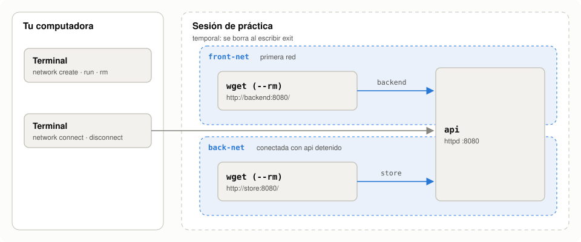

Un contenedor puede estar en más de una red. Los contenedores de cada red llegan a él por su nombre o por un alias. Un alias es un nombre más para el mismo contenedor. En este módulo, pones un servidor en una segunda red y lo llamas desde las dos redes.

**Tiempo** 15 minutos. Este módulo va después de [Conecta dos contenedores por su nombre](../container-network/).



## Inicia el módulo

Abre **Training** en Podbag Desktop y selecciona **Conecta un contenedor a una segunda red**. Los módulos nuevos aparecen después de **Actualizar**. O ejecuta este comando en una terminal:

```sh
podbag lab start network-connect
```

Necesitas una versión de Podbag con el catálogo de Training (posterior a v0.3.2). Continúa en el prompt `training $`.

Para hacer los pasos en la TUI en lugar de Podbag Desktop, añade `--tui`.

```sh
podbag lab start network-connect --tui
```

En la TUI, pulsa `:` para abrir la shell de Training cuando un paso pida un comando, escribe `exit` para volver a la TUI y pulsa `q` para terminar la sesión.

## Crea dos redes

Crea las redes `front-net` y `back-net`. Cada una es un bridge independiente con sus propias direcciones.

```sh
podbag network create front-net
podbag network create back-net
```

Podbag comprueba cada red después de su paso.

## Ejecuta api con un alias de red

Ejecuta un pequeño servidor llamado `api` en `front-net`. Sirve el texto `Hello from api` en el puerto `8080`. `--network-alias backend` le da un nombre más en `front-net`.

```sh
podbag run -d --name api --network front-net --network-alias backend docker.io/library/busybox:1.37.0 sh -c 'mkdir -p /www && echo "Hello from api" > /www/index.html && exec httpd -f -p 8080 -h /www'
```

Podbag comprueba que `api` está en ejecución.

## Llama a api por su alias

Ejecuta un contenedor de un solo uso en `front-net`. Pide `http://backend:8080/`. El alias lleva a `api`.

```sh
podbag run --rm --network front-net docker.io/library/busybox:1.37.0 wget -qO- http://backend:8080/
```

La terminal muestra `Hello from api`. Podbag comprueba esta salida.

## Detén api antes de cambiar sus redes

Podbag cambia las redes de un contenedor solo mientras está detenido. El cambio se aplica a partir del siguiente inicio. Si lo intentas con un contenedor en ejecución, Podbag te avisa y te pide que lo detengas primero.

```sh
podbag stop api
```

- **En Podbag Desktop:** Selecciona **Contenedores de práctica → api → Detener**.
- **En la TUI:** Selecciona `api` en **Contenedores** y pulsa `x`.

Podbag comprueba que `api` está en el estado `exited`.

## Conecta api a back-net

`podbag network connect` añade una red al contenedor. `--alias store` le da el nombre `store` en esa red.

```sh
podbag network connect --alias store back-net api
```

Podbag comprueba que `api` ya está en `back-net`.

## Inicia api de nuevo

```sh
podbag start api
```

- **En Podbag Desktop:** Selecciona **Contenedores de práctica → api → Iniciar**.
- **En la TUI:** Selecciona `api` en **Contenedores** y pulsa `s`.

`api` se inicia con dos redes. Su primera red sigue siendo `front-net`.

## Llama a api desde back-net

Ejecuta un contenedor de un solo uso en `back-net`. Pide `http://store:8080/`.

```sh
podbag run --rm --network back-net docker.io/library/busybox:1.37.0 wget -qO- http://store:8080/
```

La terminal muestra `Hello from api`. Podbag comprueba esta salida. Cada alias funciona solo en su propia red. En `back-net`, el nombre `backend` no existe. El nombre `api` funciona en las dos redes.

## Detén api y desconéctalo

Detén `api` otra vez. Luego quítale `back-net` con `podbag network disconnect`.

- **En Podbag Desktop:** Selecciona **Contenedores de práctica → api → Detener**.
- **En la TUI:** Selecciona `api` en **Contenedores** y pulsa `x`.

```sh
podbag stop api
podbag network disconnect back-net api
```

Podbag comprueba que `api` ya no está en `back-net`. No puedes desconectar un contenedor de su primera red. Para cambiarla, crea el contenedor de nuevo.

## Limpia y termina

Elimina `api`. Luego elimina las dos redes con un solo comando. Una red se puede eliminar cuando ningún contenedor la usa.

- **En Podbag Desktop:** Selecciona **Contenedores de práctica → api → Eliminar** y confirma.
- **En la TUI:** Selecciona `api` en **Contenedores**, pulsa `d` y luego `y`.
- **En Podbag Desktop:** Selecciona **Contenedores de práctica → Eliminar la red back-net** y confirma.
- **En la TUI:** Selecciona `back-net` en **Redes**, pulsa `d` y luego `y`.

El comando `podbag network rm front-net back-net` elimina las dos redes. En Podbag Desktop y en la TUI, este paso elimina solo `back-net`. `front-net` desaparece cuando termina la sesión.

```sh
podbag rm api
podbag network rm front-net back-net
exit
```

Se eliminan los recursos temporales de la práctica. Training muestra el módulo como completado.
