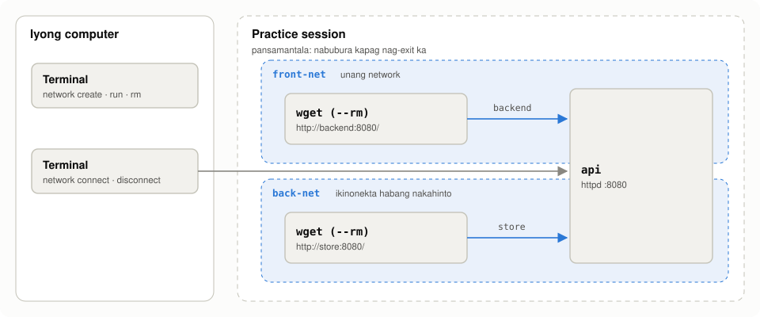

Maaaring nasa higit sa isang network ang container. Naaabot ito ng mga container sa bawat network gamit ang pangalan nito o ang alias. Ang alias ay isa pang pangalan para sa parehong container. Sa module na ito, ilalagay mo ang server sa pangalawang network. Tatawagin mo ito mula sa dalawang network.

**Oras** 15 minuto. Sumusunod ang module na ito sa [Ikonekta ang dalawang container gamit ang pangalan](../container-network/).



## Simulan ang module

Buksan ang **Training** sa Podbag Desktop at piliin ang **Ikonekta ang container sa pangalawang network**. Lalabas ang mga bagong module pagkatapos ng **I-refresh**. O patakbuhin ang command na ito sa terminal:

```sh
podbag lab start network-connect
```

Kailangan mo ng build ng Podbag na may Training catalog (pagkatapos ng v0.3.2). Magpatuloy sa prompt na `training $`.

Para gawin ang mga hakbang sa TUI sa halip na sa Podbag Desktop, idagdag ang `--tui`.

```sh
podbag lab start network-connect --tui
```

Sa TUI, pindutin ang `:` para buksan ang training shell sa isang hakbang na command. I-type ang `exit` para bumalik sa TUI. Pindutin ang `q` para tapusin ang practice session.

## Gumawa ng dalawang network

Gawin ang mga network na `front-net` at `back-net`. Hiwalay na bridge ang bawat isa, na may sariling mga address.

```sh
podbag network create front-net
podbag network create back-net
```

Sinusuri ng Podbag ang bawat network pagkatapos ng hakbang nito.

## Patakbuhin ang api na may network alias

Magpatakbo ng maliit na server na `api` sa `front-net`. Inihahain nito ang text na `Hello from api` sa port na `8080`. Binibigyan ito ng `--network-alias backend` ng isa pang pangalan sa `front-net`.

```sh
podbag run -d --name api --network front-net --network-alias backend docker.io/library/busybox:1.37.0 sh -c 'mkdir -p /www && echo "Hello from api" > /www/index.html && exec httpd -f -p 8080 -h /www'
```

Sinusuri ng Podbag na tumatakbo ang `api`.

## Tawagin ang api gamit ang alias nito

Magpatakbo ng isang beses na container sa `front-net`. Hinihingi nito ang `http://backend:8080/`. Papunta sa `api` ang alias.

```sh
podbag run --rm --network front-net docker.io/library/busybox:1.37.0 wget -qO- http://backend:8080/
```

Ipinapakita ng terminal ang `Hello from api`. Sinusuri ng Podbag ang output na ito.

## Ihinto ang api bago baguhin ang mga network nito

Binabago lang ng Podbag ang mga network ng container habang nakahinto ito. Magkakabisa ang pagbabago sa susunod na pagsisimula nito. Kung susubukan mo ito sa tumatakbong container, sasabihin iyon ng Podbag at hihilingin nitong ihinto mo muna ang container.

```sh
podbag stop api
```

- **Sa Podbag Desktop:** Piliin ang **Mga practice container → api → Ihinto**.
- **Sa TUI:** Piliin ang `api` sa **Mga container** at pindutin ang `x`.

Sinusuri ng Podbag na nasa state na `exited` ang `api`.

## Ikonekta ang api sa back-net

Nagdaragdag ang `podbag network connect` ng network sa container. Binibigyan ito ng `--alias store` ng pangalang `store` sa network na iyon.

```sh
podbag network connect --alias store back-net api
```

Sinusuri ng Podbag na nasa `back-net` na ang `api`.

## Simulan ulit ang api

```sh
podbag start api
```

- **Sa Podbag Desktop:** Piliin ang **Mga practice container → api → Simulan**.
- **Sa TUI:** Piliin ang `api` sa **Mga container** at pindutin ang `s`.

Nagsisimula ang `api` na may dalawang network. `front-net` pa rin ang una nitong network.

## Tawagin ang api mula sa back-net

Magpatakbo ng isang beses na container sa `back-net`. Hinihingi nito ang `http://store:8080/`.

```sh
podbag run --rm --network back-net docker.io/library/busybox:1.37.0 wget -qO- http://store:8080/
```

Ipinapakita ng terminal ang `Hello from api`. Sinusuri ng Podbag ang output na ito. Gumagana lang ang bawat alias sa sarili nitong network. Sa `back-net`, hindi kilala ang pangalang `backend`. Gumagana ang pangalang `api` sa dalawang network.

## Ihinto ang api at idiskonekta ito

Ihinto ulit ang `api`. Pagkatapos, alisin dito ang `back-net` gamit ang `podbag network disconnect`.

- **Sa Podbag Desktop:** Piliin ang **Mga practice container → api → Ihinto**.
- **Sa TUI:** Piliin ang `api` sa **Mga container** at pindutin ang `x`.

```sh
podbag stop api
podbag network disconnect back-net api
```

Sinusuri ng Podbag na wala na sa `back-net` ang `api`. Hindi mo maidiskonekta ang container sa una nitong network. Para baguhin iyon, gawin ulit ang container.

## Maglinis at tapusin

Alisin ang `api`. Pagkatapos, alisin ang dalawang network sa iisang command. Maaaring alisin ang network kapag walang container na gumagamit nito.

- **Sa Podbag Desktop:** Piliin ang **Mga practice container → api → Alisin** at kumpirmahin.
- **Sa TUI:** Piliin ang `api` sa **Mga container**, pindutin ang `d`, saka ang `y`.
- **Sa Podbag Desktop:** Piliin ang **Mga practice container → Alisin ang network na back-net** at kumpirmahin.
- **Sa TUI:** Piliin ang `back-net` sa **Mga network**, pindutin ang `d`, saka ang `y`.

Inaalis ng command na `podbag network rm front-net back-net` ang dalawang network. Sa Podbag Desktop at sa TUI, `back-net` lang ang inaalis sa hakbang na ito. Mawawala ang `front-net` kapag natapos ang session.

```sh
podbag rm api
podbag network rm front-net back-net
exit
```

Naaalis ang mga pansamantalang resource ng practice. Ipinapakita ng Training na tapos na ang module.
