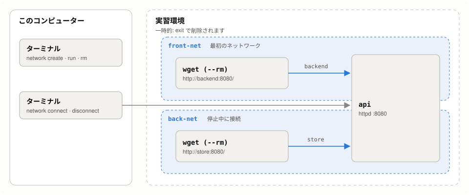

コンテナは複数のネットワークに参加できます。各ネットワークのコンテナは、名前またはエイリアスでそのコンテナに接続します。エイリアスは、同じコンテナのもう 1 つの名前です。このモジュールでは、サーバーを 2 つ目のネットワークに参加させ、両方のネットワークから呼び出します。

**所要時間** 15 分。このモジュールは [2 つのコンテナを名前でつなぐ](../container-network/)の続きです。



## モジュールを開始する

Podbag Desktop で **Training** を開き、**コンテナを 2 つ目のネットワークにつなぐ**を選びます。新しいモジュールは**更新**の後に表示されます。ターミナルで次のコマンドを実行しても開始できます。

```sh
podbag lab start network-connect
```

Training カタログがある Podbag のビルド（v0.3.2 より後）が必要です。`training $` プロンプトが表示されたら続けます。

## 2 つのネットワークを作成する

ネットワーク `front-net` と `back-net` を作成します。それぞれが独立したブリッジで、専用のアドレスを持ちます。

```sh
podbag network create front-net
podbag network create back-net
```

Podbag は各手順の後でネットワークを確認します。

## ネットワークエイリアスを付けて api を実行する

`front-net` 上で、`api` という小さなサーバーを実行します。このサーバーは、ポート `8080` でテキスト `Hello from api` を配信します。`--network-alias backend` は、`front-net` 上でもう 1 つの名前を付けます。

```sh
podbag run -d --name api --network front-net --network-alias backend docker.io/library/busybox:1.37.0 sh -c 'mkdir -p /www && echo "Hello from api" > /www/index.html && exec httpd -f -p 8080 -h /www'
```

Podbag は `api` が実行中であることを確認します。

## エイリアスで api を呼び出す

`front-net` 上で、1 回だけ動くコンテナを実行します。このコンテナは `http://backend:8080/` にリクエストを送ります。エイリアスは `api` に届きます。

```sh
podbag run --rm --network front-net docker.io/library/busybox:1.37.0 wget -qO- http://backend:8080/
```

ターミナルに `Hello from api` と表示されます。Podbag はこの出力を確認します。

## ネットワークを変更する前に api を停止する

Podbag は、停止しているコンテナのネットワークだけを変更します。変更は次の起動から有効になります。実行中のコンテナで試すと、Podbag はそのことを伝え、先に停止するよう求めます。

```sh
podbag stop api
```

Podbag は `api` が `exited` の状態であることを確認します。

## api を back-net につなぐ

`podbag network connect` はコンテナにネットワークを追加します。`--alias store` は、そのネットワーク上で `store` という名前を付けます。

```sh
podbag network connect --alias store back-net api
```

Podbag は `api` が `back-net` に参加したことを確認します。

## api をもう一度起動する

```sh
podbag start api
```

`api` は 2 つのネットワークで起動します。最初のネットワークは引き続き `front-net` です。

## back-net から api を呼び出す

`back-net` 上で、1 回だけ動くコンテナを実行します。このコンテナは `http://store:8080/` にリクエストを送ります。

```sh
podbag run --rm --network back-net docker.io/library/busybox:1.37.0 wget -qO- http://store:8080/
```

ターミナルに `Hello from api` と表示されます。Podbag はこの出力を確認します。各エイリアスは、自分のネットワーク上でだけ使えます。`back-net` では、`backend` という名前は使えません。`api` という名前は両方のネットワークで使えます。

## api を停止して切断する

もう一度 `api` を停止します。次に、`podbag network disconnect` で `api` から `back-net` を外します。

```sh
podbag stop api
podbag network disconnect back-net api
```

Podbag は `api` が `back-net` から外れたことを確認します。最初のネットワークからは切断できません。最初のネットワークを変えるには、コンテナを作り直します。

## 片付けて終了する

`api` を削除します。次に、1 つのコマンドで両方のネットワークを削除します。ネットワークは、どのコンテナも使っていなければ削除できます。

```sh
podbag rm api
podbag network rm front-net back-net
exit
```

一時的な実習用のリソースが削除されます。Training にモジュールの完了が表示されます。
