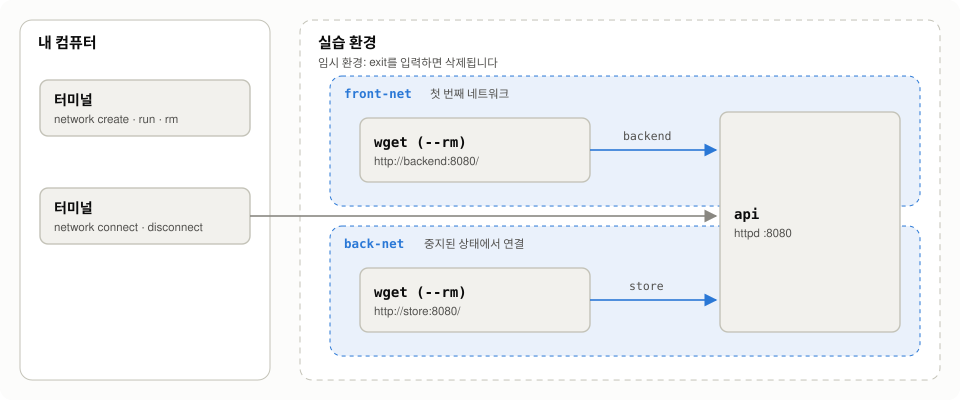

컨테이너는 네트워크 여러 개에 연결될 수 있습니다. 각 네트워크의 컨테이너는 이름이나 별칭으로 이 컨테이너에 접속합니다. 별칭은 같은 컨테이너의 다른 이름입니다. 이번 트레이닝에서는 서버를 두 번째 네트워크에 연결하고 두 네트워크에서 모두 호출합니다.

**예상 시간** 15분. [이름으로 컨테이너 두 개 연결하기](/ko/blog/container-network/)를 마친 뒤 진행합니다.



## 실습 시작

Podbag Desktop에서 **Training**을 열고 **컨테이너를 두 번째 네트워크에 연결하기**를 선택합니다. 새 모듈은 **새로 고침**을 누르면 나타납니다. 터미널에서 다음 명령으로 시작할 수도 있습니다.

```sh
podbag lab start network-connect
```

Training 카탈로그가 있는 Podbag 빌드(v0.3.2 이후)가 필요합니다. `training $` 프롬프트가 나오면 다음 단계로 진행합니다.

## 네트워크 두 개 만들기

`front-net`과 `back-net` 네트워크를 만듭니다. 각 네트워크는 자기 주소를 가진 별도의 브리지입니다.

```sh
podbag network create front-net
podbag network create back-net
```

Podbag은 단계마다 네트워크가 있는지 확인합니다.

## 네트워크 별칭을 붙여 api 실행

`front-net`에 `api`라는 작은 서버를 실행합니다. 이 서버는 `8080` 포트에서 `Hello from api`라는 글자를 보여 줍니다. `--network-alias backend`는 `front-net`에서 이 서버에 이름을 하나 더 붙입니다.

```sh
podbag run -d --name api --network front-net --network-alias backend docker.io/library/busybox:1.37.0 sh -c 'mkdir -p /www && echo "Hello from api" > /www/index.html && exec httpd -f -p 8080 -h /www'
```

Podbag은 `api`가 실행 중인지 확인합니다.

## 별칭으로 api 호출

`front-net`에 한 번만 쓰는 컨테이너를 실행합니다. 이 컨테이너는 `http://backend:8080/`에 접속합니다. 별칭이 `api`로 연결됩니다.

```sh
podbag run --rm --network front-net docker.io/library/busybox:1.37.0 wget -qO- http://backend:8080/
```

터미널에 `Hello from api`가 출력됩니다. Podbag이 이 출력을 확인합니다.

## 네트워크를 바꾸기 전에 api 중지

Podbag은 중지된 컨테이너의 네트워크만 바꿉니다. 바뀐 내용은 다음에 시작할 때부터 적용됩니다. 실행 중인 컨테이너에 시도하면 Podbag이 먼저 중지하라고 알려 줍니다.

```sh
podbag stop api
```

Podbag은 `api`가 `exited` 상태인지 확인합니다.

## api를 back-net에 연결

`podbag network connect`는 컨테이너에 네트워크를 추가합니다. `--alias store`는 그 네트워크에서 `store`라는 이름을 붙입니다.

```sh
podbag network connect --alias store back-net api
```

Podbag은 `api`가 이제 `back-net`에 있는지 확인합니다.

## api 다시 시작

```sh
podbag start api
```

`api`는 네트워크 두 개를 가지고 시작합니다. 첫 번째 네트워크는 여전히 `front-net`입니다.

## back-net에서 api 호출

`back-net`에 한 번만 쓰는 컨테이너를 실행합니다. 이 컨테이너는 `http://store:8080/`에 접속합니다.

```sh
podbag run --rm --network back-net docker.io/library/busybox:1.37.0 wget -qO- http://store:8080/
```

터미널에 `Hello from api`가 출력됩니다. Podbag이 이 출력을 확인합니다. 별칭은 자기 네트워크에서만 쓸 수 있습니다. `back-net`에서는 `backend`라는 이름을 모릅니다. `api`라는 이름은 두 네트워크에서 모두 쓸 수 있습니다.

## api 중지하고 연결 끊기

`api`를 다시 중지합니다. 그런 다음 `podbag network disconnect`로 `back-net` 연결을 끊습니다.

```sh
podbag stop api
podbag network disconnect back-net api
```

Podbag은 `api`가 더 이상 `back-net`에 없는지 확인합니다. 컨테이너의 첫 번째 네트워크는 끊을 수 없습니다. 첫 번째 네트워크를 바꾸려면 컨테이너를 다시 만듭니다.

## 실습 리소스 정리

`api`를 삭제합니다. 그런 다음 명령 하나로 네트워크 두 개를 삭제합니다. 네트워크는 사용하는 컨테이너가 없을 때 삭제할 수 있습니다.

```sh
podbag rm api
podbag network rm front-net back-net
exit
```

임시 실습 환경이 정리되면 Training에서 **수업 완료**를 확인합니다.
