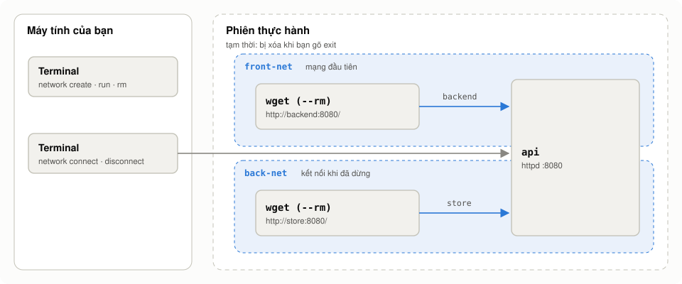

Một container có thể ở trong nhiều mạng. Các container trong mỗi mạng gọi nó bằng tên hoặc bằng bí danh. Bí danh (alias) là thêm một tên nữa cho cùng container. Trong mô-đun này, bạn đưa một máy chủ vào mạng thứ hai và gọi nó từ cả hai mạng.

**Thời gian** 15 phút. Mô-đun này nối tiếp [Kết nối hai container bằng tên](../container-network/).



## Bắt đầu mô-đun

Mở **Training** trong Podbag Desktop và chọn **Kết nối container với mạng thứ hai**. Mô-đun mới xuất hiện sau khi chọn **Làm mới**. Hoặc chạy lệnh này trong terminal:

```sh
podbag lab start network-connect
```

Bạn cần bản Podbag có danh mục Training (sau v0.3.2). Tiếp tục tại dấu nhắc `training $`.

## Tạo hai mạng

Tạo hai mạng `front-net` và `back-net`. Mỗi mạng là một bridge riêng với dải địa chỉ riêng.

```sh
podbag network create front-net
podbag network create back-net
```

Podbag kiểm tra từng mạng sau mỗi bước.

## Chạy api với bí danh mạng

Chạy một máy chủ nhỏ tên `api` trong `front-net`. Nó phục vụ dòng chữ `Hello from api` ở cổng `8080`. `--network-alias backend` cho nó thêm một tên trong `front-net`.

```sh
podbag run -d --name api --network front-net --network-alias backend docker.io/library/busybox:1.37.0 sh -c 'mkdir -p /www && echo "Hello from api" > /www/index.html && exec httpd -f -p 8080 -h /www'
```

Podbag kiểm tra rằng `api` đang chạy.

## Gọi api bằng bí danh

Chạy một container dùng một lần trong `front-net`. Nó yêu cầu `http://backend:8080/`. Bí danh này dẫn tới `api`.

```sh
podbag run --rm --network front-net docker.io/library/busybox:1.37.0 wget -qO- http://backend:8080/
```

Terminal in `Hello from api`. Podbag kiểm tra kết quả này.

## Dừng api trước khi đổi mạng

Podbag chỉ đổi mạng của container khi container đã dừng. Thay đổi có hiệu lực từ lần chạy tiếp theo. Nếu bạn thử với container đang chạy, Podbag sẽ báo và yêu cầu bạn dừng nó trước.

```sh
podbag stop api
```

Podbag kiểm tra rằng `api` ở trạng thái `exited`.

## Kết nối api với back-net

`podbag network connect` thêm một mạng cho container. `--alias store` cho nó tên `store` trong mạng đó.

```sh
podbag network connect --alias store back-net api
```

Podbag kiểm tra rằng `api` giờ đã ở trong `back-net`.

## Chạy lại api

```sh
podbag start api
```

`api` chạy với hai mạng. Mạng đầu tiên của nó vẫn là `front-net`.

## Gọi api từ back-net

Chạy một container dùng một lần trong `back-net`. Nó yêu cầu `http://store:8080/`.

```sh
podbag run --rm --network back-net docker.io/library/busybox:1.37.0 wget -qO- http://store:8080/
```

Terminal in `Hello from api`. Podbag kiểm tra kết quả này. Mỗi bí danh chỉ dùng được trong mạng của nó. Trong `back-net`, tên `backend` không được biết đến. Tên `api` dùng được trong cả hai mạng.

## Dừng api và ngắt kết nối

Dừng `api` một lần nữa. Sau đó gỡ `back-net` khỏi nó bằng `podbag network disconnect`.

```sh
podbag stop api
podbag network disconnect back-net api
```

Podbag kiểm tra rằng `api` không còn ở trong `back-net`. Bạn không thể ngắt container khỏi mạng đầu tiên của nó. Để đổi mạng đó, hãy tạo lại container.

## Dọn dẹp và kết thúc

Xóa `api`. Sau đó xóa cả hai mạng bằng một lệnh. Chỉ xóa được mạng khi không còn container nào dùng nó.

```sh
podbag rm api
podbag network rm front-net back-net
exit
```

Các tài nguyên thực hành tạm thời đã được xóa. Training hiển thị mô-đun đã hoàn thành.
