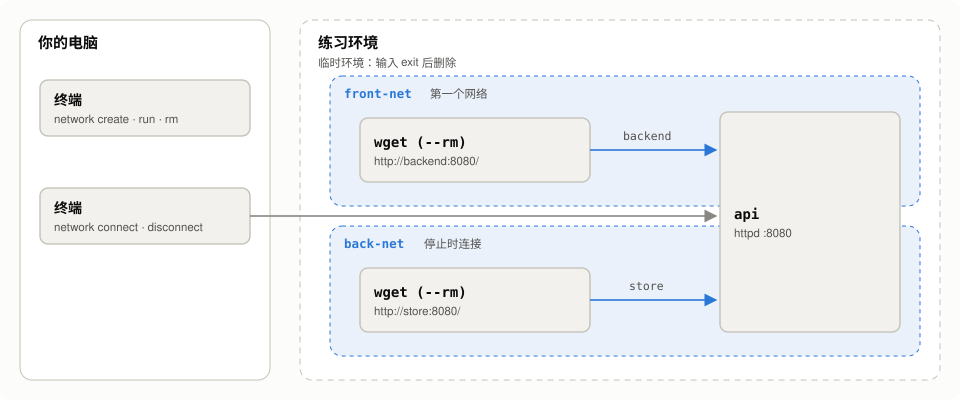

一个容器可以同时在多个网络中。每个网络中的容器可以通过名称或别名访问它。别名是同一个容器的另一个名称。在本模块中，你将把一个服务器放到第二个网络中，并从两个网络调用它。

**预计用时** 15 分钟。请在完成[通过名称连接两个容器](../container-network/)后学习本模块。



## 开始模块

在 Podbag Desktop 中打开 **Training**，选择**将容器连接到第二个网络**。点击**刷新**后会出现新模块。也可以在终端中运行以下命令：

```sh
podbag lab start network-connect
```

需要带有 Training 目录的 Podbag 版本（v0.3.2 之后）。出现 `training $` 提示符后继续。

## 创建两个网络

创建网络 `front-net` 和 `back-net`。每个网络都是独立的网桥，有自己的地址。

```sh
podbag network create front-net
podbag network create back-net
```

每一步之后，Podbag 都会检查对应的网络。

## 运行带网络别名的 api

在 `front-net` 中运行一个名为 `api` 的小型服务器。它在 `8080` 端口上提供文字 `Hello from api`。`--network-alias backend` 为它在 `front-net` 中再起一个名称。

```sh
podbag run -d --name api --network front-net --network-alias backend docker.io/library/busybox:1.37.0 sh -c 'mkdir -p /www && echo "Hello from api" > /www/index.html && exec httpd -f -p 8080 -h /www'
```

Podbag 会检查 `api` 是否正在运行。

## 通过别名调用 api

在 `front-net` 中运行一个一次性容器。它请求 `http://backend:8080/`。这个别名指向 `api`。

```sh
podbag run --rm --network front-net docker.io/library/busybox:1.37.0 wget -qO- http://backend:8080/
```

终端打印 `Hello from api`。Podbag 会检查这个输出。

## 更改网络前先停止 api

Podbag 只在容器停止时更改它的网络。更改从下次启动开始生效。如果对正在运行的容器执行此操作，Podbag 会提示你先停止它。

```sh
podbag stop api
```

Podbag 会检查 `api` 是否处于 `exited` 状态。

## 将 api 连接到 back-net

`podbag network connect` 为容器添加一个网络。`--alias store` 让它在该网络中使用名称 `store`。

```sh
podbag network connect --alias store back-net api
```

Podbag 会检查 `api` 现在是否在 `back-net` 中。

## 再次启动 api

```sh
podbag start api
```

`api` 启动后连接两个网络。它的第一个网络仍然是 `front-net`。

## 从 back-net 调用 api

在 `back-net` 中运行一个一次性容器。它请求 `http://store:8080/`。

```sh
podbag run --rm --network back-net docker.io/library/busybox:1.37.0 wget -qO- http://store:8080/
```

终端打印 `Hello from api`。Podbag 会检查这个输出。每个别名只在自己的网络中有效。在 `back-net` 中无法识别名称 `backend`。名称 `api` 在两个网络中都有效。

## 停止 api 并断开连接

再次停止 `api`。然后用 `podbag network disconnect` 将它从 `back-net` 中移除。

```sh
podbag stop api
podbag network disconnect back-net api
```

Podbag 会检查 `api` 是否已不在 `back-net` 中。容器不能断开与第一个网络的连接。如果要更改第一个网络，请重新创建容器。

## 清理并结束

删除 `api`。然后用一条命令删除两个网络。没有容器使用网络时，才能删除网络。

```sh
podbag rm api
podbag network rm front-net back-net
exit
```

临时实验资源会被删除。Training 会显示该模块已完成。
