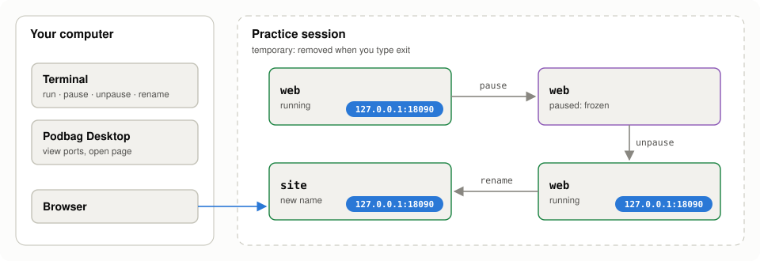

`podbag pause` freezes every process of a container. The processes keep their memory, but they do not run. `podbag unpause` lets them run again from the same point. `podbag rename` gives a container a new name while it runs. In this module, you do both with a small web server.

**Time** 10 minutes.



## Start the module

Open **Training** in Podbag Desktop and select **Pause and rename a container**. New modules appear after **Refresh**. Or run this command in a terminal:

```sh
podbag lab start pause-and-rename
```

You need a Podbag build with the Training catalog (after v0.3.2). Continue at the `training $` prompt.

## Run a web server

Run a small web server named `web`. It serves the text `Hello from web` and publishes port `18090` on your computer. Use the port shown in Training if `18090` is already in use.

```sh
podbag run -d --name web -p 127.0.0.1:18090:8080 docker.io/library/busybox:1.37.0 sh -c 'mkdir -p /www && echo "Hello from web" > /www/index.html && exec httpd -f -p 8080 -h /www'
```

Podbag checks that `web` publishes the port and that the page shows `Hello from web`.

## Pause the container

```sh
podbag pause web
```

The server is frozen. If you open `http://127.0.0.1:18090/` now, the page does not load. Podbag checks that `web` is in the state `paused`.

## See Paused in the list

```sh
podbag ps
```

The status of `web` ends with `(Paused)`. A paused container still counts as up, so plain `podbag ps` lists it. Podbag checks that the output contains `(Paused)`.

## Unpause the container

```sh
podbag unpause web
```

The server runs again and answers requests. Podbag checks the page again.

## Rename the container

`podbag rename` changes only the name. The container, its process and its port stay the same.

```sh
podbag rename web site
```

Podbag checks that `site` publishes the same port and shows the same page.

## Check that the old name is gone

```sh
podbag ps -a
```

The list has `site` and no `web`. Podbag checks that no container is named `web`. Use the new name in every command from now on.

## Open the page in the browser

In Podbag Desktop, go to **Practice containers → site → View ports**. Select **Open in browser**. The page displays **Hello from web**. Podbag checks for an HTTP 200 response and this text.

## Clean up and finish

`site` is still running. `rm -f` stops it and removes it.

```sh
podbag rm -f site
exit
```

The temporary practice resources are removed. Training shows the module as complete.
