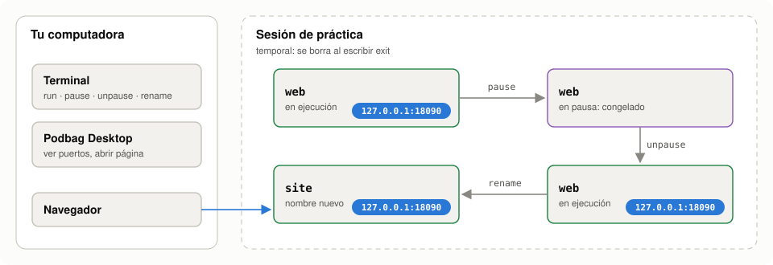

`podbag pause` congela todos los procesos de un contenedor. Los procesos conservan su memoria, pero no se ejecutan. `podbag unpause` hace que sigan desde el mismo punto. `podbag rename` da un nombre nuevo a un contenedor mientras se ejecuta. En este módulo, haces las dos cosas con un pequeño servidor web.

**Tiempo** 10 minutos.



## Inicia el módulo

Abre **Training** en Podbag Desktop y selecciona **Pausa un contenedor y cambia su nombre**. Los módulos nuevos aparecen después de **Actualizar**. O ejecuta este comando en una terminal:

```sh
podbag lab start pause-and-rename
```

Necesitas una versión de Podbag con el catálogo de Training (posterior a v0.3.2). Continúa en el prompt `training $`.

## Ejecuta un servidor web

Ejecuta un pequeño servidor web llamado `web`. Sirve el texto `Hello from web` y publica el puerto `18090` en tu computadora. Si `18090` ya está en uso, usa el puerto que indica Training.

```sh
podbag run -d --name web -p 127.0.0.1:18090:8080 docker.io/library/busybox:1.37.0 sh -c 'mkdir -p /www && echo "Hello from web" > /www/index.html && exec httpd -f -p 8080 -h /www'
```

Podbag comprueba que `web` publica el puerto y que la página muestra `Hello from web`.

## Pausa el contenedor

```sh
podbag pause web
```

El servidor está congelado. Si ahora abres `http://127.0.0.1:18090/`, la página no carga. Podbag comprueba que `web` está en el estado `paused`.

## Mira Paused en la lista

```sh
podbag ps
```

El estado de `web` termina en `(Paused)`. Un contenedor en pausa sigue contando como activo. Por eso `podbag ps` sin opciones lo lista. Podbag comprueba que la salida contiene `(Paused)`.

## Reanuda el contenedor

```sh
podbag unpause web
```

El servidor vuelve a funcionar y responde a las solicitudes. Podbag comprueba la página otra vez.

## Cambia el nombre del contenedor

`podbag rename` cambia solo el nombre. El contenedor, su proceso y su puerto no cambian.

```sh
podbag rename web site
```

Podbag comprueba que `site` publica el mismo puerto y muestra la misma página.

## Comprueba que el nombre anterior ya no existe

```sh
podbag ps -a
```

La lista tiene `site` y no tiene `web`. Podbag comprueba que ningún contenedor se llama `web`. A partir de ahora, usa el nombre nuevo en todos los comandos.

## Abre la página en el navegador

En Podbag Desktop, ve a **Contenedores de práctica → site → Ver puertos**. Selecciona **Abrir en el navegador**. La página muestra **Hello from web**. Podbag comprueba que hay una respuesta HTTP 200 y este texto.

## Limpia y termina

`site` sigue en ejecución. `rm -f` lo detiene y lo elimina.

```sh
podbag rm -f site
exit
```

Se eliminan los recursos temporales de la práctica. Training muestra el módulo como completado.
