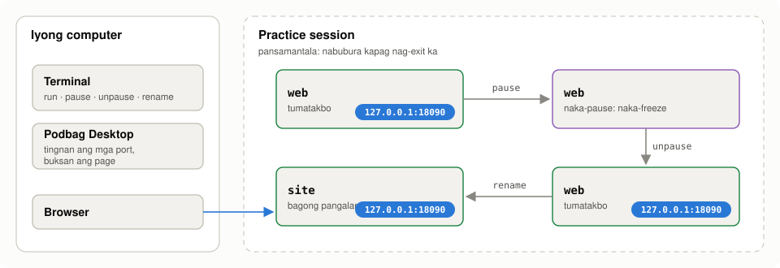

Fini-freeze ng `podbag pause` ang bawat proseso ng container. Nananatili ang memory ng mga proseso, pero hindi sila tumatakbo. Pinapatakbo ulit sila ng `podbag unpause` mula sa parehong punto. Binibigyan ng `podbag rename` ng bagong pangalan ang container habang tumatakbo ito. Sa module na ito, gagawin mo ang dalawa sa isang maliit na web server.

**Oras** 10 minuto.



## Simulan ang module

Buksan ang **Training** sa Podbag Desktop at piliin ang **I-pause at palitan ang pangalan ng container**. Lalabas ang mga bagong module pagkatapos ng **I-refresh**. O patakbuhin ang command na ito sa terminal:

```sh
podbag lab start pause-and-rename
```

Kailangan mo ng build ng Podbag na may Training catalog (pagkatapos ng v0.3.2). Magpatuloy sa prompt na `training $`.

## Magpatakbo ng web server

Magpatakbo ng maliit na web server na `web`. Inihahain nito ang text na `Hello from web` at nagpa-publish ito ng port na `18090` sa computer mo. Gamitin ang port na nasa Training kung gamit na ang `18090`.

```sh
podbag run -d --name web -p 127.0.0.1:18090:8080 docker.io/library/busybox:1.37.0 sh -c 'mkdir -p /www && echo "Hello from web" > /www/index.html && exec httpd -f -p 8080 -h /www'
```

Sinusuri ng Podbag na nagpa-publish ng port ang `web` at ipinapakita ng page ang `Hello from web`.

## I-pause ang container

```sh
podbag pause web
```

Naka-freeze ang server. Kung bubuksan mo ngayon ang `http://127.0.0.1:18090/`, hindi maglo-load ang page. Sinusuri ng Podbag na nasa state na `paused` ang `web`.

## Tingnan ang Paused sa listahan

```sh
podbag ps
```

Nagtatapos sa `(Paused)` ang status ng `web`. Binibilang pa ring up ang naka-pause na container. Kaya inililista ito ng simpleng `podbag ps`. Sinusuri ng Podbag na nasa output ang `(Paused)`.

## I-unpause ang container

```sh
podbag unpause web
```

Tumatakbo ulit ang server at sumasagot ito sa mga request. Sinusuri ulit ng Podbag ang page.

## Palitan ang pangalan ng container

Pangalan lang ang binabago ng `podbag rename`. Pareho pa rin ang container, ang proseso nito at ang port nito.

```sh
podbag rename web site
```

Sinusuri ng Podbag na nagpa-publish ang `site` ng parehong port at ipinapakita nito ang parehong page.

## Tiyaking wala na ang lumang pangalan

```sh
podbag ps -a
```

May `site` sa listahan at walang `web`. Sinusuri ng Podbag na walang container na may pangalang `web`. Gamitin ang bagong pangalan sa bawat command mula ngayon.

## Buksan ang page sa browser

Sa Podbag Desktop, pumunta sa **Mga practice container → site → Tingnan ang mga port**. Piliin ang **Buksan sa browser**. Ipinapakita ng page ang **Hello from web**. Sinusuri ng Podbag kung may tugon na HTTP 200 at ang text na ito.

## Maglinis at tapusin

Tumatakbo pa rin ang `site`. Inihihinto at inaalis ito ng `rm -f`.

```sh
podbag rm -f site
exit
```

Naaalis ang mga pansamantalang resource ng practice. Ipinapakita ng Training na tapos na ang module.
