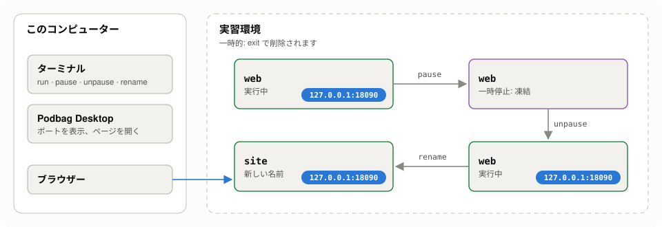

`podbag pause` は、コンテナのすべてのプロセスを凍結します。プロセスはメモリを保ったまま、動きを止めます。`podbag unpause` は、同じところからプロセスを再び動かします。`podbag rename` は、実行中のコンテナに新しい名前を付けます。このモジュールでは、小さな Web サーバーで両方を試します。

**所要時間** 10 分。



## モジュールを開始する

Podbag Desktop で **Training** を開き、**コンテナを一時停止して名前を変更する**を選びます。新しいモジュールは**更新**の後に表示されます。ターミナルで次のコマンドを実行しても開始できます。

```sh
podbag lab start pause-and-rename
```

Training カタログがある Podbag のビルド（v0.3.2 より後）が必要です。`training $` プロンプトが表示されたら続けます。

Podbag Desktop の代わりに TUI で手順を進めるには、`--tui` を付けます。

```sh
podbag lab start pause-and-rename --tui
```

TUI では、コマンドの手順で `:` を押すと Training シェルが開きます。`exit` と入力すると TUI に戻ります。`q` を押すと実習を終了します。

## Web サーバーを実行する

`web` という小さな Web サーバーを実行します。このサーバーはテキスト `Hello from web` を配信し、このコンピューターのポート `18090` を公開します。`18090` がすでに使われている場合は、Training に表示されるポートを使います。

```sh
podbag run -d --name web -p 127.0.0.1:18090:8080 docker.io/library/busybox:1.37.0 sh -c 'mkdir -p /www && echo "Hello from web" > /www/index.html && exec httpd -f -p 8080 -h /www'
```

Podbag は、`web` がポートを公開し、ページに `Hello from web` と表示されることを確認します。

## コンテナを一時停止する

```sh
podbag pause web
```

- **Podbag Desktop で:** **実習コンテナ → web → 一時停止**を選びます。
- **TUI で:** **コンテナ**で `web` を選び、`p` を押します。

サーバーは凍結されています。ここで `http://127.0.0.1:18090/` を開いても、ページは読み込まれません。Podbag は `web` が `paused` の状態であることを確認します。

## 一覧で Paused を確認する

```sh
podbag ps
```

`web` の状態の末尾に `(Paused)` が付きます。一時停止したコンテナも動いているものとして数えられます。そのため、オプションなしの `podbag ps` でも表示されます。Podbag は出力に `(Paused)` があることを確認します。

## コンテナを再開する

```sh
podbag unpause web
```

- **Podbag Desktop で:** **実習コンテナ → web → 再開**を選びます。
- **TUI で:** **コンテナ**で `web` を選び、`p` を押します。

サーバーが再び動き、リクエストに応答します。Podbag はもう一度ページを確認します。

## コンテナの名前を変更する

`podbag rename` が変えるのは名前だけです。コンテナ、そのプロセス、ポートは変わりません。

```sh
podbag rename web site
```

Podbag は、`site` が同じポートを公開し、同じページを表示することを確認します。

## 古い名前がなくなったことを確認する

```sh
podbag ps -a
```

一覧には `site` があり、`web` はありません。Podbag は `web` という名前のコンテナがないことを確認します。これ以降のコマンドでは、新しい名前を使います。

## ブラウザーでページを開く

Podbag Desktop で**実習コンテナ → site → ポートを表示**に移動します。**ブラウザーで開く**を選びます。ページに **Hello from web** と表示されます。Podbag は、HTTP 200 の応答とこのテキストを確認します。

- **Podbag Desktop で:** **実習コンテナ → site → ポートを表示 → ブラウザーで開く**を選びます。
- **TUI で:** ブラウザーで `http://127.0.0.1:18090/` を開きます。ページが表示されたら `o` を押します。

## 片付けて終了する

`site` はまだ実行中です。`rm -f` はコンテナを停止して削除します。

- **Podbag Desktop で:** **実習コンテナ → site → 削除**を選び、確認します。
- **TUI で:** **コンテナ**で `site` を選び、`d` を押してから `y` を押します。

```sh
podbag rm -f site
exit
```

一時的な実習用のリソースが削除されます。Training にモジュールの完了が表示されます。
