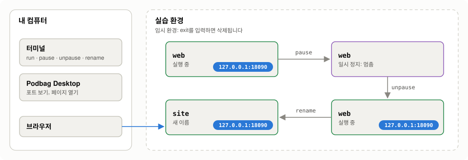

`podbag pause`는 컨테이너의 모든 프로세스를 멈춥니다. 프로세스는 메모리를 그대로 가지고 있지만 실행되지 않습니다. `podbag unpause`는 멈춘 지점부터 다시 실행합니다. `podbag rename`은 실행 중인 컨테이너에 새 이름을 붙입니다. 이번 트레이닝에서는 작은 웹 서버로 두 가지를 모두 해 봅니다.

**예상 시간** 10분.



## 실습 시작

Podbag Desktop에서 **Training**을 열고 **컨테이너 일시 정지하고 이름 바꾸기**를 선택합니다. 새 모듈은 **새로 고침**을 누르면 나타납니다. 터미널에서 다음 명령으로 시작할 수도 있습니다.

```sh
podbag lab start pause-and-rename
```

Training 카탈로그가 있는 Podbag 빌드(v0.3.2 이후)가 필요합니다. `training $` 프롬프트가 나오면 다음 단계로 진행합니다.

## 웹 서버 실행

`web`이라는 작은 웹 서버를 실행합니다. 이 서버는 `Hello from web`이라는 글자를 보여 주고, 내 컴퓨터의 `18090` 포트로 공개됩니다. `18090` 포트가 이미 사용 중이면 Training에 표시된 포트를 사용합니다.

```sh
podbag run -d --name web -p 127.0.0.1:18090:8080 docker.io/library/busybox:1.37.0 sh -c 'mkdir -p /www && echo "Hello from web" > /www/index.html && exec httpd -f -p 8080 -h /www'
```

Podbag은 `web`이 포트를 공개하는지, 페이지에 `Hello from web`이 나오는지 확인합니다.

## 컨테이너 일시 정지

```sh
podbag pause web
```

서버가 멈춥니다. 지금 `http://127.0.0.1:18090/`을 열면 페이지가 열리지 않습니다. Podbag은 `web`이 `paused` 상태인지 확인합니다.

## 목록에서 Paused 확인

```sh
podbag ps
```

`web`의 상태 끝에 `(Paused)`가 붙습니다. 일시 정지한 컨테이너도 실행 중인 것으로 보기 때문에 `-a` 없이 `podbag ps`에 나옵니다. Podbag은 출력에 `(Paused)`가 있는지 확인합니다.

## 일시 정지 풀기

```sh
podbag unpause web
```

서버가 다시 실행되고 요청에 응답합니다. Podbag은 페이지를 다시 확인합니다.

## 컨테이너 이름 바꾸기

`podbag rename`은 이름만 바꿉니다. 컨테이너, 프로세스, 포트는 그대로입니다.

```sh
podbag rename web site
```

Podbag은 `site`가 같은 포트를 공개하고 같은 페이지를 보여 주는지 확인합니다.

## 이전 이름이 없는지 확인

```sh
podbag ps -a
```

목록에 `site`가 있고 `web`은 없습니다. Podbag은 `web`이라는 컨테이너가 없는지 확인합니다. 이제부터는 모든 명령에 새 이름을 사용합니다.

## 브라우저에서 페이지 열기

Podbag Desktop에서 **실습 컨테이너 → site → 포트 보기**를 누릅니다. **브라우저에서 열기**를 누릅니다. 페이지에 **Hello from web**이 표시됩니다. Podbag은 HTTP 200 응답과 이 글자를 확인합니다.

## 실습 리소스 정리

`site`는 아직 실행 중입니다. `rm -f`는 컨테이너를 중지한 뒤 삭제합니다.

```sh
podbag rm -f site
exit
```

임시 실습 환경이 정리되면 Training에서 **수업 완료**를 확인합니다.
