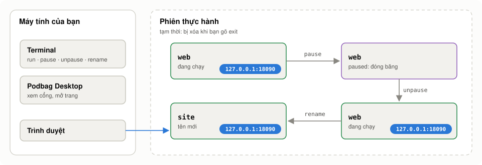

`podbag pause` đóng băng mọi tiến trình của container. Các tiến trình vẫn giữ bộ nhớ, nhưng không chạy. `podbag unpause` cho chúng chạy tiếp từ đúng chỗ đó. `podbag rename` đặt tên mới cho container khi nó đang chạy. Trong mô-đun này, bạn làm cả hai việc với một máy chủ web nhỏ.

**Thời gian** 10 phút.



## Bắt đầu mô-đun

Mở **Training** trong Podbag Desktop và chọn **Tạm dừng và đổi tên container**. Mô-đun mới xuất hiện sau khi chọn **Làm mới**. Hoặc chạy lệnh này trong terminal:

```sh
podbag lab start pause-and-rename
```

Bạn cần bản Podbag có danh mục Training (sau v0.3.2). Tiếp tục tại dấu nhắc `training $`.

Để làm các bước trong TUI thay cho Podbag Desktop, hãy thêm `--tui`.

```sh
podbag lab start pause-and-rename --tui
```

Trong TUI, nhấn `:` để mở shell Training cho bước chạy lệnh, gõ `exit` để quay lại TUI và nhấn `q` để kết thúc phiên.

## Chạy máy chủ web

Chạy một máy chủ web nhỏ tên `web`. Nó phục vụ dòng chữ `Hello from web` và công bố cổng `18090` trên máy tính của bạn. Nếu `18090` đang được dùng, hãy dùng cổng hiển thị trong Training.

```sh
podbag run -d --name web -p 127.0.0.1:18090:8080 docker.io/library/busybox:1.37.0 sh -c 'mkdir -p /www && echo "Hello from web" > /www/index.html && exec httpd -f -p 8080 -h /www'
```

Podbag kiểm tra rằng `web` công bố cổng và trang hiển thị `Hello from web`.

## Tạm dừng container

```sh
podbag pause web
```

- **Trong Podbag Desktop:** Chọn **Container thực hành → web → Tạm dừng**.
- **Trong TUI:** Chọn `web` trong **Container** rồi nhấn `p`.

Máy chủ bị đóng băng. Nếu bạn mở `http://127.0.0.1:18090/` lúc này, trang sẽ không tải được. Podbag kiểm tra rằng `web` ở trạng thái `paused`.

## Xem Paused trong danh sách

```sh
podbag ps
```

Trạng thái của `web` kết thúc bằng `(Paused)`. Container bị tạm dừng vẫn được tính là đang hoạt động, nên `podbag ps` không có tùy chọn vẫn liệt kê nó. Podbag kiểm tra rằng kết quả có `(Paused)`.

## Cho container chạy tiếp

```sh
podbag unpause web
```

- **Trong Podbag Desktop:** Chọn **Container thực hành → web → Tiếp tục**.
- **Trong TUI:** Chọn `web` trong **Container** rồi nhấn `p`.

Máy chủ chạy lại và trả lời các yêu cầu. Podbag kiểm tra lại trang.

## Đổi tên container

`podbag rename` chỉ đổi tên. Container, tiến trình và cổng của nó vẫn giữ nguyên.

```sh
podbag rename web site
```

Podbag kiểm tra rằng `site` công bố cùng cổng và hiển thị cùng trang.

## Kiểm tra rằng tên cũ không còn

```sh
podbag ps -a
```

Danh sách có `site` và không có `web`. Podbag kiểm tra rằng không có container nào tên `web`. Từ giờ, hãy dùng tên mới trong mọi lệnh.

## Mở trang trong trình duyệt

Trong Podbag Desktop, đi tới **Container thực hành → site → Xem cổng**. Chọn **Mở trong trình duyệt**. Trang hiển thị **Hello from web**. Podbag kiểm tra phản hồi HTTP 200 và dòng chữ này.

- **Trong Podbag Desktop:** Chọn **Container thực hành → site → Xem cổng → Mở trong trình duyệt**.
- **Trong TUI:** Mở `http://127.0.0.1:18090/` trong trình duyệt. Khi trang hiện ra, nhấn `o`.

## Dọn dẹp và kết thúc

`site` vẫn đang chạy. `rm -f` dừng rồi xóa nó.

- **Trong Podbag Desktop:** Chọn **Container thực hành → site → Xóa** và xác nhận.
- **Trong TUI:** Chọn `site` trong **Container**, nhấn `d`, rồi nhấn `y`.

```sh
podbag rm -f site
exit
```

Các tài nguyên thực hành tạm thời đã được xóa. Training hiển thị mô-đun đã hoàn thành.
