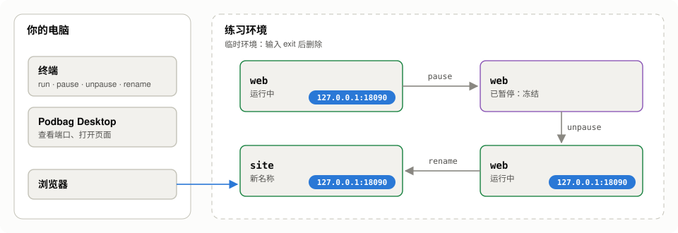

`podbag pause` 会冻结容器中的所有进程。进程保留内存，但不再运行。`podbag unpause` 让它们从原来的位置继续运行。`podbag rename` 可以在容器运行时为它改名。在本模块中，你将用一个小型 Web 服务器完成这两项操作。

**预计用时** 10 分钟。



## 开始模块

在 Podbag Desktop 中打开 **Training**，选择**暂停并重命名容器**。点击**刷新**后会出现新模块。也可以在终端中运行以下命令：

```sh
podbag lab start pause-and-rename
```

需要带有 Training 目录的 Podbag 版本（v0.3.2 之后）。出现 `training $` 提示符后继续。

## 运行 Web 服务器

运行一个名为 `web` 的小型 Web 服务器。它提供文字 `Hello from web`，并在你的电脑上发布端口 `18090`。如果 `18090` 已被占用，请使用 Training 中显示的端口。

```sh
podbag run -d --name web -p 127.0.0.1:18090:8080 docker.io/library/busybox:1.37.0 sh -c 'mkdir -p /www && echo "Hello from web" > /www/index.html && exec httpd -f -p 8080 -h /www'
```

Podbag 会检查 `web` 是否发布了端口，以及页面是否显示 `Hello from web`。

## 暂停容器

```sh
podbag pause web
```

服务器被冻结。如果现在打开 `http://127.0.0.1:18090/`，页面无法加载。Podbag 会检查 `web` 是否处于 `paused` 状态。

## 在列表中查看 Paused

```sh
podbag ps
```

`web` 的状态以 `(Paused)` 结尾。暂停的容器仍算作运行中，所以不带选项的 `podbag ps` 也会列出它。Podbag 会检查输出中是否包含 `(Paused)`。

## 恢复容器

```sh
podbag unpause web
```

服务器再次运行并响应请求。Podbag 会再次检查页面。

## 重命名容器

`podbag rename` 只更改名称。容器、进程和端口都保持不变。

```sh
podbag rename web site
```

Podbag 会检查 `site` 是否发布同一个端口，并显示同一个页面。

## 确认旧名称已消失

```sh
podbag ps -a
```

列表中有 `site`，没有 `web`。Podbag 会检查是否已没有名为 `web` 的容器。从现在起，所有命令都使用新名称。

## 在浏览器中打开页面

在 Podbag Desktop 中，前往**实验容器 → site → 查看端口**。点击**在浏览器中打开**。页面显示 **Hello from web**。Podbag 会检查 HTTP 200 响应和这段文字。

## 清理并结束

`site` 仍在运行。`rm -f` 会停止并删除它。

```sh
podbag rm -f site
exit
```

临时实验资源会被删除。Training 会显示该模块已完成。
