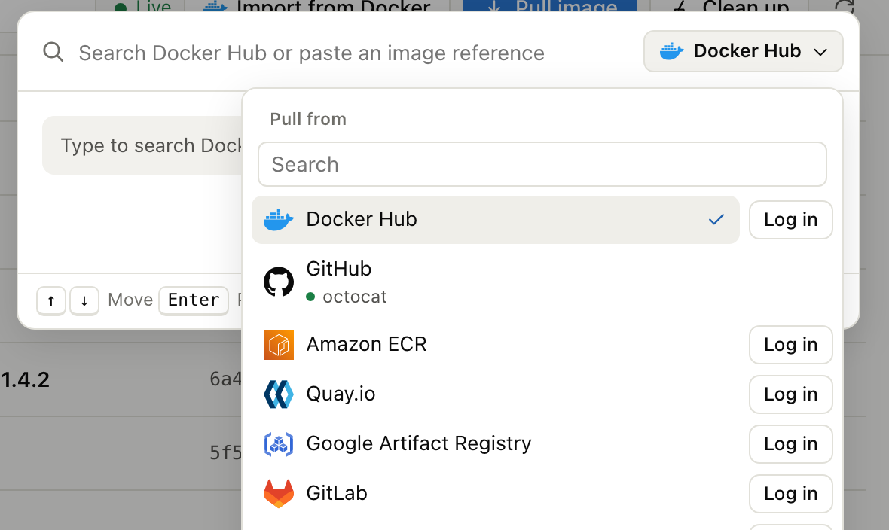
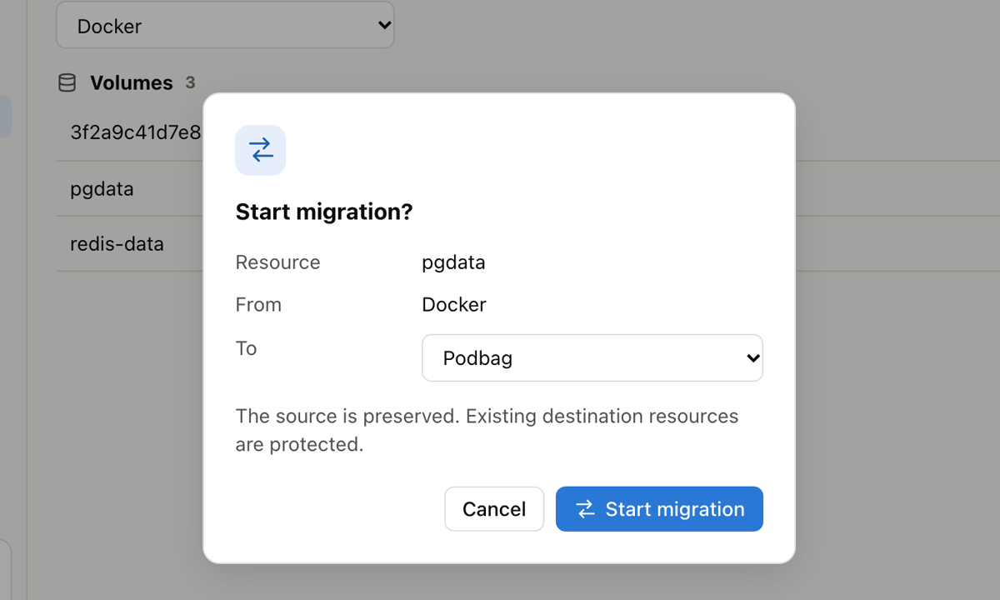
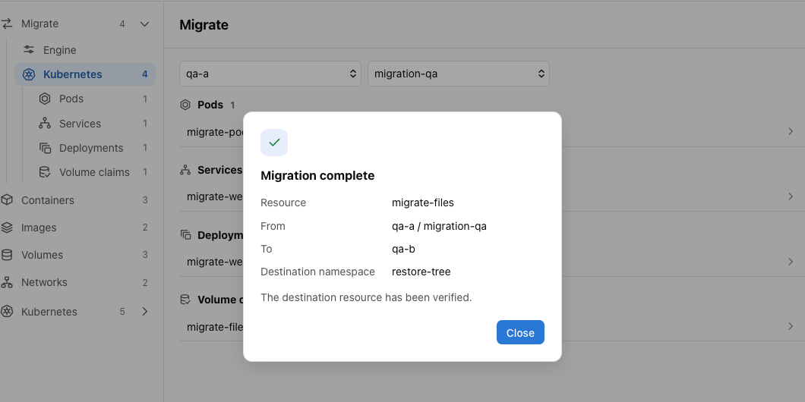
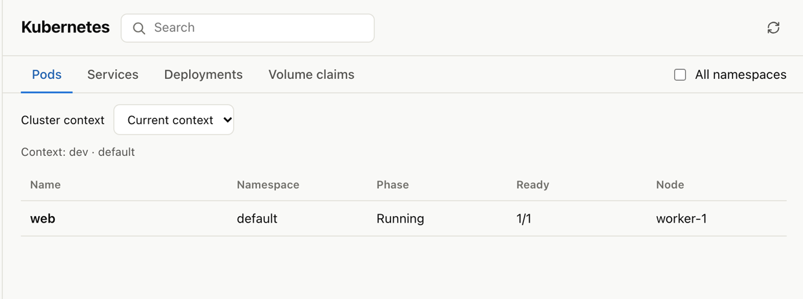
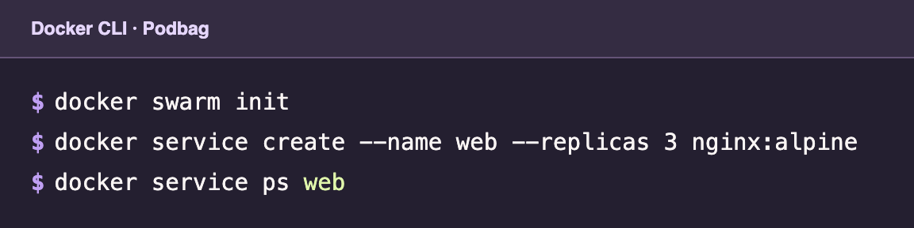
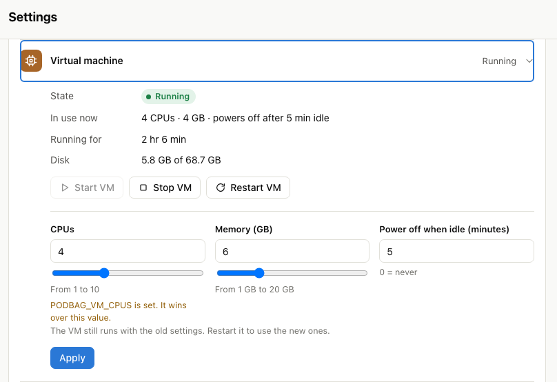

Podbag 0.2.0 is available. This release adds image builds and registry publishing. It also lets you copy existing images and data to another engine or Kubernetes cluster.

## Build and pull images

Build an image from a Dockerfile with `podbag build`. Pull images from a registry or push the images you build.

```dockerfile
FROM mirror.gcr.io/library/alpine:3.22
CMD ["echo", "Hello from Podbag"]
```

Save the file in an empty folder and run these commands there. [Download Dockerfile](Dockerfile)

```sh
podbag build -t hello .
podbag run --rm hello
```

The container prints `Hello from Podbag`.

In Podbag Desktop, open **Pull image** and choose Docker Hub, GitHub Container Registry, or a custom registry address. Enter the image name and tag. For private images, reuse a Docker login that has access to the registry.



## Copy between engines and clusters

Use `podbag migrate` or the Migrate menu in Desktop to copy single-platform images, stopped containers, and local volumes between Docker-compatible engines. The source stays in place.



Desktop copies standalone Pods, Services, Deployments, and filesystem persistent volume claims (PVCs) between Kubernetes contexts. A bound filesystem PVC transfers its files and verifies them at the destination. Stop workloads that write to the source volume before copying. [Migration requirements](https://github.com/SteelCrab/podbag/blob/v0.2.0/docs/usage.md#migrate-between-engines-or-kubernetes-clusters)



## Kubernetes, Swarm, and Desktop

On a Linux node, run `podbag cri serve` as the Kubernetes container runtime. The published k3s test compares Docker Engine and Podbag on the same node. [k3s workload test](/blog/k3s-30-pods-docker-podbag/)



Podbag also runs Docker Swarm services and stacks on one node.



Use `podbag tui` or Desktop to manage containers and images and to switch the Docker CLI context. On Apple silicon, Desktop configures the Linux VM's CPU count, memory, and idle shutdown time.



## Install 0.2.0

On Linux or Apple silicon macOS, install the 0.2.0 CLI with the following commands. The installer verifies the download's SHA-256 checksum.

```sh
curl -fsSL https://podbag.dev/install.sh | PODBAG_VERSION=v0.2.0 sh
podbag --version
```

Desktop is available as DEB or RPM packages for AMD64 and ARM64 Linux and as a ZIP for Apple silicon Macs. Install the CLI before opening Desktop on macOS. The experimental Windows CLI requires WSL 2. The Android ARM64 CLI supports image commands. [0.2.0 downloads](https://github.com/SteelCrab/podbag/releases/tag/v0.2.0)

To apply the file timestamp and crontab fixes to an affected image stored by 0.1.0, remove the image and pull or load it again. [Full changelog](https://github.com/SteelCrab/podbag/blob/v0.2.0/CHANGELOG.md#v020-2026-11-20)
