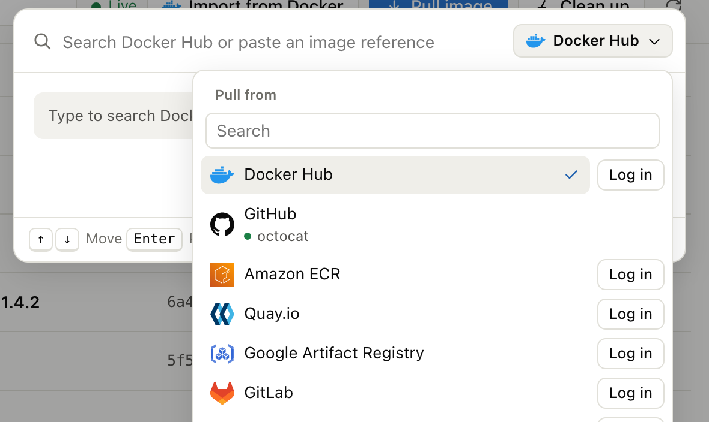
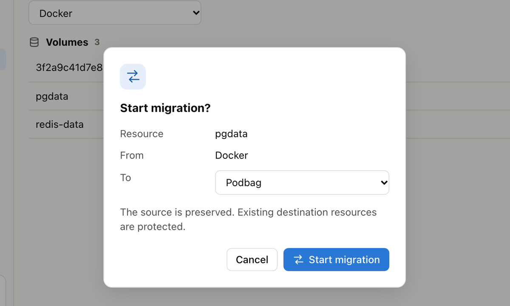
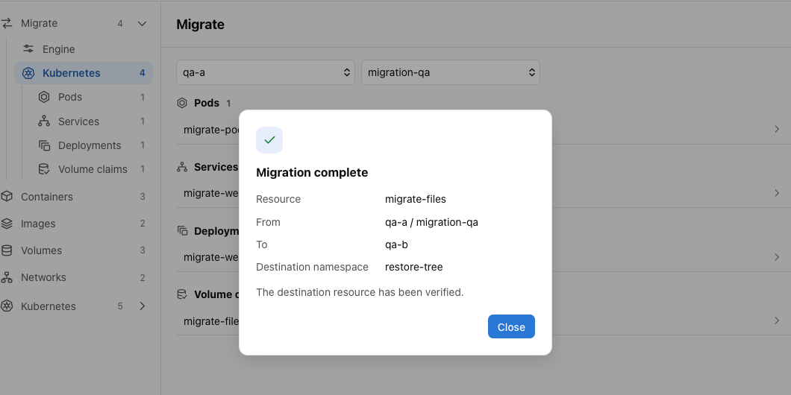
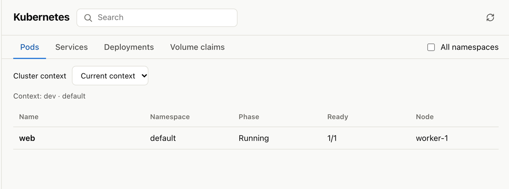
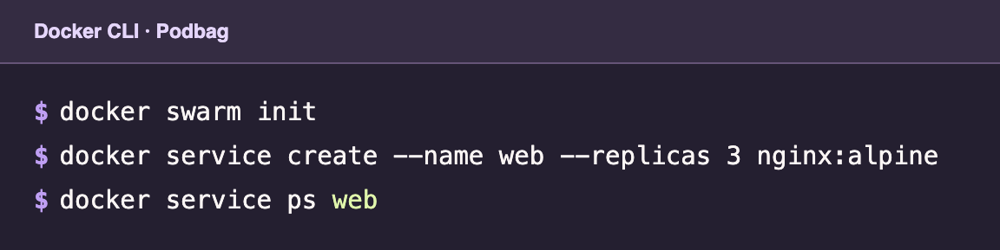
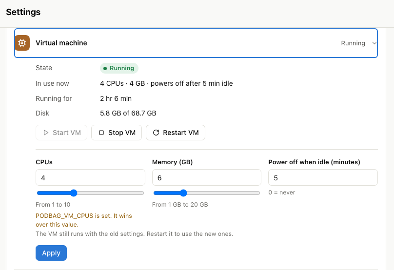

Podbag 0.2.0 ya está disponible. Esta versión permite construir imágenes y publicarlas en un registro. También puedes copiar imágenes y datos existentes a otro motor o clúster de Kubernetes.

## Construcción y descarga de imágenes

Usa `podbag build` para construir una imagen a partir de un Dockerfile. Puedes descargar imágenes de un registro o subir las que hayas construido.

```dockerfile
FROM mirror.gcr.io/library/alpine:3.22
CMD ["echo", "Hello from Podbag"]
```

Guarda el archivo en una carpeta vacía y ejecuta allí estos comandos. [Descargar Dockerfile](Dockerfile)

```sh
podbag build -t hello .
podbag run --rm hello
```

El contenedor imprime `Hello from Podbag`.

En Podbag Desktop, abre el cuadro de descarga de imágenes. Elige Docker Hub, GitHub Container Registry o la dirección de otro registro. Introduce el nombre y la etiqueta de la imagen. Para descargar una imagen privada, puedes usar una sesión de Docker con acceso al registro.



## Copias entre motores y clústeres

Usa `podbag migrate` o el menú de migración de Desktop para copiar imágenes de una sola plataforma, contenedores detenidos y volúmenes locales entre motores compatibles con Docker. Se conserva el origen.



Desktop permite copiar pods independientes, servicios, despliegues y solicitudes de volumen persistente (PVC) de tipo sistema de archivos entre contextos de Kubernetes. Si la solicitud ya está vinculada a un volumen, Podbag copia los archivos y los verifica en el destino. Detén las cargas que escriben en el volumen de origen antes de copiarlo. [Requisitos de migración](https://github.com/SteelCrab/podbag/blob/v0.2.0/docs/usage.md#migrate-between-engines-or-kubernetes-clusters)



## Kubernetes, Swarm y Desktop

En un nodo Linux, ejecuta `podbag cri serve` como entorno de ejecución de contenedores de Kubernetes. Probamos Docker Engine y Podbag en el mismo nodo k3s. [Prueba de carga en k3s](/es/blog/k3s-30-pods-docker-podbag/)



Podbag también ejecuta servicios y stacks de Docker Swarm en un solo nodo.



Usa `podbag tui` o Desktop para gestionar contenedores e imágenes y para cambiar el contexto de la CLI de Docker. En un Mac con Apple silicon, puedes configurar desde Desktop las CPU, la memoria y el tiempo de inactividad antes de apagar la máquina virtual Linux.



## Instalación de 0.2.0

En Linux o macOS con Apple silicon, instala la CLI de 0.2.0 con los siguientes comandos. El instalador comprueba la suma SHA-256 de la descarga.

```sh
curl -fsSL https://podbag.dev/install.sh | PODBAG_VERSION=v0.2.0 sh
podbag --version
```

Desktop se distribuye como paquetes DEB y RPM para Linux AMD64 y ARM64, y como ZIP para Mac con Apple silicon. En macOS, instala primero la CLI. La CLI experimental de Windows requiere WSL 2. La CLI de Android ARM64 admite comandos de imágenes. [Descargas de 0.2.0](https://github.com/SteelCrab/podbag/releases/tag/v0.2.0)

Para aplicar las correcciones de fechas de modificación y crontab a una imagen afectada que se guardó con 0.1.0, elimínala, y luego vuelve a descargarla o cargarla. [Registro completo de cambios](https://github.com/SteelCrab/podbag/blob/v0.2.0/CHANGELOG.md#v020-2026-11-20)
